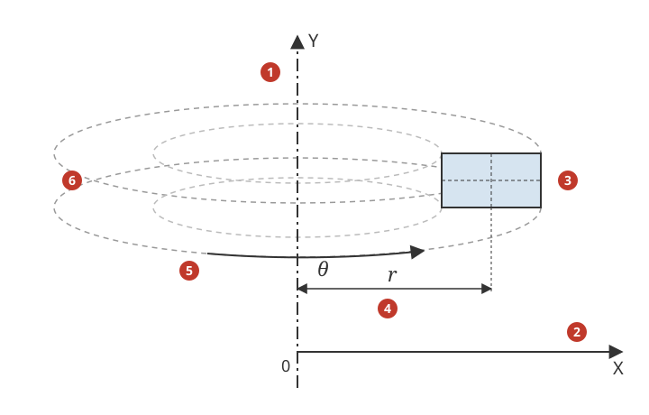
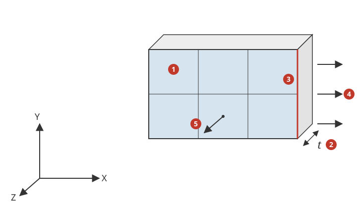
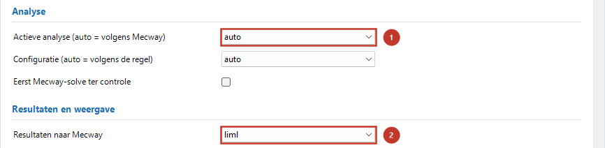

# 2D- en axisymmetrische analyses

*English version: [2D_and_axisymmetric.md](en/2D_and_axisymmetric.md)*

De bridge vertaalt de statische en dynamische 2D-analysetypen van Mecway naar
Code-Aster `MECA_STATIQUE` of `DYNA_NON_LINE` met vlakke elementen (U3.13.01
"Modélisations AXIS, D_PLAN, C_PLAN"):

| Mecway-analyse | Mecway-materiaal | Code-Aster | Resultaat in Mecway |
|---|---|---|---|
| Static 2D (S20) | *Shell/membrane* met een dikte | `C_PLAN` (vlakke spanning) | verplaatsing X, Y; spanning (σ_zz = 0); von Mises; reacties voor de dikte t |
| Static 2D (S20) | *Shell/membrane* met een dikte en *plane strain* | `D_PLAN` (vlakke rek) | als hierboven, σ_zz = ν(σ_xx + σ_yy) |
| Static Axisymmetric (SA0) | geen geometrie (isotroop materiaal) | `AXIS` | verplaatsing X (radiaal), Y (axiaal); spanning met `stresszz` = tangentiële spanning (hoop stress); reacties voor 360 graden |
| Dynamic Response 2D (D20), Dynamic Response Axisymmetric (DA0) | als S20 / SA0 | als S20 / SA0, in de tijd (§2.4) | als S20 / SA0 per uitvoertijd, plus snelheid en versnelling |
| Acoustic Resonance 2D (A20) | *Speed of sound* (een dikte telt niet) | `PHENOMENE='ACOUSTIQUE'`, `PLAN` (§4) | per mode de frequentie en het drukveld `pressure`, als A30 |

De bridge-analyse is `lin_static_3d` ("Statisch") voor S20 en SA0 en `dyna_impl_3d`
("Dynamisch (impliciet)") voor D20 en DA0: met *Actieve analyse (auto = volgens Mecway)*
= `auto` kiest de bridge die. Algemene werking van de bridge:
[`Handleiding.md`](Handleiding.md). Acoustic Resonance 2D (A20) gaat naar de akoestische holtemodes `acoustic_modes_3d` (§4). Mecway heeft geen thermisch 2D-type: een thermisch model in een vlak
maak je met schalen ([`Thermisch.md`](Thermisch.md)).



1. Mecway's Y-as: de symmetrieas (SA0, Code-Aster `AXIS`).
2. Mecway's X-as: de straal r; alle knopen bij X ≥ 0.
3. De vlakke elementen in het XY-vlak: een doorsnede van het lichaam.
4. Straal r van een punt: Code-Aster integreert per radiaal (r dθ), de bridge vermenigvuldigt krachten en reacties met 2π.
5. Tangentiële richting θ: `stresszz` is de tangentiële spanning σ_θ (hoop stress).
6. De ring die de elementen voorstellen (360 graden): Mecway's krachten en reacties gelden voor deze hele ring.



1. De vlakke elementen in het XY-vlak (Z = 0).
2. Dikte t: de *Shell/membrane*-dikte van het materiaal (S20); Mecway's krachten en reacties gelden voor de hele t, Code-Aster rekent per eenheid van dikte.
3. Een rand van de vlakke elementen (faceid 1..4): druk, traction en een randkracht werken op zo'n rand (randcellen `SEG2`/`SEG3`).
4. Een belasting op de rand, in het XY-vlak.
5. σ_zz, loodrecht op het vlak: 0 bij vlakke spanning (`C_PLAN`), ν(σ_xx + σ_yy) bij vlakke rek (`D_PLAN`).

## 1. Werkwijze stap voor stap

**Twee invoerroutes.** Mecway's eigen 2D-typen (route B) zijn lineair. Voor plasticiteit,
grote vervormingen, laststappen en contact is het model een 3D-model van vlakke elementen
(*Nonlinear Static*) plus een regel die de bridge zegt het in 2D te rekenen (route A). Kies
de route naar wat je wilt rekenen:

| Wat je wilt | Route | Mecway-analysetype | Materiaal / elementen | Extra regel in de custom model definition | Paragraaf |
|---|---|---|---|---|---|
| Lineair statisch, ook met een temperatuur (thermische spanning) | B | *Static 2D* (S20) of *Static Axisymmetric* (SA0) | vlakke elementen; S20: *Shell/membrane* met een dikte | geen | §1.1 … §1.3, §2.5 |
| Lineaire dynamica in de tijd | B | *Dynamic Response 2D* (D20) of *Axisymmetric* (DA0) | zoals S20 / SA0 | geen | §1.1, §2.4 |
| Akoestische holtemodes in 2D | – | *Acoustic Resonance 2D* (A20) | vlakke elementen | geen | §4 |
| Plasticiteit, grote vervormingen, tijdstappen, lasttabellen | A | *Nonlinear Static* (L30), solver CCX | vlakke shell-elementen met *Shell/membrane*-dikte | `**ASTER-PLANE C_PLAN`, `D_PLAN` of `AXIS` | §1.4 |
| Contact (krimpverbinding, delen die elkaar raken) | A | *Nonlinear Static* (L30), solver CCX | zoals hierboven, *Contact* tussen randen | `**ASTER-PLANE ...` | §1.4 (punt 6) |
| Lineair statisch als 3D-model (bijv. om te vergelijken met shells) | A | *Static 3D* (S30) | zoals hierboven | `**ASTER-PLANE C_PLAN` (nagelopen; `D_PLAN`/`AXIS` volgen dezelfde route) | §1.4 |
| Warmtetransport in 2D of axisymmetrisch, axisymmetrische schalen | – | – | – | nog niet | §3 |
| Niet-lineaire dynamica, modes, knik in 2D | – | – | – | niet mogelijk | §3 |

Route B heeft geen extra regel nodig en Mecway rekent hetzelfde model zelf; route A gebruikt
Mecway's 3D-analysetypen, zodat Mecway hun tijdstappen, plasticiteit en contact bewaart, en de
regel `**ASTER-PLANE` zet de bridge om van shells naar `C_PLAN` (vlakke spanning), `D_PLAN`
(vlakke rek) of `AXIS` (axisymmetrisch). Meng ze niet: de regel in een S20/SA0-model is een
ERROR (§1.6). Uitgewerkte voorbeelden van beide routes: §1.5.

### 1.1 In Mecway: het model

1. **Analysetype.** *Static 2D*, *Static Axisymmetric*, *Dynamic Response 2D* of
   *Dynamic Response Axisymmetric* in de analyse-instellingen (dynamisch: *Time period*,
   *Time step size* en *Generate solution every n time steps*; geen *Mode
   superposition*).
2. **Mesh.** Vlakke elementen tri3, tri6, quad4 of quad8 in het XY-vlak, alle knopen met
   Z = 0 (Mecway negeert Z; de bridge stopt als Z ≠ 0, §3). Axisymmetrisch: Y is de
   symmetrieas, X de straal, alle knopen met X ≥ 0 (Mecway Ltd., 2026, §6.1.3, §7.2).
   Kwadratische elementen mogen gekromde randen hebben (middenknoop naast de koorde).
3. **Materiaal.**
   - S20: geef het materiaal een geometrie *Shell/membrane* met een **dikte** t; voor
     vlakke rek ook *plane strain* aanvinken. Zonder dikte rekent Mecway niet en stopt
     de bridge (§3). Het hele model heeft een dikte en een type (vlakke spanning of
     vlakke rek), anders stopt de bridge.
   - SA0: geen geometrie. Een dikte telt niet (de bridge negeert hem met een WARNING;
     Mecway's eigen solve geeft dan geen oplossing).
   - Dichtheid voor zwaartekracht, centrifugaalkracht en dynamica.
4. **Opleggingen.** *Fixed support*, *Pinned support* en *Displacement* langs X of Y op
   knopen of op randen (vlakselectie van randen, faceid 1..4), *Symmetry* met normaal X
   of Y op randen. Axisymmetrisch: Mecway vraagt een oplegging in X op knopen op de as
   (X = 0) (Mecway Ltd., 2026, §7.2); doe dat ook voor de bridge (zonder NIET
   geverifieerd). Een oplegging in Y is nodig tegen starre beweging langs de as.
5. **Belastingen** (alle waarden zoals in Mecway, zie §2.2):
   - *Pressure* en *Traction* op randen;
   - *Force* op knopen (totaal, gelijk per knoop) of op randen (totaal, uniform over het
     randoppervlak);
   - *Gravity* in het XY-vlak (SA0: alleen langs Y);
   - *Centrifugal force* om Z (S20) of om Y (SA0);
   - S20 en SA0: *Thermal stress* met *Temperature* (op knopen, randen of elementen) of
     *Node temperature*, en de uitzettingscoëfficiënt in het materiaal (§2.5).
   Waarden mogen een tijdtabel zijn (dynamica). Dynamica: *Rayleigh damping* op het hele
   model. Andere items stoppen of worden overgeslagen met een ERROR (§3, §4).

### 1.2 In het hoofdvenster van de bridge



1. *Actieve analyse (auto = volgens Mecway)*: `auto` (of `lin_static_3d`; voor D20/DA0
   `dyna_impl_3d`).
2. *Resultaten naar Mecway*: `liml`.

*Actieve analyse (auto = volgens Mecway)* `auto` (of `lin_static_3d`) en *Resultaten naar Mecway* `liml` (pagina
Algemeen; de route `tabel` schaalt de reacties niet, de bridge stopt). De instellingen
van de pagina Statisch of Dynamisch (impliciet) gelden zoals in 3D; voor D20/DA0 gelijk
aan Mecway: *Tijdschema (SCHEMA_TEMPS)* `NEWMARK`, `deformation` `PETIT` en
*Rekenstappen per Mecway-tijdstap* = 1 (standaard; §2.4). De
resultaatvelden `strain` en `shell_*`
geven niets in 2D; `principal_stresses` geeft `principal1..3` en `tresca` zoals Mecway
(eigenwaarden van de 3D-tensor met σ_zz, per elementknoop, knoop = gemiddelde). De
foutschatter wordt in 2D niet gebruikt (INFO).

### 1.3 De resultaten in Mecway bekijken

De resultaten hebben Mecway's eigen namen en staan onder dezelfde items als Mecway's
eigen S20/SA0-oplossing (gemeten: Mecway voegt *displacement*, *stress*, *von Mises
stress*, *reaction force*, *principal stress* en *Tresca stress* toe als het het
resultaat opent):

| Mecway-variabele | Code-Aster | Betekenis |
|---|---|---|
| `displx`, `disply`, `displmag` | `DEPL` DX, DY | X, Y (SA0: radiaal, axiaal); geen `displz` (zoals Mecway) |
| `stressxx`, `stressyy`, `stressxy` | `SIGM_NOEU`/`SIGM_ELNO` | spanningen in het vlak (SA0: σ_r, σ_z, τ_rz) |
| `stresszz` | `SIGM_*` SIZZ | 0 bij vlakke spanning, ν(σ_xx + σ_yy) bij vlakke rek, **tangentiële spanning** in SA0 |
| `stressyz`, `stresszx` | – | 0 (zoals Mecway) |
| `vonmises` | `SIEQ_*` | 3D-von Mises met σ_zz |
| `reactionforcex/y/mag` | `REAC_NODA` × t of × 2π | voor de hele dikte (S20) of 360 graden (SA0), zoals Mecway |

### 1.4 Niet-lineair in 2D: een 3D-model met `**ASTER-PLANE` (route A)

Mecway heeft geen niet-lineair 2D-type. Voor plasticiteit, grote vervormingen, tijdstappen
en lastopbouw in 2D maak je het model als 3D-model en zeg je de bridge het in 2D te rekenen:

1. **Analysetype** *Nonlinear Static* (L30), met CCX als Mecway's solver (Mecway rekent L30
   alleen met CCX). *Static 3D* (S30) kan ook (lineair, zoals S20).
2. **Mesh**: vlakke shell-elementen tri3, tri6, quad4 of quad8 in het XY-vlak (Z = 0),
   verder niets; axisymmetrisch: Y is de as, X ≥ 0 (zoals §1.1).
3. **Materiaal**: een geometrie *Shell/membrane* met een dikte (Mecway heeft hem nodig voor
   shells; voor `C_PLAN`/`D_PLAN` is het de dikte t van §2.2, voor `AXIS` telt hij niet),
   plasticiteit (*Bilinear*, *Stress-strain curve*) zoals in 3D.
4. **De schakelaar**: in CCX > *Custom model definition* een regel

   ```
   **ASTER-PLANE C_PLAN
   ```

   met `C_PLAN` (vlakke spanning), `D_PLAN` (vlakke rek) of `AXIS` (axisymmetrisch);
   `#ASTER-PLANE` in een OpenRadioss-veld en `$ASTER-PLANE` in een Mystran-veld werken ook,
   `-VLAK` is de Nederlandse spelling ([`ASTER_regels_voorbeelden.md`](ASTER_regels_voorbeelden.md) §2).
   Mecway's eigen solver negeert de regel; de bridge rekent dan elke elset met die
   modelisatie in plaats van als shells (een vinkje *plane strain* op het materiaal telt
   dan niet).
5. **Opleggingen en belastingen** zoals in §1.1, op knopen en randen; een *Node
   rotation*, een *Displacement* nul langs Z en een *Symmetry* met normaal Z (voor
   Mecway's eigen shell-solve) vallen weg met een INFO. *Thermal stress* met *Temperature*
   en *Node temperature* zoals in §2.5, ook als tijdtabel.
6. **Contact** (alleen L30): een *Contact* (unilateraal) tussen twee
   vlakselecties van randen van de vlakke elementen; de bridge schrijft ze als randcellen
   (`SEG2`/`SEG3`) voor `DEFI_CONTACT` met de instellingen van de pagina Niet-lineair
   statisch, zoals in 3D. Overlappende geometrie (een krimpverbinding) wordt in de eerste
   stap opgelost. Het resultaat `contactpressure` is een druk (geen factor t of 2π).
   Nagelopen wrijvingsloos in `AXIS` en `D_PLAN`; wrijving en `C_PLAN` NIET nagelopen.
   *Bonded* contact in 2D: ERROR. Of Mecway's venster shell-randen laat kiezen voor een
   contact is NIET nagelopen.

De bridge-analyse is `nonlin_static_3d` (L30) of `lin_static_3d` (S30); de instellingen van
de pagina Niet-lineair statisch gelden zoals in 3D. *deformation* `GROT_GDEP` (de standaard)
wordt `GDEF_LOG` voor plastisch materiaal (`SIMO_MIEHE` als gekozen, alleen in
`D_PLAN`/`AXIS`) en `GREEN_LAGRANGE` voor elastisch materiaal; een druk is dan een
meebewegende belasting zoals in 3D. De plasticiteitswetten van de bridge kennen `C_PLAN`
zelf (catalogus Code-Aster 17.4). Resultaten per stap zoals in §1.3, plus
`plasticstrainxx/yy/zz/xy` en `equivalentplasticstrain`; de reactiekrachten met de factor t
of 2π in elke stap (PL-30, PL-32). Verificatie PL-30 … PL-36: een dikwandige cilinder met ideale
plasticiteit (Hill) in `D_PLAN` en `AXIS`, eerste vloei bij een gat in `C_PLAN`,
Code-Aster-testcase ssnp159b (`AXIS`, `GDEF_LOG`) door de bridge. NIET meegenomen: de
bezwijklus (`#ASTER-BEZWIJKEN`, WARNING), verlijmd contact, thermische analyses (S44d).
Contact: PL-40 en PL-41 (een krimpverbinding, contactdruk binnen 0,01% van Lamé). Het
openen van zo'n resultaat in het Mecway-venster is NIET nagelopen (een test in de
Mecway-GUI moet nog).

### 1.5 Uitgewerkte voorbeelden

De drie modellen staan in de repository (`TestFiles/Verificatie/modellen/`, gemaakt door
`tests_vlak_2d_thermisch.py`, `tests_vlak_2d_nonlin.py` en `tests_vlak_2d_contact.py`);
open er een in Mecway om elke instelling te zien. Eenheden SI, staal E = 210 GPa, ν = 0,3.
Voor `AXIS` gelden de assen van de eerste figuur: Y de symmetrieas, X de straal. Route A is
nagelopen met de bridge (resultaten tegen gesloten oplossingen), nog niet in Mecway's
venster: of Mecway shell-randen laat kiezen voor een *Contact* en hoe het een resultaat van
route A toont is NIET nagelopen; Mecway's eigen solve van voorbeeld 2 en 3 is niet nodig.

**Voorbeeld 1 – route B: een dikwandige buis met een radiale temperatuur (`PL-24.liml`).**

1. Analysetype *Static Axisymmetric* (SA0).
2. Mesh: een rechthoek X = 0,1 … 0,2 m (binnen- en buitenstraal), Y = 0 … 0,01 m (een
   plak van de buis), 8 × 1 quad8.
3. Materiaal: isotroop, *Thermal expansion* 1,2e-5 1/K; geen geometrie (SA0).
4. Opleggingen: *Displacement* langs Y = 0 op de onderrand en op de bovenrand (beide
   einden axiaal vast = een lange buis in vlakke rek).
5. Belastingen: *Thermal stress* met referentietemperatuur 293 K en een *Node
   temperature* per knoop (hier een logaritmisch verloop van 393 K binnen tot 293 K buiten;
   het kan ook uit een thermische oplossing van een 3D-model komen,
   [`Thermisch.md`](Thermisch.md)).
6. Bridge: "Actieve analyse" `auto` (→ `lin_static_3d`), "Resultaten naar Mecway" `liml`.
   De log toont `INFO: Elset 'Buis' -> MODELISATION='AXIS' (Mecway SA0).` en de
   temperaturen.
7. Resultaten: `stresszz` = tangentiële spanning σ_θ (−220 MPa aan de binnenwand, +140 MPa
   aan de buitenwand), `stressyy` = axiale σ_z, `stressxx` = radiale σ_r; `displx` = radiale
   verplaatsing. Een buis met vrije einden: §2.5 (een `#ASTER`-regel `LIAISON_UNIF`,
   `PL-25.liml`).

**Voorbeeld 2 – route A: een elastisch-plastische cilinder onder inwendige druk (`PL-31.liml`).**

1. Analyse-instellingen: *Nonlinear Static* (L30), solver CCX, *Time period* 1 s, *Time
   step size* 0,05 s.
2. Mesh: dezelfde rechthoek X = 0,1 … 0,2 m, Y = 0 … 0,01 m, 16 × 1 quad8, als
   **shell**-elementen (Mecway's quad8 in een 3D-type).
3. Materiaal: *Shell/membrane* met een dikte (willekeurig; telt niet voor `AXIS`),
   isotroop, plasticiteit *Bilinear isotropic* met vloeigrens 250 MPa en tangent
   modulus 0.
4. Opleggingen: *Displacement* langs Y = 0 op de onder- en bovenrand.
5. Belasting: *Pressure* op de binnenrand (X = 0,1 m) als tijdtabel: 0 op 0 s, 159,1 MPa op
   0,5 s, 187,6 MPa op 1 s.
6. De schakelaar: met solver CCX heeft de boom een tak CCX; in CCX > *Custom model
   definition* een regel (met een andere solver: het vrije veld van die solver, met zijn
   commentaarteken, [`ASTER_regels_voorbeelden.md`](ASTER_regels_voorbeelden.md) §1):

   ```
   **ASTER-PLANE AXIS
   ```

7. Bridge: `auto` (→ `nonlin_static_3d`). De log toont `INFO: Elset '…' -> MODELISATION=
   'AXIS' (Mecway L30)` en dat de shell-dikte niet telt.
8. Resultaten per stap: `equivalentplasticstrain` (plastische zone tot r ≈ 0,13 m op 0,5 s
   en 0,16 m op 1 s), `displx` van de buitenwand (0,163 mm op 1 s, 1,7% boven Hills
   0,160 mm: de druk volgt de vervormde wand), `stresszz` = tangentiële spanning.

**Voorbeeld 3 – route A: een krimpverbinding met contact (`PL-40.liml`).**

1. Als voorbeeld 2, maar twee delen: een binnenring X = 0,1 … 0,15005 m en een buitenring
   X = 0,15 … 0,2 m (ze overlappen 0,05 mm), elastisch, *Time period* 1 s in een stap.
2. Mesh 8 × 1 quad8 per ring. Vlakselecties van randen: de buitenrand van de binnenring
   (slave) en de binnenrand van de buitenring (master); een *Contact* van het type
   unilateral elastic ertussen, wrijving 0, normal stiffness 1000 GPa/m (Mecway vraagt een
   waarde; met het standaard contactalgoritme `STANDARD` gebruikt de bridge hem niet).
3. *Displacement* langs Y = 0 op de onder- en bovenranden van beide ringen;
   `**ASTER-PLANE AXIS`.
4. Resultaat: de gemiddelde `contactpressure` op de slave-rand 12,46 MPa (Lamé:
   12,46 MPa); de overlap wordt in de eerste stap opgelost.

### 1.6 Veelgemaakte fouten

| Wat ging er mis | Melding van de bridge | Oplossing |
|---|---|---|
| Mesh niet in het XY-vlak | ERROR: Een 2D-analyse (…) heeft alle knopen in het XY-vlak nodig (Z = 0) … | verplaats of draai de mesh naar Z = 0 |
| Knopen bij X < 0 in een axisymmetrisch model | ERROR: Axisymmetrisch (SA0): alle knopen moeten X >= 0 hebben … (ook in route A) | Y is de as, X de straal (eerste figuur) |
| De as langs X getekend (alle X ≥ 0) | geen: de bridge neemt Y als as | teken de doorsnede met Y als as |
| Balken, truss of volume-elementen in het model | ERROR: Elset '…' bevat line2 …; in een 2D-analyse … | alleen vlakke elementen; of reken in 3D |
| `**ASTER-PLANE` in een S20/SA0-model | ERROR: '#ASTER-PLANE …' werkt alleen in Mecway's Static 3D (S30) en Nonlinear Static (L30) … (al een 2D-type: haal de regel weg) | route B heeft geen regel nodig; haal hem weg |
| `**ASTER-PLANE` in een ander 3D-type (T30, V30, D30, …) | dezelfde ERROR | S30 of L30; thermisch 2D kan nog niet |
| `**ASTER-PLANE` met een andere waarde of zonder waarde | ERROR: '#ASTER-PLANE …': verwacht C_PLAN, D_PLAN of AXIS. | schrijf C_PLAN, D_PLAN of AXIS |
| Twee `**ASTER-PLANE`-regels met verschillende waarden | WARNING: Meerdere #ASTER-PLANE-regels; de laatste telt (…). | houd een regel |
| *Plane strain* aangevinkt op het materiaal met `**ASTER-PLANE C_PLAN` | WARNING: Materiaal '…' heeft plane strain, maar #ASTER-PLANE zegt C_PLAN; de bridge volgt de regel. | de regel beslist; haal het vinkje weg of schrijf D_PLAN |
| `#ASTER PLANE AXIS` (spatie in plaats van streepje) | ERROR: '#ASTER PLANE AXIS' is Code-Aster-code en wordt overgeslagen; bedoeld is '#ASTER-PLANE AXIS' | schrijf `**ASTER-PLANE AXIS` |
| `#ASTER-PLANE` getypt in het CCX-veld | geen van de bridge (die neemt `#`, `**`, `$`); Mecway's eigen CCX-solve kan over de `#`-regel struikelen | gebruik `**` in het CCX-veld, `#` in het OpenRadioss-veld |
| Route A met `C_PLAN`/`D_PLAN` maar zonder shell-dikte | ERROR: Elset '…': #ASTER-PLANE C_PLAN heeft een dikte nodig … | geef het materiaal *Shell/membrane* met de dikte t |
| Plasticiteit in een S20/SA0-model | WARNING: Materiaal '…' heeft plasticiteit, maar S20 is lineair … | route A (voorbeeld 2) |
| Contact in S30 met `**ASTER-PLANE` | ERROR: Contact in een 2D-analyse (S30) wordt (nog) niet vertaald … | *Nonlinear Static* (L30) |
| Een *Displacement* langs Z of een *Node rotation* uit het 3D-shell-model | INFO (route A, weggelaten); ERROR in S20/SA0 | niets te doen in route A |

## 2. Hoe de bridge vertaalt

### 2.1 Elementen en mesh

De bridge schrijft de vlakke elementen als `TRIA3`/`TRIA6`/`QUAD4`/`QUAD8`-cellen met
`COOR_3D` en Z = 0; Code-Aster leest zo'n mesh als 2D (gemeten, geen alarm). Elke
component krijgt `MODELISATION='C_PLAN'`, `'D_PLAN'` of `'AXIS'`; randen met een druk
of randbelasting worden `SEG2`/`SEG3`-cellen met dezelfde modelisatie (drukranden naar
buiten gericht met `MODI_MAILLAGE ORIE_PEAU`). Gemeten tegen Mecway's eigen oplossing
(headless): tri3, tri6, quad4 en quad8 geven dezelfde verplaatsingen (≤ 1e-11
relatief); Mecway's quad4 in 2D heeft geen incompatibele modes (anders dan hex8, KB1).

### 2.2 Dikte en 360 graden

Code-Aster rekent `C_PLAN`/`D_PLAN` per eenheid van dikte (er is geen dikte in
`AFFE_CARA_ELEM`; gemeten: de reactie van een druk op een rand van 20 mm is p × 0,02 m
× 1 m) en `AXIS` per radiaal (U4.44.01 §3.5: krachten "teruggebracht tot een sector van
1 radiaal"). Mecway geeft krachten en reacties voor de hele dikte t (ook bij vlakke
rek) en voor 360 graden (gemeten). De bridge doet daarom:

| Mecway | Code-Aster | Factor |
|---|---|---|
| kracht op knopen (N, totaal) | `FORCE_NODALE` | / t (S20) of / 2π (SA0) |
| kracht op randen (N, totaal) | `FORCE_CONTOUR` = F / A | A = L·t (S20) of 2π∫r dl (SA0) |
| druk, traction (Pa) | `PRES_REP`, `FORCE_CONTOUR` | geen |
| zwaartekracht, centrifugaalkracht | `PESANTEUR`, `ROTATION` | geen |
| reactiekrachten | `REAC_NODA` | × t of × 2π |

De massa in de log (`BRIDGE_STATCHECK`) is die van de hele dikte of van 360 graden
(Code-Aster's `MASS_INER` van `AXIS` is al voor 360 graden, gemeten).

### 2.3 Voorwaarden

`fixed`, `pinnedsupport`: `DDL_IMPO` DX = DY = 0; `displacement` langs X of Y:
`DDL_IMPO`; `symmetry` met normaal X of Y: `DDL_IMPO` DX = 0 of DY = 0. Componenten die
het 2D-model niet heeft (DZ, rotaties, FZ) vallen weg. Een pinned support op meer dan
een knoop houdt elke knoop vast (WARNING); Mecway's pinned support houdt de gemiddelde
verplaatsing vast (in 3D, KNOWN_BUGS 134).

### 2.4 Dynamica (D20, DA0)

D20 en DA0 gaan via `dyna_impl_3d` (`DYNA_NON_LINE`), precies als Mecway's 3D Dynamic
Response (D30) zonder *Mode superposition*: uitvoertijden elke n-de Mecway-stap,
belastingen als tijdtabel, Rayleigh-demping (`AMOR_RAYL`). De massa per eenheid van
dikte of per radiaal past bij de krachten van §2.2, dus geen extra factor. Mecway rekent
lineair met Newmark (gemiddelde versnelling): met *Tijdschema (SCHEMA_TEMPS)* `NEWMARK`,
`deformation` `PETIT` en een rekenstap per Mecway-stap (*Rekenstappen per
Mecway-tijdstap* = 1, de standaard) is de bridge gelijk aan Mecway's eigen
D20/DA0-oplossing (≤ 4e-8, PL-10 … PL-12). De rekenstap is Mecway's *Time step size*,
ook met *Generate solution every n time steps* > 1: de bridge rekent dan n stappen per
uitvoerinterval en schrijft alleen de uitvoertijden. Met de standaard HHT geeft de bridge
een WARNING (numerieke demping).

### 2.5 Thermische spanning (S20, SA0)

Een *Thermal stress* met *Temperature* of *Node temperature* gaat zoals in 3D: een
temperatuurveld in de knopen (`CREA_CHAMP` `NOEU_TEMP_R`, knopen zonder temperatuur op
de referentietemperatuur) als commandovariabele `AFFE_VARC` `NOM_VARC='TEMP'` met
`VALE_REF` = de referentietemperatuur, en `ALPHA` in `ELAS` (U4.43.03). Een temperatuur
is een rekbelasting: geen factor t of 2π (§2.2). Code-Aster interpoleert de
knooptemperaturen binnen het element.

| Model | Thermische rek | `stresszz` |
|---|---|---|
| vlakke spanning (`C_PLAN`) | α ΔT in X, Y en door de dikte (vrij) | 0 |
| vlakke rek (`D_PLAN`) | α ΔT in alle drie richtingen, totale ε_zz = 0 | ν(σ_xx + σ_yy) − E α ΔT |
| axisymmetrisch (`AXIS`) | α ΔT radiaal, axiaal en in de omtrek | omtrekspanning σ_θ |

Eindvoorwaarde van een buis in `AXIS`: een eindrand die axiaal is vastgehouden
(*Displacement* in Y) is vlak en vast; een eindrand zonder oplegging is vrij maar blijft
niet vlak. Een lange buis met vrije einden (gegeneraliseerde vlakke rek: vlakke einden die
axiaal mogen bewegen, axiale resultante nul) heeft een eindrand nodig die vlak blijft: zet
op die rand (hier de vlakselectie `Boven`) in de custom model definition

```
#ASTER vlak = AFFE_CHAR_MECA(MODELE=model, LIAISON_UNIF=_F(GROUP_MA='<<Boven>>', DDL='DY'))
#ASTER-EXCIT vlak
```

(`LIAISON_UNIF`: alle knopen van de rand krijgen dezelfde DY; [`ASTER_regels_voorbeelden.md`](ASTER_regels_voorbeelden.md)).
Verificatie PL-20 … PL-28 ([`Verificatie.md`](Verificatie.md)): vrije uitzetting (ook
een volle schijf met knopen op de as en een temperatuur op randen) en rondom
vastgehouden platen exact, een dikwandige buis met een logaritmische temperatuur binnen
1% van Timoshenko & Goodier (|σ_r| 1,04% te groot, zie daar). Verplaatsingen en reacties zijn
gelijk aan Mecway's eigen S20/SA0-oplossing (≤ 1e-13, Mecway 35 headless; ook Mecway
interpoleert de knooptemperaturen binnen het element); knoopspanningen verschillen door de
extrapolatie (§5).

## 3. Niet mogelijk

KNOWN_BUGS 126; geplande stappen in `STAPPENPLAN.md`: S16e (belastingen en elementen in de
lineaire typen), S44 (niet-lineair, contact, thermisch, axisymmetrische schalen). A20
(akoestiek): §4.

- Balken, truss, veren of volume-elementen in een 2D-analyse (Mecway's S20 kent balken
  en truss): ERROR, de bridge stopt.
- Meerdere diktes, of vlakke spanning en vlakke rek in een model: ERROR.
- Moment, line pressure, hydrostatische druk, frictionless en elastic support,
  compression only, node rotation, constraint equations, koppelingen, contact,
  puntmassa's: ERROR (stop of overgeslagen).
- Temperaturen (thermal stress) in D20/DA0: ERROR (in S20/SA0 vertaald, §2.5). Een
  *Temperature* met een tijdtabel in S20/SA0 valt weg (WARNING), zoals in 3D Static;
  Mecway's eigen S20 en SA0 geven er ook geen uitzetting mee (headless gemeten).
- Displacement in een schuine richting, symmetrie met een schuine normaal: overgeslagen
  (ERROR).
- S20/SA0 met een andere analyse dan `lin_static_3d`, D20/DA0 met een andere dan
  `dyna_impl_3d`, expliciete schema's, *Mode superposition* en een beginsnelheid in 2D:
  ERROR. Mecway zelf heeft geen niet-lineair, frequentie- of knik-2D-type (Mecway 34
  zet V20 om naar V30 en B20 naar S30); niet-lineair in 2D: §1.4. S20/SA0 met een
  plastisch materiaal rekenen elastisch (WARNING).
- `**ASTER-PLANE` in een ander type dan S30/L30, met een andere waarde dan `C_PLAN`,
  `D_PLAN`, `AXIS`, of zonder streepje: ERROR. Een element offset in een 2D-analyse (S20,
  SA0, D20, DA0 of `**ASTER-PLANE`): ERROR.
- De foutschatter (INFO) en de resultaatroute `tabel` (ERROR).

## 4. Akoestiek in 2D

| Mecway | Status | Toelichting |
|---|---|---|
| Acoustic Resonance 2D (A20) | Ja: holtemodes (`acoustic_modes_3d`, `MODELISATION='PLAN'`), ook met impedantie | [`Akoestiek.md`](Akoestiek.md) §3.5; gelijk aan Mecway's eigen A20-oplossing (quads ≤ 1e-6, driehoeken iets hoger, KNOWN_BUGS 130); geen harmonisch drukveld in 2D (Mecway heeft daar in 2D geen invoer voor) |
| akoestiek axisymmetrisch | Mecway heeft dit type niet (de analysecodes in Mecway 34: S20, SA0, D20, DA0, A20 en de 3D-typen) | 3D (A30) of een doorsnede in 2D (A20) |

## 5. Interpretatie

- Verplaatsingen en reactiekrachten zijn gelijk aan Mecway's eigen S20/SA0-oplossing
  (≤ 1e-11 relatief, verificatie PL-01, PL-02, PL-04 … PL-06), de tijdsverlopen van
  D20/DA0 binnen 4e-8 (PL-10 … PL-12, met de instellingen van §2.4).
- Knoopspanningen verschillen van Mecway waar de spanning sterk varieert over een
  element (bijv. 1 tot 3% bij het gat van PL-01 met n = 16, 2% aan de binnenwand van
  een grove ring): een andere extrapolatie vanuit de integratiepunten, zoals bij
  volume-elementen (KB3). Waar de spanning uniform of lineair is in het element zijn ze
  gelijk.
- Druk op gekromde kwadratische randen: Mecway's resultante is iets te groot (kwart ring
  a = 0,1 m, t = 10 mm, 100 MPa: Mecway 100161 N in plaats van p·a·t = 100000 N, u_r aan
  de binnenwand 0,17% kleiner dan de bridge); de bridge is exact (KB125).

## 6. Meldingen en oplossingen

| Melding | Oorzaak | Oplossing |
|---|---|---|
| ERROR: Elset '…': Static 2D (S20) heeft een dikte nodig | materiaal zonder geometrie *Shell/membrane* | geef het materiaal een dikte (ook voor plane strain) |
| ERROR: De 2D-analyse heeft elsets met verschillende modelisatie of dikte | twee materialen met een andere dikte of type | een dikte en een type per model; of reken in 3D |
| ERROR: Een 2D-analyse (…) heeft alle knopen in het XY-vlak nodig (Z = 0) | mesh niet in het XY-vlak | verplaats of draai de mesh naar het XY-vlak |
| ERROR: Axisymmetrisch (SA0): alle knopen moeten X >= 0 hebben | deel van de mesh bij X < 0 | spiegel de mesh naar X ≥ 0 (Y = as) |
| ERROR: Elset '…' bevat line2 …; in een 2D-analyse … | balken, truss, veren of volume-elementen in het model | haal ze weg of reken in 3D |
| ERROR: … in een 2D-analyse (…) wordt (nog) niet vertaald | contact, koppeling, constraint equation, puntmassa, of een temperatuur in D20/DA0 | haal het weg of reken in 3D |
| ERROR: … op '…' in een 2D-analyse: … NIET meegenomen. | belasting of voorwaarde zonder 2D-route (§3) | vervang hem door een ondersteunde belasting (§1.1) |
| ERROR: Mecway-analysetype A20 (Acoustic Resonance 2D) wordt alleen vertaald naar de holtemodes … | een andere analyse gekozen | kies `auto` of `acoustic_modes_3d` ([`Akoestiek.md`](Akoestiek.md) §3.5) |
| ERROR: Mecway-analysetype D20 (2D) wordt alleen vertaald naar dyna_impl_3d, niet naar … | een andere analyse gekozen op het startscherm | kies `auto` of de genoemde analyse |
| ERROR: D20 (2D) wordt vertaald met het impliciete schema … | expliciet schema of *Mode superposition* | kies `NEWMARK` of `HHT`; zet *Mode superposition* in Mecway uit |
| ERROR: Een 2D-analyse (…) werkt alleen met de resultaatroute 'liml' | route `tabel` gekozen | kies `liml` op de pagina Algemeen |
| ERROR: '#ASTER-PLANE …' werkt alleen in Mecway's Static 3D (S30) en Nonlinear Static (L30) … | de schakelaar in een ander analysetype | gebruik S30 of L30 (§1.4), of haal de regel weg |
| ERROR: '#ASTER PLANE …' is Code-Aster-code en wordt overgeslagen; bedoeld is '#ASTER-PLANE …' | de schakelaar zonder streepje | schrijf `**ASTER-PLANE` (§1.4) |
| WARNING: Materiaal '…' heeft plasticiteit, maar S20 is lineair … | plasticiteit in S20/SA0 | Nonlinear Static (L30) met `**ASTER-PLANE` (§1.4) |
