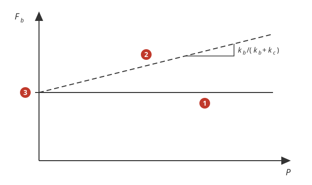
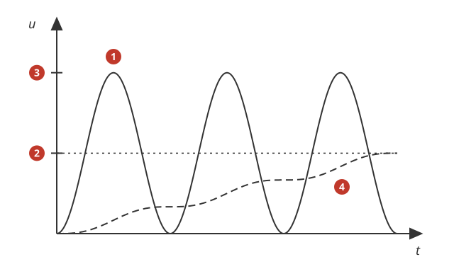
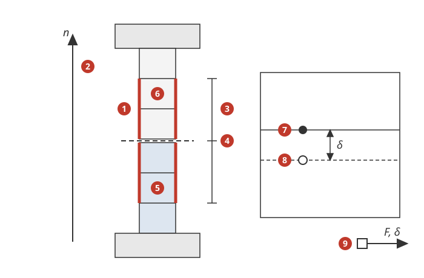

# Boutvoorspanning (Pre-tension section)

*English version: [Bolt_pretension.md](en/Bolt_pretension.md)*

Mecway's *Pre-tension section* (handleiding v34 §9.11) spant een bout of een ander
prismatisch deel voor: met een **kracht** (trek positief) of een **lengteverandering**
(*Length adjustment*: de vrije lengte verandert, positief = verkorting). De bridge
vertaalt de variant met een prisma van volume-elementen (in Mecway de CCX-variant) in
**Lineair statisch** (S30, `lin_static_3d`), **Niet-lineair statisch** (L30,
`nonlin_static_3d`) en **Dynamische respons** (D30/D31, impliciet `dyna_impl_3d`), en de
variant met één **veerelement** (in Mecway de variant voor de interne solver) in
**Lineair statisch**.

## 1. Gebruiken

1. Modelleer de bout (of het voor te spannen deel) met volume-elementen: hex, wedge,
   tet of piramide, lineair of kwadratisch. Het deel waar de doorsnede komt moet
   prismatisch zijn (dezelfde doorsnede langs de as).
2. *Loads and constraints* > *Pre-tension section*: selecteer minstens twee
   **buitenvlakken van de schacht onder verschillende hoeken**, bijv. het hele
   cilindervlak van een stuk schacht. Die vlakken bepalen de as (loodrecht op hun
   normalen) en de axiale lengte; de doorsnede komt in het **midden** van die lengte.
   Selecteer vlakken aan beide kanten van de plek waar de doorsnede moet komen.
3. Kies *Force* (bijv. `10 kN`) of *Length adjustment* (bijv. `0.01 mm`). Beide
   mogen constant zijn, een tabel in de tijd of een formule in t.
4. Mecway rekent de doorsnede zelf alleen met CCX; voor de bridge maakt de
   solverkeuze in Mecway niet uit. Kies de analyse Static 3D, Nonlinear static 3D of
   (Nonlinear) Dynamic Response 3D en start de bridge zoals gewoonlijk.
5. Veerelement in plaats van een prisma (Mecway's variant voor de interne solver):
   selecteer het vlak van **één** veerelement (lijnelement met een *Spring*-materiaal)
   en geef een *Length adjustment*. Mecway gebruikt bij een veer altijd de
   lengteverandering, ook als *Force* gekozen is (de kracht wordt dan genegeerd); de
   bridge doet hetzelfde. Alleen in Static 3D.

Er zijn geen instellingen. De bridge meldt de doorsnede in de log: as, axiale
lengte, plek van de doorsnede, doorsnede-oppervlak met de nominale spanning F/A, het
aantal elementen aan beide kanten en het referentieknooppunt.

## 2. Kracht of lengteverandering

| Mecway | Wat vast blijft | Onder een extra externe last |
|---|---|---|
| Force | de kracht in de doorsnede, de hele berekening lang | de boutkracht blijft F (de bout rekt mee); er is geen "vergrendeling" na het aanspannen |
| Length adjustment | de verkorting | de boutkracht verandert met de stijfheden (verbindingsdiagram: + P kb/(kb + kc)) |

1. Kracht: de boutkracht Fb blijft gelijk aan de opgegeven kracht, wat de externe last P ook is.
2. Lengteverandering: de boutkracht stijgt met P met de helling kb/(kb + kc) (kb bout, kc geklemde delen), zolang de delen geklemd blijven.
3. De voorspanning Fp bij P = 0 (beide manieren; bij de lengteverandering Fp = kb kc/(kb + kc) × verkorting).

Zo doet Mecway het (CCX: de kracht blijft een `*CLOAD` op het pre-tension-knooppunt,
de lengteverandering is een `*BOUNDARY`) en zo doet de bridge het (verificatie PT-03
en PT-04: gelijk aan Mecway binnen 0,01%). Wilt u een aangespannen en daarna
vergrendelde bout onder een latere last? Gebruik de lengteverandering met de
verkorting die de gewenste voorspanning geeft (PT-03: Fp = kb kc/(kb + kc) ×
verkorting; Mecway heeft ook geen twee stappen "kracht, dan vastzetten").

Tijdsverloop: zoals een gewone kracht of opgelegde verplaatsing. In Niet-lineair
statisch met Mecway's *Quasi-static* tijdstappen werkt een constante waarde vanaf de
eerste stap volledig (zoals in Mecway, BoltedJoint); zonder tijdstappen lopen de
lasten op.

**Dynamische respons** (D30/D31): Mecway (CCX) rekent één dynamische stap met de
kracht of de lengteverandering op het pre-tension-knooppunt, constante waarden als
staplast vanaf t = 0 (`AMPLITUDE=STEP`); er is geen statische voorspanstap vooraf. De
bridge doet hetzelfde in `dyna_impl_3d`. Een constante voorspanning zet dus een
trilling om de statische toestand in gang; gebruik een tabel of formule in t die
langzaam oploopt (vergeleken met de laagste eigenperiode) als de bout quasi-statisch
aangespannen moet worden.

1. Constante waarde: werkt als staplast vanaf t = 0 en de constructie trilt (ongedempt
   tussen 0 en twee keer de statische waarde).
2. De statische waarde u_s: de verplaatsing die Static 3D geeft met dezelfde
   voorspanning.
3. Twee keer de statische waarde: de eerste piek van de stapresponsie.
4. Waarde als langzaam oplopende tabel of formule: volgt de statische waarde met een
   kleine trilling.

## 3. Hoe de bridge vertaalt

1. De geselecteerde buitenvlakken van de schacht (minstens twee onder verschillende hoeken).
2. De as n, loodrecht op de normalen van die vlakken.
3. De axiale lengte van de geselecteerde vlakken; het prisma zijn de volume-elementen daarbinnen.
4. De doorsnede in het midden van die lengte.
5. De kant onder (langs n): de elementen krijgen kopieën van de knopen van de doorsnede.
6. De kant boven: houdt de Mecway-knopen; Mecway toont deze waarden.
7. Een Mecway-knoop op de doorsnede (kant boven).
8. Zijn kopie (kant onder), op dezelfde plek; de twee verschillen de verkorting δ langs n en zijn gelijk dwars op n.
9. Het referentieknooppunt: zijn DX is δ; het draagt de kracht F of de opgelegde δ.

- **Prisma** (zoals Mecway, handleiding §9.11): de as is de mediaan van de
  kruisproducten van de normalen van elk paar geselecteerde vlakken (hoogstens 1000
  vlakken), de axiale lengte die van de geselecteerde vlakken; het prisma bevat alle
  volume-elementen binnen die lengte die met de geselecteerde vlakken of met elkaar
  verbonden zijn.
- **Doorsnede**: elk prisma-element ligt onder of boven het midden van de lengte (zijn
  zwaartepunt langs de as). De knopen die beide kanten delen zijn de doorsnede; in een
  gestructureerd mesh is dat een laag elementvlakken, in een tet-mesh een zigzagvlak
  over vlakken, ribben en hoekknopen (PT-05). Mecway voegt daar voor CCX een dunne laag
  elementen in; de bridge heeft die niet nodig.
- **Snede**: de elementen onder (langs de as) krijgen een kopie van de knopen van de
  doorsnede (nieuwe knopen na de Mecway-knopen). Per knooppaar drie `LIAISON_DDL`:
  u(boven) − u(onder) + δ·n = 0, met n de as en δ de verkorting = `DX` van een
  **referentieknooppunt** (POI1 met `DIS_T` stijfheid 0, groep `BRPRET`; `DY` = `DZ` =
  0). De tangentiële componenten blijven gelijk, de normale verschillen δ; dat is de
  formulering van CCX zelf (`pretensionsections.f`) en het aanspannen van de officiële
  testcase ssnv106a.
- **Belasting**: kracht → `FORCE_NODALE FX` = F op het referentieknooppunt (de
  arbeidsgeconjugeerde van δ is de normaalkracht, trek positief); lengteverandering →
  `DDL_IMPO DX` = δ. De Mecway-belasting wijst naar de knoopgroep `BRPT<k>` van dat
  knooppunt. In dynamica volgt dezelfde belasting het tijdsverloop zoals een gewone
  kracht of opgelegde verplaatsing; het referentieknooppunt heeft geen massa (het
  draagt alleen de relaties), daarom wordt het expliciete schema niet ondersteund.
- **Variant met een veerelement**: de veerkracht is k (verlenging + δ), dus een veer
  die δ verkort is dezelfde veer met twee knoopkrachten k δ die de eindknopen langs de
  as naar elkaar toe trekken: `FORCE_NODALE` op de knoopgroepen `BRPS<k>A` en
  `BRPS<k>B`. Exact in lineair statisch (PT-09, PT-10: gelijk aan Mecway's interne
  solver).

## 4. Resultaten in Mecway

- De knopen op de doorsnede tonen de waarden van de kant **boven** (de hogere kant
  langs de as, de grootste ascomponent positief). De sprong δ over de doorsnede is in
  Mecway niet te zien (de kopieën zijn geen Mecway-knopen); in Mecway zelf zijn de
  knopen van de ingevoegde laag ook niet te zien.
- De boutkracht is bij een kracht precies F. Controleer hem met de nominale spanning
  in de log, of met de spanning in de schacht (in een grof mesh wijkt de knoopspanning
  bij de overgang naar de kop af; neem een knoop halverwege de schacht).

## 5. Testmodellen

PT-01 .. PT-05 in [`Verificatie.md`](Verificatie.md): staaf met kracht en met
lengteverandering (handberekening exact, Mecway 34 −0,004%), bout met huls tussen
stijve platen (verbindingsdiagram met lengteverandering, en met kracht onder een
oplopende externe last in Niet-lineair statisch), en een staaf in tet4 met een
zigzagdoorsnede. PT-06 .. PT-08: de verbinding met een zware bovenplaat in Dynamische
respons (kracht en lengteverandering als staplast, kracht als helling in D30; periode
en piek gelijk aan de handberekening van het massa-veersysteem binnen 0,6% en aan
Mecway 34 met CCX binnen 0,06%). PT-09, PT-10: de variant met een veerelement (twee
veren in serie, langs X en schuin; exact, gelijk aan Mecway's interne solver).

## 6. Meldingen en oplossingen

| Melding | Oorzaak | Oplossing |
|---|---|---|
| ERROR: Pre-tension section op '...': alleen in lineair en niet-lineair statisch en impliciete dynamica | expliciete dynamica (`dyna_expl_3d`), dynamica op modale basis, modaal, knik, ... | gebruik Statisch, Niet-lineair statisch of `dyna_impl_3d` (KNOWN_BUGS 124) |
| ERROR: ... alleen vlakken van volume-elementen (prisma, CCX-variant) of het vlak van een enkel veerelement | de selectie bevat vlakken van schalen/balken, of vlakken van volume-elementen en veren samen | selecteer alleen vlakken van volume-elementen, of het vlak van één veer |
| ERROR: ... de variant met een veerelement werkt op het vlak van precies een veer | vlakken van meerdere veren in één selectie | maak per veer een eigen pre-tension section |
| ERROR: ... de variant met een veerelement alleen in lineair statisch | de veervariant in een andere analyse (Frequency, Buckling, niet-lineair, dynamica) | in Frequency en Buckling geeft Mecway de voorgespannen veer ook geometrische stijfheid, DIS_T van Code-Aster niet; vervang de veer door een kort staafje van volume-elementen (prisma-variant) (KNOWN_BUGS 124) |
| WARNING: Pre-tension section op veer '...': Mecway gebruikt bij een veer alleen de length adjustment | *Force* gekozen op een veer | geef de verkorting als *Length adjustment* (de kracht doet niets, zoals in Mecway) |
| ERROR: ... geen as: kies minstens twee vlakken onder verschillende hoeken | alle geselecteerde vlakken evenwijdig (bijv. alleen één platte kant van een vierkante staaf) | selecteer ook een vlak onder een andere hoek (bijv. de aangrenzende kant) |
| ERROR: ... geen doorsnede door het prisma gevonden | één element langs de as, of de vlakken overspannen de plek van de doorsnede niet | selecteer vlakken van minstens twee elementlagen, aan beide kanten van de gewenste doorsnede |
| ERROR: ... de doorsnede raakt elementen buiten het prisma | elementen rond de doorsnede die buiten de axiale lengte reiken (bijv. een moer of plaat die samen met de bout gemesht is) | selecteer vlakken over een stuk schacht met alleen schachtelementen, of mesh de bout als eigen onderdeel (contact of bonded contact met de platen) |
| ERROR: ... de doorsnede gaat door knopen van een andere pre-tension section | twee doorsneden op dezelfde plek | verplaats er een |
| WARNING: Een deel van ... element(en) ... wordt alleen door contact op zijn plaats gehouden (...) en door de kracht van een pre-tension section | de kant van de bout achter de doorsnede wordt alleen door contact (moer) en de kracht gehouden; Code-Aster stopt in stap 1 met `MECANONLINE9_4` | een zwakke *Elastic support* op een vlak van die kant, of *Length adjustment* ([Instellingen §3.11](Instellingen_contact_en_nietlineair.md#311-delen-die-alleen-door-contact-vastzitten)) |
| WARNING: Keuze LINE_QUAD ... niet toegepast: ... pre-tension section | hex8 met `elem_hex8` = LINE_QUAD | de middenknopen die Code-Aster maakt zouden in de doorsnede los blijven; gebruik hex20 in Mecway |

## 7. Wat niet kan

Zie ook KNOWN_BUGS 124.

- Expliciete dynamica (`dyna_expl_3d`), dynamica op modale basis en de andere analyses
  (modaal, knik, ...): ERROR. Mecway staat de prisma-variant alleen toe in statisch en
  dynamische respons.
- De variant met een veerelement buiten Static 3D: Mecway staat ook Frequency en
  Buckling toe, maar geeft de voorgespannen veer daar geometrische stijfheid (een
  ingeklemde kolom met een voorgespannen veer van voet naar top: knikfactor 6,99 in
  Mecway, alsof de last door de voet gericht is; 1,75 met knoopkrachten), die het
  discrete element van Code-Aster niet heeft.
- Mecway's eigen berekening van een veermodel: *Fixed* op een knoopselectie hield
  knopen met alleen veren in Mecway 34 niet vast (singulier model); gebruik daar
  *Displacement* in X, Y en Z. De bridge zet ze in beide gevallen vast.
- Een meedraaiende richting: de as blijft vast bij grote rotaties (ook in Mecway).
- Lasten, opleggingen en contact op vlakken die de doorsnede raken: aan de kant onder
  werken ze op de kopie (last, contact) of op de Mecway-knoop (alleen opleggingen); het
  verschil is hoogstens δ, zoals bij Mecway's ingevoegde laag.
- Samples/BoltedJoint zelf rekent niet met Code-Aster: plaat B wordt alleen door contact
  gehouden, en met de kracht het bovenste deel van de bout alleen door het moercontact en
  de voorspankracht. De bridge meldt beide delen vóór de run (WARNING "wordt alleen door
  contact op zijn plaats gehouden"); een zwakke *Elastic support* op elk haalt de pivots
  nul weg, maar het wrijvingscontact zelf convergeert in Code-Aster dan nog niet; zonder
  wrijving rekent het wel (KNOWN_BUGS 43,
  [Instellingen_contact_en_nietlineair.md §3.11](Instellingen_contact_en_nietlineair.md#311-delen-die-alleen-door-contact-vastzitten)).

## 8. Bronnen

- Mecway-handleiding v34 §9.11 (prisma, as, lengte, dunne laag, beperkingen); XML en
  CCX-invoer van Samples/BoltedJoint.liml en testmodellen, gelezen tijdens headless
  Mecway 34-solves (28 okt 2026): `force="true"` = kracht, `adjustment="true"` =
  lengteverandering, `*CLOAD` resp. `*BOUNDARY` op het pre-tension-knooppunt; in
  D30/D31 één `*DYNAMIC`-stap met `AMPLITUDE=STEP` (geen voorspanstap), een formule in t
  als `*AMPLITUDE`. Variant met een veerelement: Mecway 34 interne solver, headless (het
  faceid van het lijnelement maakt niet uit; de lengteverandering wordt gebruikt, wat
  de modus ook is).
- CalculiX 2.23-bron die met Mecway meekomt, `pretensionsections.f`: per knooppaar twee
  tangentiële MPC's en één normale MPC met de vrijheidsgraad van het
  referentieknooppunt.
- Code-Aster 17.4: `LIAISON_DDL` (catalogus `affe_char_meca.py`, U4.44.01); testcase
  ssnv106a (aanspannen als relatieve verplaatsing tussen verdubbelde knopen).
