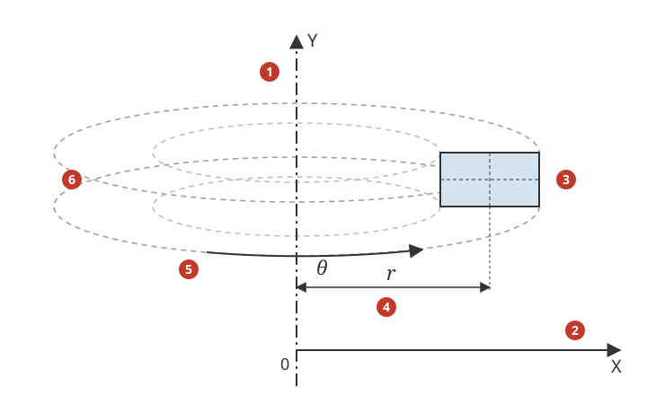
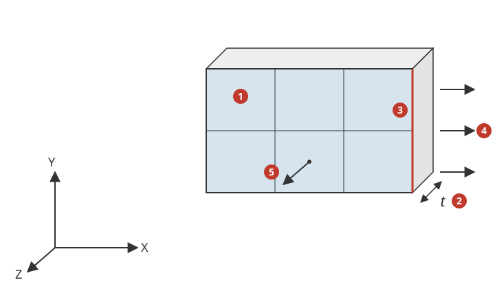
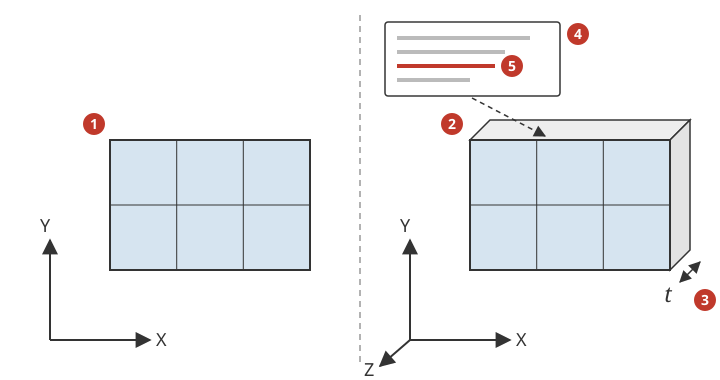
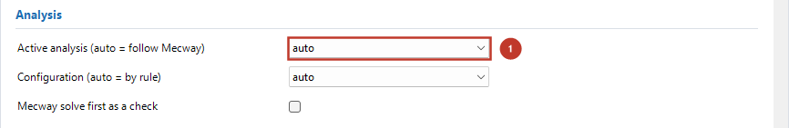
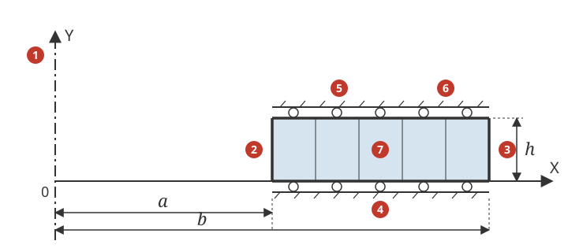
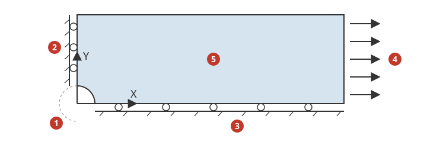
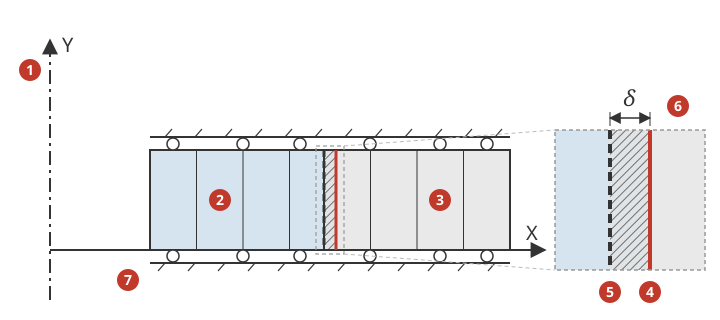

# 2D and axisymmetric analyses

*Nederlandse versie: [2D_en_axisymmetrisch.md](../2D_en_axisymmetrisch.md)*

The bridge translates Mecway's static and dynamic 2D analysis types to Code-Aster
`MECA_STATIQUE` or `DYNA_NON_LINE` with plane elements (U3.13.01 "Modélisations AXIS,
D_PLAN, C_PLAN"):

| Mecway analysis | Mecway material | Code-Aster | Result in Mecway |
|---|---|---|---|
| Static 2D (S20) | *Shell/membrane* with a thickness | `C_PLAN` (plane stress) | displacement X, Y; stress (σ_zz = 0); von Mises; reactions for the thickness t |
| Static 2D (S20) | *Shell/membrane* with a thickness and *plane strain* | `D_PLAN` (plane strain) | as above, σ_zz = ν(σ_xx + σ_yy) |
| Static Axisymmetric (SA0) | no geometry (isotropic material) | `AXIS` | displacement X (radial), Y (axial); stress with `stresszz` = hoop stress; reactions for 360 degrees |
| Dynamic Response 2D (D20), Dynamic Response Axisymmetric (DA0) | as S20 / SA0 | as S20 / SA0, in time (§2.4) | as S20 / SA0 per output time, plus velocity and acceleration |
| Acoustic Resonance 2D (A20) | *Speed of sound* (a thickness does not count) | `PHENOMENE='ACOUSTIQUE'`, `PLAN` (§4) | per mode the frequency and the pressure field `pressure`, as A30 |

The bridge analysis is `lin_static_3d` ("Static") for S20 and SA0 and `dyna_impl_3d`
("Dynamic (implicit)") for D20 and DA0: with "Active analysis (auto = follow Mecway)" =
`auto` the bridge chooses it. General operation of the bridge:
[`UserGuide.md`](UserGuide.md). Acoustic Resonance 2D (A20) goes to the acoustic cavity modes `acoustic_modes_3d` (§4). Mecway has no thermal 2D type: a thermal model in a plane is made of
shells ([`Thermal.md`](Thermal.md)); axisymmetric heat transfer: §1.4.1.



1. Mecway's Y axis: the axis of symmetry (SA0, Code-Aster `AXIS`).
2. Mecway's X axis: the radius r; all nodes at X ≥ 0.
3. The plane elements in the XY plane: a cross-section of the body.
4. Radius r of a point: Code-Aster integrates per radian (r dθ), the bridge multiplies forces and reactions by 2π.
5. Hoop direction θ: `stresszz` is the hoop stress σ_θ.
6. The ring that the elements represent (360 degrees): Mecway's forces and reactions are for this whole ring.



1. The plane elements in the XY plane (Z = 0).
2. Thickness t: the *Shell/membrane* thickness of the material (S20); Mecway's forces and reactions are for the whole t, Code-Aster computes per unit thickness.
3. An edge of the plane elements (faceid 1..4): pressure, traction and an edge force act on such an edge (edge cells `SEG2`/`SEG3`).
4. A load on the edge, in the XY plane.
5. σ_zz, normal to the plane: 0 in plane stress (`C_PLAN`), ν(σ_xx + σ_yy) in plane strain (`D_PLAN`).

## 1. Step-by-step workflow

**Choose the route first.** A 2D model reaches the bridge in one of two ways. The mesh is the
same (plane elements in the XY plane); the routes differ in the Mecway analysis type and in
one line of text:

- **Route B: Mecway's own 2D type.** *Static 2D* (S20), *Static Axisymmetric* (SA0),
  *Dynamic Response 2D* (D20) or *Dynamic Response Axisymmetric* (DA0). Linear only. No extra
  line. Mecway solves the same model itself, so its own solution is a reference (§5).
- **Route A: a Mecway 3D type on plane elements.** *Nonlinear Static* (L30), *Static 3D*
  (S30), *Thermal Steady State* (T30) or *Thermal Transient* (T31). In a 3D type Mecway treats
  the plane elements as shells, so the material needs a *Shell/membrane* geometry with a
  thickness. One line in CCX > *Custom model definition*, `**ASTER-PLANE C_PLAN` (plane
  stress), `**ASTER-PLANE D_PLAN` (plane strain) or `**ASTER-PLANE AXIS` (axisymmetric),
  makes the bridge compute every element as that 2D element instead of as a shell. Mecway's
  own solver ignores the line and computes shells. Heat transfer in a plane (T30/T31 without
  the line) is a 2D thermal model (`PLAN`) already.
- **Never both.** The line in an S20, SA0, D20 or DA0 model is an ERROR (§1.6). A model has
  one line; it holds for all elements.



1. Route B: a Mecway 2D analysis type (S20, SA0, D20, DA0); the plane elements as they are, nothing to add.
2. Route A: a Mecway 3D analysis type (L30, S30, T30, T31) on the same plane elements in the XY plane (Z = 0); Mecway treats them as shells.
3. The shell thickness t (material geometry *Shell/membrane*): Mecway needs it in route A; `C_PLAN` and `D_PLAN` use it as the thickness (§2.2), `AXIS` ignores it.
4. The text field CCX > *Custom model definition* in the outline tree; it is there when CCX is the solver in *Analysis settings* ([`ASTER_lines_examples.md`](ASTER_lines_examples.md) §1).
5. The line `**ASTER-PLANE C_PLAN`, `**ASTER-PLANE D_PLAN` or `**ASTER-PLANE AXIS` in that field: the bridge computes the shells as plane stress, plane strain or axisymmetric elements.

**Decision table.** Find the row of what you want to compute; the row gives the Mecway
analysis type (in *Analysis settings*), the route, the elements and material, the line and
where it is explained. "Example n" is a worked example with a model file in §1.5.

| What you want | Mecway analysis type | Route | Elements and material | Line in CCX > *Custom model definition* | Where |
|---|---|---|---|---|---|
| Linear static, plane stress or plane strain, also with a temperature (thermal stress) | *Static 2D* (S20) | B | plane elements; material *Shell/membrane* with the thickness t, for plane strain also *plane strain* ticked | none | §1.1 … §1.3, §2.5 |
| Linear static, axisymmetric, also with a temperature | *Static Axisymmetric* (SA0) | B | plane elements at X ≥ 0 (Y = axis); material without geometry | none | §1.1 … §1.3, §2.5; example 1 |
| Linear dynamics in time | *Dynamic Response 2D* (D20) or *Dynamic Response Axisymmetric* (DA0) | B | as S20 / SA0, with a density; no temperature | none | §1.1, §2.4 |
| Acoustic cavity modes in 2D | *Acoustic Resonance 2D* (A20) | – | plane elements; *Speed of sound* | none | §4 |
| Plasticity, large deformations, load steps (time tables), plane stress or plane strain | *Nonlinear Static* (L30) | A | plane shell elements in the XY plane; *Shell/membrane* with the thickness t; plasticity as in 3D | `**ASTER-PLANE C_PLAN` or `**ASTER-PLANE D_PLAN` | §1.4; example 3 |
| The same, axisymmetric | *Nonlinear Static* (L30) | A | plane shell elements at X ≥ 0; *Shell/membrane* with any thickness (it does not count) | `**ASTER-PLANE AXIS` | §1.4; example 2 |
| Contact between parts (shrink fit, parts that touch), also with friction | only *Nonlinear Static* (L30) | A | as the two rows above, plus a *Contact* (unilateral) between two face selections of edges | `**ASTER-PLANE C_PLAN`, `D_PLAN` or `AXIS` | §1.4 item 6; example 4 |
| Linear static as a 3D model (e.g. to compare with Mecway's own shell solve) | *Static 3D* (S30) | A | as for L30; no contact | `**ASTER-PLANE C_PLAN` (verified, PL-33); `D_PLAN` and `AXIS` take the same route, not verified in S30 | §1.4; example 3 |
| Heat transfer in a plane | *Thermal Steady State* (T30) or *Thermal Transient* (T31) | – (3D thermal type, no line) | plane shell elements; the shell thickness counts | none (the bridge computes `PLAN`) | [`Thermal.md`](Thermal.md) |
| Heat transfer, axisymmetric | T30 or T31 | A | plane shell elements at X ≥ 0; *Shell/membrane* with any thickness; *Thermal conductivity* (T31 also *Specific heat* and *Density*) | `**ASTER-PLANE AXIS` | §1.4.1; example 5 |
| Thermal stress from an axisymmetric heat transfer (chain thermal -> mechanical) | *Thermal Transient* (T31) with *Thermal stress* | A | as the row above, plus E, ν, *Thermal expansion* and supports | `**ASTER-PLANE AXIS` | §1.4.1; example 6 |
| The chain thermal -> mechanical in plane stress or plane strain | – | – | – | not possible yet | §3 |
| Axisymmetric shells (line elements) | – | – | – | not yet | §3 |
| Nonlinear dynamics, modes, buckling in 2D | – | – | – | not possible | §3 |

Where to type the line: Mecway solves L30 only with CCX; choose CCX as the solver in
*Analysis settings* for S30, T30 and T31 as well, then the branch CCX with *Custom model
definition* is in the outline tree. The field of another solver works too, with that
solver's prefix: `#ASTER-PLANE` in an OpenRadioss field, `$ASTER-PLANE` in a Mystran field
([`ASTER_lines_examples.md`](ASTER_lines_examples.md) §1); `-VLAK` is the Dutch spelling
(`**ASTER-VLAK AXIS`). The bridge reads the line whichever solver is chosen.

### 1.1 In Mecway: the model (route B)

1. **Analysis type.** *Static 2D*, *Static Axisymmetric*, *Dynamic Response 2D* or
   *Dynamic Response Axisymmetric* in the analysis settings (dynamic: *Time period*,
   *Time step size* and *Generate solution every n time steps*; no *Mode
   superposition*).
2. **Mesh.** Plane elements tri3, tri6, quad4 or quad8 in the XY plane, all nodes with
   Z = 0 (Mecway ignores Z; the bridge stops if Z ≠ 0, §3). Axisymmetric: Y is the axis
   of symmetry, X the radius, all nodes with X ≥ 0 (Mecway Ltd., 2026, §6.1.3, §7.2).
   Quadratic elements may have curved edges (midside node off the chord).
3. **Material.**
   - S20: give the material a geometry *Shell/membrane* with a **thickness** t; for
     plane strain also tick *plane strain*. Without a thickness Mecway does not solve
     and the bridge stops (§3). The whole model has one thickness and one type (plane
     stress or plane strain), otherwise the bridge stops.
   - SA0: no geometry. A thickness does not count (the bridge ignores it with a
     WARNING; Mecway's own solve gives no solution then).
   - Density for gravity, centrifugal force and dynamics.
4. **Supports.** *Fixed support*, *Pinned support* and *Displacement* along X or Y on
   nodes or on edges (face selection of edges, faceid 1..4), *Symmetry* with normal X
   or Y on edges. Axisymmetric: Mecway asks for a support in X on nodes on the axis
   (X = 0) (Mecway Ltd., 2026, §7.2); do the same for the bridge (without it NOT
   verified). One support in Y is needed against rigid motion along the axis.
5. **Loads** (all values as in Mecway, see §2.2):
   - *Pressure* and *Traction* on edges;
   - *Force* on nodes (total, equally per node) or on edges (total, uniform over the
     edge area);
   - *Gravity* in the XY plane (SA0: only along Y);
   - *Centrifugal force* about Z (S20) or about Y (SA0);
   - S20 and SA0: *Thermal stress* with *Temperature* (on nodes, edges or elements) or
     *Node temperature*, and the thermal expansion coefficient in the material (§2.5).
   Values may be a time table (dynamics). Dynamics: *Rayleigh damping* on the whole
   model. Other items stop or are skipped with an ERROR (§3, §4).

### 1.2 In the main window of the bridge



1. *Active analysis (auto = follow Mecway)*: `auto` (or `lin_static_3d`; for D20/DA0
   `dyna_impl_3d`).
2. *Results to Mecway*: `liml`.

"Active analysis (auto = follow Mecway)" `auto` (or `lin_static_3d`) and "Results to Mecway" `liml` (General page;
the route `tabel` does not scale the reactions, the bridge stops). The settings of the
Static or Dynamic (implicit) page apply as in 3D; for D20/DA0 equal to Mecway: "Time
scheme (SCHEMA_TEMPS)" `NEWMARK`, `deformation` `PETIT` and "Solver steps per Mecway
time step" = 1 (default; §2.4). The result fields `strain` and `shell_*`
give nothing in 2D;
`principal_stresses` gives `principal1..3` and `tresca` as Mecway does (eigenvalues of
the 3D tensor with σ_zz, per element node, node = average). The error estimator is not
used in 2D (INFO).

### 1.3 Viewing the results in Mecway

The results have Mecway's own names and appear under the same items as Mecway's own
S20/SA0 solution (measured: Mecway adds *displacement*, *stress*, *von Mises stress*,
*reaction force*, *principal stress* and *Tresca stress* when it opens the result):

| Mecway variable | Code-Aster | Meaning |
|---|---|---|
| `displx`, `disply`, `displmag` | `DEPL` DX, DY | X, Y (SA0: radial, axial); no `displz` (as Mecway) |
| `stressxx`, `stressyy`, `stressxy` | `SIGM_NOEU`/`SIGM_ELNO` | in-plane stresses (SA0: σ_r, σ_z, τ_rz) |
| `stresszz` | `SIGM_*` SIZZ | 0 in plane stress, ν(σ_xx + σ_yy) in plane strain, **hoop stress** in SA0 |
| `stressyz`, `stresszx` | – | 0 (as Mecway) |
| `vonmises` | `SIEQ_*` | 3D von Mises with σ_zz |
| `reactionforcex/y/mag` | `REAC_NODA` × t or × 2π | for the whole thickness (S20) or 360 degrees (SA0), as Mecway |

### 1.4 Nonlinear in 2D: a 3D model with `**ASTER-PLANE` (route A)

Mecway has no nonlinear 2D type. For plasticity, large deformations, time steps, load
ramps and contact in 2D, make the model as a 3D model of plane elements and tell the bridge
with one line to compute it in 2D (examples 2, 3 and 4 in §1.5):

1. **Analysis type.** *Nonlinear Static* (L30) in *Analysis settings*, with CCX as the
   solver (Mecway only solves L30 with CCX). *Static 3D* (S30) works too (linear, as S20;
   no contact).
2. **Mesh.** Plane elements tri3, tri6, quad4 or quad8 in the XY plane (Z = 0), nothing
   else (no beams, trusses, springs or solids); in a 3D type Mecway treats them as shells.
   Axisymmetric: Y is the axis, X the radius, all nodes at X ≥ 0 (first figure).
3. **Material.** A *Shell/membrane* geometry with a thickness (Mecway needs it for
   shells). For `C_PLAN` and `D_PLAN` it is the thickness t: Mecway's forces and the
   reactions are for t (§2.2). For `AXIS` any value: it does not count (INFO). All elements
   have the same thickness. Plasticity (*Bilinear isotropic*, *Stress-strain curve*) as in
   3D.
4. **The line.** In CCX > *Custom model definition* one line:

   ```
   **ASTER-PLANE C_PLAN
   ```

   with `C_PLAN` (plane stress), `D_PLAN` (plane strain) or `AXIS` (axisymmetric). Write
   the hyphen: `**ASTER PLANE AXIS` (with a space) is an ERROR (§1.6). Mecway's own solver
   ignores the line; the bridge then computes every elset with that modelisation instead of
   as shells (a *plane strain* tick on the material does not count then; WARNING if it
   contradicts the line). Other fields and prefixes: see "Where to type the line" in §1.
5. **Supports and loads** on nodes and on edges, as in §1.1. An edge is a face selection of
   edges of the plane elements (faceid 1..4, figure in example 4); a face selection of the
   element faces (faceid 5/6) gives an ERROR ("only edges of plane elements (faceid 1..4),
   here shellface", §1.6). Supports that only hold Z or rotations (*Node rotation*, a zero
   *Displacement* along Z, a *Symmetry* with normal Z: often there for Mecway's own shell
   solve) are left out with an INFO. *Thermal stress* with *Temperature* and *Node
   temperature* as in §2.5, also as a time table (PL-34, PL-36; Mecway's own CCX solve of
   the shells gives half the thermal expansion, KNOWN_BUGS 139).
6. **Contact** (L30 only): a *Contact* (unilateral) between two face selections of edges of
   the plane elements: the master edge and the slave edge (figure and steps: example 4;
   which side is master: [`Settings_contact_and_nonlinear.md`](Settings_contact_and_nonlinear.md) §3.2).
   The bridge writes them as edge cells (`SEG2`/`SEG3`) for `DEFI_CONTACT` with the
   settings of the Nonlinear static page, as in 3D. Overlapping geometry (a shrink fit) is
   resolved in the first step. The result `contactpressure` is a pressure (no factor t or
   2π). Verified in `AXIS` and `D_PLAN` (shrink fit, Hertz line contact, a Code-Aster test
   case) and with Coulomb friction (a block sliding over a block); `C_PLAN` runs (checked
   only with ν = 0). With friction, slave nodes that another support holds along the contact
   edge can make Code-Aster stop with a singular matrix: the bridge then gives a WARNING;
   leave those nodes out with a node selection and
   `**ASTER-ZONE SANS_GROUP_NO='<<selection>>'` (KNOWN_BUGS 141). *Bonded* contact in 2D:
   ERROR. Whether Mecway's window lets you pick shell edges for a contact is NOT verified.
7. **Bridge.** "Active analysis (auto = follow Mecway)" `auto` (→ `nonlin_static_3d` for
   L30, `lin_static_3d` for S30) and "Results to Mecway" `liml` (the route `tabel`: ERROR).
   Check in the log that the line was read: per elset
   `INFO: Elset '…' -> MODELISATION='C_PLAN', thickness … m (Mecway L30).` (for `AXIS`
   without the thickness) and once `INFO: 2D analysis L30: MODELISATION='…'; concentrated
   forces / … and reactions x … (…).` Without these lines the bridge computed the elements
   as shells (the line is missing or not in a field the bridge reads).

The bridge analysis is `nonlin_static_3d` (L30) or `lin_static_3d` (S30); the settings of
the Nonlinear static page apply as in 3D. *deformation* `GROT_GDEP` (the default) becomes
`GDEF_LOG` for plastic material (`SIMO_MIEHE` if chosen, only in `D_PLAN`/`AXIS`) and
`GREEN_LAGRANGE` for elastic material; a pressure is then a follower load as in 3D. The
plasticity laws of the bridge support `C_PLAN` natively (Code-Aster 17.4 catalogue). Results
per step as in §1.3, plus `plasticstrainxx/yy/zz/xy` and `equivalentplasticstrain`; the
reaction forces with the factor t or 2π in every step (PL-30, PL-32). Verification PL-30 … PL-36: a thick
cylinder with perfect plasticity (Hill) in `D_PLAN` and `AXIS`, first yield at a hole in
`C_PLAN`, Code-Aster test case ssnp159b (`AXIS`, `GDEF_LOG`) through the bridge. NOT
included: the failure loop (`#ASTER-BEZWIJKEN`, WARNING), bonded contact, the chain
thermal -> mechanical (heat transfer itself and the chain in `AXIS`: §1.4.1). Contact: PL-40 … PL-46 (a shrink fit within 0.01% of Lamé, Hertz line contact, a
Code-Aster test case, friction). Opening such a result in the Mecway window is NOT verified (a test in the Mecway
GUI still to do).

### 1.4.1 Heat transfer axisymmetric

Mecway has no axisymmetric thermal type; the bridge computes one from the 3D thermal types
(route A). Heat transfer in a plane needs no line: plane shell elements in T30 or T31 are
already a 2D thermal model (`PLAN`, [`Thermal.md`](Thermal.md)), the shell thickness counts.
Worked examples: example 5 (heat transfer) and example 6 (the chain) in §1.5.

1. **Analysis type.** *Thermal Steady State* (T30) or *Thermal Transient* (T31) in
   *Analysis settings*, solver CCX (for the field of step 4).
2. **Mesh.** Plane shell elements tri3, tri6, quad4 or quad8 in the XY plane (Z = 0),
   all X ≥ 0; Y is the axis of symmetry, X the radius.
3. **Material.** *Shell/membrane* with a thickness (Mecway needs it; in `AXIS` it does not
   count), *Thermal conductivity*, for T31 also *Specific heat* and *Density*.
4. **The line.** In CCX > *Custom model definition* one line `**ASTER-PLANE AXIS`
   (spellings as in §1.4). Without it the shells stay a `PLAN` model; `C_PLAN` or `D_PLAN` in
   T30/T31 only give an INFO that the line is not needed (in T31 with *Thermal stress*: an
   ERROR, see the chain below).
5. **Loads** on the edges of the elements (faceid 1..4) and on the elements: *Temperature*,
   *Heat flux*, *Convection*, *Radiation*, *Internal heat generation*, *Heat flow*, also as
   time tables and in the same way as in 3D ([`Thermal.md`](Thermal.md); *Internal heat
   generation* and a *Heat flow* on elements verified: PL-56, PL-57). T31: an initial
   temperature (as in 3D).
6. **Bridge.** "Active analysis (auto = follow Mecway)" `auto` (→ `ther_3d`, page Thermal)
   and "Results to Mecway" `liml`. The log shows `INFO: T30 (or T31) with '#ASTER-PLANE AXIS':
   thermal MODELISATION='AXIS' about Y (per radian in Code-Aster, 360 degrees in Mecway).`
   and per elset `INFO: Elset '…' -> thermal MODELISATION='AXIS' (the shell thickness does
   not count).`

What the bridge does: the elsets become thermal `MODELISATION='AXIS'` about Y. Code-Aster
computes per radian, the temperature does not depend on that. Factors:

- A load per area (*Heat flux*, *Convection*, *Radiation*, *Temperature* on an edge) and per
  volume (*Internal heat generation*) needs no factor, and the shell thickness does not
  count.
- A total *Heat flow* (W, for the whole 360 degrees) on an edge is divided by the revolved
  area 2π ∫ r dl of the edge, on elements by the revolved volume, then applied as above.
- Results as in 3D: `temperature`, `heatfluxx` = radial and `heatfluxy` = axial flux (W/m²).

NOT translated (an ERROR line "Not translated: …", the run continues without the load):
loads on the face of the cross-section (faceid 5/6: there is no surface in `AXIS`) and a
*Heat flow* on nodes (use a heat flow on an edge). A *Thermal stress* in T30 has no effect
(the chain needs T31), as in 3D. Refused with an ERROR in `AXIS` (the bridge stops):
`#ASTER-LASBRON` (welding), `#ASTER-METALLURGIE` and *Bonded* contact. Nodes at X < 0 give the
ERROR of §1.6. The exact messages: §1.6.

**Thermal stress (chain, T31).** A *Thermal Transient* model (T31) with a *Thermal stress* and
the line `**ASTER-PLANE AXIS` is computed as the chain of [`Welding.md`](Welding.md) §9: first
the thermal steps (`THERMIQUE` `AXIS`, above), then `STAT_NON_LINE` with the temperature field
of every step as the load, also `AXIS` (supports and loads as in route A of §1.4; the reactions
are for 360 degrees, `stresszz` is the hoop stress). In Mecway, in addition to steps 1 to 6:

7. **Material**: also *Young's modulus*, *Poisson's ratio* and *Thermal expansion coefficient*.
8. **Supports and mechanical loads** on edges or nodes, as in §1.4 (at least one support in
   Y against rigid motion along the axis). If Mecway offers *Displacement* and *Thermal
   stress* only in a mechanical analysis type: [`Welding.md`](Welding.md) §9.1 step 4.
9. ***Thermal stress*** with the initial temperature as *Reference temperature*.

The log then also shows `INFO: T31: the mechanical part of the thermomechanical chain as
MODELISATION='AXIS' (reactions x 2 pi).` Only `AXIS`: the chain with `C_PLAN` or `D_PLAN` is
not possible yet (T31 with *Thermal stress* and the line `C_PLAN`/`D_PLAN` gives the ERROR
"Thermal stress (thermal -> mechanical chain) with '#ASTER-PLANE C_PLAN' in T31 is not
translated (yet); only AXIS.", §1.6), and a plastic (nonlinear) material in the chain with
`AXIS` is not verified. ERROR in this chain: the result route
`tabel` (the reactions are not scaled to 360 degrees), contact, node-surface couplings, bonded
contact and an initial velocity. Point masses are ignored with an INFO; constraint equations,
flexible joints and element offsets are skipped by the reader already with a WARNING (not an
ERROR of the chain). In `AXIS` (with or without the chain) `#ASTER-LASBRON` (welding),
`#ASTER-METALLURGIE` and bonded contact also give an ERROR.
Verified: PL-58 (the thick tube of PL-24 as T31, 10 steps of 2000 s, θ = 1, steady): equal to
PL-24 (the same tube with the exact ln temperature in the nodes, MECA_STATIQUE) within 1.0e-6
(u_r at both walls and the axial reaction); against the closed form u_r 1.5e-5, σ_θ +0.66% and
+0.13%, σ_z +0.11% and +0.36%, σ_r −1.04% (tolerance 1.2%, as PL-24), the steady temperature at
mid-wall 1e-8 K; the axial reaction 2π α E ∫ θ r dr (factor 2π) 9e-7. PL-59 is PL-58 with an
internal pressure of 50 MPa on the inner edge (an edge load in the chain): u_r(a) against the
thermal solution plus the plane-strain Lamé solution 6.8e-6, the axial reaction 9.5e-7.

Verified (Code-Aster 17.4, PL-50 … PL-57, [`Verification.md`](Verification.md) §2D and
axisymmetric): radial conduction in a tube, a total heat flow on the inner edge, convection
and radiation on the outer edge, transient cooling of a solid cylinder against the Bessel
series, a solid cylinder with *Internal heat generation* (PL-56) and with the same heat as a
total *Heat flow* on the elements (PL-57), all within 0.7% of the closed form (steady cases
within 0.1 K or 0.5%), and plane
shells with convection without the line exactly. Mecway has no axisymmetric thermal type,
so there is no Mecway reference; the Code-Aster test case tpla01 is replaced by these
closed-form cases.

### 1.5 Worked examples

Six models in the repository, one per kind of use; open one in Mecway to see every setting:

| Example | File (`TestFiles/Verificatie/modellen/`) | Route | Mecway type | Line | What it shows |
|---|---|---|---|---|---|
| 1 | `PL-24.liml` | B | SA0 | none | a tube with a radial temperature (thermal stress) |
| 2 | `PL-31.liml` | A | L30 | `**ASTER-PLANE AXIS` | plasticity, axisymmetric, a pressure in time steps |
| 3 | `PL-32.liml` (and `PL-33.liml`) | A | L30 (S30) | `**ASTER-PLANE C_PLAN` | plasticity in plane stress, a plate with a hole |
| 4 | `PL-40.liml` | A | L30 | `**ASTER-PLANE AXIS` | contact: a shrink fit of two rings |
| 5 | `PL-50.liml` | A | T30 | `**ASTER-PLANE AXIS` | heat transfer through a tube wall |
| 6 | `PL-58.liml` (and `PL-59.liml`) | A | T31 | `**ASTER-PLANE AXIS` | the chain thermal -> mechanical: thermal stress in a tube |

Before you start:

- Units SI; steel E = 210 GPa (`210000 MPa` in the files), ν = 0.3. Every model has one
  material `Staal`.
- The selection names in the files are Dutch: `Onder` = bottom edge, `Boven` = top edge,
  `Binnen`/`Binnenwand` = inner edge, `Buiten` = outer edge, `Einden` = the end edges,
  `Alle` = all nodes. Every edge selection is a face selection of edges (faceid 1..4).
  Exception: in example 4 (`PL-40.liml`) `Binnen` and `Buiten` are the elsets of the inner
  and the outer ring; its edge selections have their own names.
- The files have no solver set: choose CCX in *Analysis settings* to see the line in CCX >
  *Custom model definition* (the bridge reads it anyway).
- The models were made by the scripts `tests_vlak_2d_thermisch.py`, `tests_vlak_2d_nonlin.py`,
  `tests_vlak_2d_contact.py` and `tests_vlak_2d_thermisch_axis.py` in `TestFiles/Verificatie/`
  and computed with the bridge (results against closed forms, [`Verification.md`](Verification.md)
  §2D and axisymmetric). Route A was not yet checked in Mecway's window: whether Mecway lets you
  pick shell edges for a *Contact* and how it shows a route-A result is NOT verified. Mecway's own
  solve of the route-A models is not needed (it computes shells).

Examples 1, 2, 5 and 6 use the same slice of a thick tube (a = 0.1 m, b = 0.2 m, h = 0.01 m):



1. Mecway's Y axis: the axis of symmetry of the tube (`AXIS`).
2. The inner edge, X = a = 0.1 m (selection `Binnen` or `Binnenwand`; faceid 4 of the first element).
3. The outer edge, X = b = 0.2 m (selection `Buiten`; faceid 2 of the last element).
4. The bottom edge, Y = 0 (selection `Onder`; faceid 1 of every element).
5. The top edge, Y = h = 0.01 m (selection `Boven`; faceid 3 of every element).
6. The rollers: *Displacement* along Y with value 0 on the bottom and top edges: both ends of the slice held axially, a long tube in plane strain (examples 1, 2 and 6; not in example 5, which is thermal only).
7. The elements: one row of quad8 through the wall (8, 16 or 10 elements, see the example), in the XY plane.

**Example 1 – route B: a thick tube with a radial temperature (`PL-24.liml`).**

1. *Analysis settings*: *Static Axisymmetric* (SA0).
2. Mesh: elset `Buis`, 8 × 1 quad8 (8 through the wall, 1 along the axis), X = 0.1 … 0.2 m,
   Y = 0 … 0.01 m (figure above).
3. Material `Staal`: isotropic, E, ν, *Thermal expansion* 1.2e-5 1/K; no geometry (SA0).
4. Supports and loads:

   | Selection | Where (figure above) | Mecway item |
   |---|---|---|
   | `Onder` (face selection, 8 edges) | bottom edge (4) | *Displacement* along Y, value 0 |
   | `Boven` (face selection, 8 edges) | top edge (5) | *Displacement* along Y, value 0 |
   | all 43 nodes | – | *Node temperature* per node: T(r) = 393 K − 100 K · ln(r/a) / ln(b/a), 393 K at the inner and 293 K at the outer wall |
   | – | – | *Thermal stress* with *Reference temperature* 293 K |

   The node temperatures can also come from a thermal solution of a 3D model
   ([`Thermal.md`](Thermal.md)) or from the chain of example 6.
5. Bridge: "Active analysis (auto = follow Mecway)" `auto` (→ `lin_static_3d`), "Results to
   Mecway" `liml`. The log shows `INFO: Elset 'Buis' -> MODELISATION='AXIS' (Mecway SA0).`
   and `INFO: 2D analysis SA0: MODELISATION='AXIS'; concentrated forces / 6.28319 and
   reactions x 6.28319 (per radian in Code-Aster, 360 degrees in Mecway).`
6. Results: `stresszz` = hoop stress σ_θ (about −219 MPa at the inner wall, +140 MPa at the
   outer wall), `stressyy` = axial σ_z (about −318 MPa at the inner wall), `stressxx` = radial
   σ_r (about −28 MPa at mid-wall); `displx` = radial displacement (0.0605 mm at the inner
   wall, 0.121 mm at the outer wall); the axial reaction (`reactionforcey` summed over the
   bottom edge, 360 degrees) 9.2155 MN in magnitude. A tube with free ends: §2.5 (an `#ASTER` line
   `LIAISON_UNIF`, `PL-25.liml`).

**Example 2 – route A: an elastic-plastic cylinder under internal pressure (`PL-31.liml`).**

1. *Analysis settings*: *Nonlinear Static* (L30), solver CCX, *Time period* 1 s, *Time step
   size* 0.05 s (20 steps).
2. Mesh: elset `Cilinder`, 16 × 1 quad8, X = 0.1 … 0.2 m, Y = 0 … 0.01 m: the same plane
   elements, in a 3D type (so shell elements for Mecway).
3. Material `Staal`: *Shell/membrane* with thickness 10 mm (any value: it does not count for
   `AXIS`), isotropic E, ν, plasticity *Bilinear isotropic* with yield strength 250 MPa and
   tangent modulus 0 (perfectly plastic).
4. Supports and loads:

   | Selection | Where (figure above) | Mecway item |
   |---|---|---|
   | `Binnenwand` (face selection, 1 edge) | inner edge (2) | *Pressure* as a time table: 0 at 0 s, 159.1 MPa at 0.5 s, 187.6 MPa at 1 s |
   | `Onder` (face selection, 16 edges) | bottom edge (4) | *Displacement* along Y, value 0 |
   | `Boven` (face selection, 16 edges) | top edge (5) | *Displacement* along Y, value 0 |

5. The line: in CCX > *Custom model definition*

   ```
   **ASTER-PLANE AXIS
   ```

6. Bridge: `auto` (→ `nonlin_static_3d`), `liml`, the Nonlinear static page unchanged. The log
   shows `INFO: Elset 'Cilinder': the shell thickness (0.01 m) does not count with
   #ASTER-PLANE AXIS.` and `INFO: Elset 'Cilinder' -> MODELISATION='AXIS' (Mecway L30).`
7. Results per step: `equivalentplasticstrain` (plastic zone up to r ≈ 0.13 m at 0.5 s and
   0.16 m at 1 s), `displx` of the outer wall (0.163 mm at 1 s, 1.7% above Hill's 0.160 mm:
   the pressure follows the deformed wall), `stresszz` = hoop stress.

**Example 3 – route A: first yield at a hole in plane stress (`PL-32.liml`).**



1. The hole, radius 0.01 m, centre at the origin; the dashed part lies outside the model (symmetry).
2. The edge X = 0 (Y = 0.01 … 0.05 m): selection `SymX`, *Symmetry* with normal X.
3. The edge Y = 0 (X = 0.01 … 0.15 m): selection `SymY`, *Symmetry* with normal Y.
4. The edge X = 0.15 m: selection `Trek`, *Traction* along X.
5. The plane elements (a quarter of a plate 0.3 × 0.1 m), thickness t = 1 mm normal to the drawing.

Steps:

1. *Analysis settings*: *Nonlinear Static* (L30), solver CCX, *Time period* 1 s, *Time step
   size* 0.02 s (50 steps).
2. Mesh: elset `Plaat`, a quarter of a plate 0.3 × 0.1 m with a central hole of radius
   0.01 m: X = 0 … 0.15 m, Y = 0 … 0.05 m, the hole centre at the origin; 12 288 quad8 (fine,
   so the run takes a while).
3. Material `Staal`: *Shell/membrane* with thickness 1 mm (this is t: it counts for
   `C_PLAN`), E, ν, plasticity *Bilinear isotropic* with yield strength 250 MPa and tangent
   modulus 2100 MPa (0.01 E).
4. Supports and loads:

   | Selection | Where (figure above) | Mecway item |
   |---|---|---|
   | `SymX` (face selection, 64 edges) | edge X = 0 (2) | *Symmetry* with normal X |
   | `SymY` (face selection, 128 edges) | edge Y = 0 (3) | *Symmetry* with normal Y |
   | `Trek` (face selection, 64 edges) | edge X = 0.15 m (4) | *Traction* along X as a time table: 71.46 MPa at 0 s, 87.33 MPa at 1 s |

5. The line: in CCX > *Custom model definition* `**ASTER-PLANE C_PLAN`.
6. Bridge: `auto` (→ `nonlin_static_3d`), `liml`. The log shows `INFO: Elset 'Plaat' ->
   MODELISATION='C_PLAN', thickness 0.001 m (Mecway L30).` and `INFO: 2D analysis L30:
   MODELISATION='C_PLAN'; concentrated forces / 0.001 and reactions x 0.001 (per unit
   thickness in Code-Aster, thickness t in Mecway).`
7. Results per step: `equivalentplasticstrain` appears first at the hole (X = 0,
   Y = 0.01 m), at about 0.6 s: the stress in the net section (traction / 0.8) is then 1.8%
   above σ_y / Kt = 250 / 2.519 = 99.2 MPa (Peterson). The sum of `reactionforcex` on `SymX`
   at 1 s is −87.33 MPa × 0.05 m × 0.001 m = −4367 N: the reactions are for the thickness t.

`PL-33.liml` is the same plate with 3 072 quad8 as *Static 3D* (S30), linear, a constant
*Traction* of 100 MPa on `Trek`, the same line `**ASTER-PLANE C_PLAN`: `displx` at
(0.15, 0) = 7.377e-5 m and `disply` at (0, 0.01) = −5.394e-6 m, equal to route B
(`PL-01-n16.liml`, S20) within 1e-6.

**Example 4 – route A: a shrink fit with contact (`PL-40.liml`).**



1. Mecway's Y axis: the axis of symmetry (`AXIS`).
2. The inner ring: elset `Binnen`, X = 0.1 … 0.15005 m.
3. The outer ring: elset `Buiten`, X = 0.15 … 0.2 m. Each ring has its own nodes; the rings are not connected.
4. The slave edge: the outer edge of the inner ring, X = 0.15005 m (face selection `Binnenring_buiten`, faceid 2 of the last element of `Binnen`).
5. The master edge: the inner edge of the outer ring, X = 0.15 m (face selection `Buitenring_binnen`, faceid 4 of the first element of `Buiten`).
6. The interference δ = 0.05 mm: the rings overlap in the mesh (drawn enlarged); the contact resolves it in the first step.
7. The rollers: *Displacement* along Y with value 0 on the bottom and top edges of both rings (face selection `Einden`, faceid 1 and 3).

Steps:

1. *Analysis settings*: *Nonlinear Static* (L30), solver CCX, *Time period* 1 s, *Time step
   size* 1 s (one step).
2. Mesh: two elsets, `Binnen` (X = 0.1 … 0.15005 m) and `Buiten` (X = 0.15 … 0.2 m), both
   Y = 0 … 0.01 m and 8 × 1 quad8; each ring has its own nodes (do not merge the nodes at the
   contact).
3. Material `Staal` for both: *Shell/membrane* with thickness 10 mm (it does not count for
   `AXIS`), E, ν; elastic.
4. Supports and contact:

   | Selection | Where (figure above) | Mecway item |
   |---|---|---|
   | `Binnenring_buiten` (face selection, 1 edge) | slave edge (4) | *Contact*: slave |
   | `Buitenring_binnen` (face selection, 1 edge) | master edge (5) | *Contact*: master |
   | `Einden` (face selection, 32 edges) | bottom and top edges of both rings (7) | *Displacement* along Y, value 0 |
   | `Slave` (node selection, 3 nodes) | the nodes of the slave edge | none; only to read the mean contact pressure |

   The *Contact*: type *unilateral elastic*, friction coefficient 0, *normal stiffness*
   1000 GPa/m (Mecway asks for a value; with the bridge's default contact algorithm
   `STANDARD` it is not used), tolerance 0.
5. The line: in CCX > *Custom model definition* `**ASTER-PLANE AXIS`.
6. Bridge: `auto` (→ `nonlin_static_3d`), `liml`; the contact settings of the Nonlinear
   static page as in 3D.
7. Result: `contactpressure` on the slave nodes, mean 12.465 MPa (Lamé, plane strain:
   12.464 MPa); the overlap is resolved in the first step. `PL-41.liml` is the same in
   `D_PLAN` (quarter rings with *Symmetry*), `PL-46.liml` a contact with friction 0.3
   (`D_PLAN`).

**Example 5 – route A: radial conduction in a tube (`PL-50.liml`).**

1. *Analysis settings*: *Thermal Steady State* (T30), solver CCX.
2. Mesh: elset `Buis`, 10 × 1 quad8, X = 0.1 … 0.2 m (inner and outer radius),
   Y = 0 … 0.01 m, as **shell** elements.
3. Material `Staal`: *Shell/membrane* with thickness 0.01 m (any value; it does not count in
   `AXIS`), *Thermal conductivity* 50 W/m/K (the density and specific heat in the file are
   not used in T30).
4. Loads:

   | Selection | Where (tube figure, §1.5) | Mecway item |
   |---|---|---|
   | `Binnen` (face selection, 1 edge) | inner edge (2) | *Temperature* 393 K |
   | `Buiten` (face selection, 1 edge) | outer edge (3) | *Temperature* 293 K |
   | – | bottom and top edges (4, 5) | nothing: insulated |

5. The line: in CCX > *Custom model definition*

   ```
   **ASTER-PLANE AXIS
   ```

6. Bridge: `auto` (→ `ther_3d`, page Thermal), "Results to Mecway" `liml`. The log shows
   `INFO: T30 with '#ASTER-PLANE AXIS': thermal MODELISATION='AXIS' about Y (per radian in
   Code-Aster, 360 degrees in Mecway).` and `INFO: Elset 'Buis' -> thermal
   MODELISATION='AXIS' (the shell thickness does not count).`
7. Results: `temperature` follows T(r) = T_a − (T_a − T_b) ln(r/a) / ln(b/a) (334.5 K at
   r = 0.15 m); `heatfluxx` is the radial flux k (T_a − T_b) / (r ln(b/a)) (48.09 kW/m² at
   r = 0.15 m, −0.07% in the result), `heatfluxy` is 0.

**Example 6 – route A: the chain thermal -> mechanical in a tube (`PL-58.liml`).**

1. *Analysis settings*: *Thermal Transient* (T31), solver CCX, *Time period* 20000 s, *Time
   step size* 2000 s (10 steps; the last one is steady).
2. Mesh: elset `Buis`, 8 × 1 quad8, X = 0.1 … 0.2 m, Y = 0 … 0.01 m (the tube of
   example 1, as shell elements).
3. Material `Staal`: *Shell/membrane* with thickness 10 mm (it does not count in `AXIS`);
   E, ν, *Thermal expansion* 1.2e-5 1/K; *Density* 7800 kg/m³, *Thermal conductivity*
   50 W/m/K, *Specific heat* 500 J/kg/K.
4. Supports and loads:

   | Selection | Where (tube figure, §1.5) | Mecway item |
   |---|---|---|
   | `Binnen` (face selection, 1 edge) | inner edge (2) | *Temperature* 393 K |
   | `Buiten` (face selection, 1 edge) | outer edge (3) | *Temperature* 293 K |
   | `Alle` (node selection, 43 nodes) | all nodes | initial condition *Temperature* 293 K |
   | `Onder` (face selection, 8 edges) | bottom edge (4) | *Displacement* along Y, value 0 |
   | `Boven` (face selection, 8 edges) | top edge (5) | *Displacement* along Y, value 0 |
   | – | – | *Thermal stress* with *Reference temperature* 293 K (= the initial temperature) |

5. The line: in CCX > *Custom model definition* `**ASTER-PLANE AXIS`.
6. Bridge: `auto` (→ `ther_3d`), "Results to Mecway" `liml`; on the Thermal page "Time
   scheme THETA (0 .. 1)" = 1 as in the verification (the default 0.57 is not checked for
   this case). The log shows the two INFO lines of example 5 (with T31 instead of T30) and `INFO: T31: the mechanical
   part of the thermomechanical chain as MODELISATION='AXIS' (reactions x 2 pi).`
7. Results per step: `temperature` and the mechanical fields. In the last step (steady) the
   tube equals example 1: `displx` 0.0605 mm at the inner and 0.121 mm at the outer wall,
   `stresszz` (σ_θ) −218.9 MPa and +139.9 MPa, `stressyy` (σ_z) −317.7 MPa at the inner
   wall, `stressxx` (σ_r) −28.33 MPa at mid-wall; the axial reaction (360 degrees) 9.2155 MN
   in magnitude. `PL-59.liml` is the same with a *Pressure* of 50 MPa on `Binnen`.

### 1.6 Common mistakes

The messages in the log, word for word; '…' stands for a name or number of your model. An
ERROR with "NOT included" or "Not translated" only skips that item: the run continues without
it and ends with a note that names it. Every other ERROR below stops the bridge before
Code-Aster. The bridge writes the line as `#ASTER-PLANE`, also when you typed
`**ASTER-PLANE`.

| What went wrong | Message of the bridge | Solution |
|---|---|---|
| Mesh not in the XY plane | ERROR: A 2D analysis (…) needs all nodes in the XY plane (Z = 0); here up to Z = … m. Code-Aster only computes a 2D model with Z = 0 (Mecway ignores Z). | move or rotate the mesh to Z = 0 |
| Nodes at X < 0 in an axisymmetric model (also route A and T30/T31 with `AXIS`) | ERROR: Axisymmetric (…): all nodes must have X >= 0 (X = radius, Y = axis); here X down to … m. | Y is the axis, X the radius (first figure) |
| The axis drawn along X (all X ≥ 0) | none: the bridge takes Y as the axis | draw the cross-section with Y as the axis |
| Beams, trusses, springs or solids in the model | ERROR: Elset '…' contains …; in a 2D analysis (…) the bridge only translates plane elements (tri3, tri6, quad4, quad8), no beams, trusses, springs or solid elements. (T30/T31 with `AXIS`: ERROR: Elset '…' contains …; with '#ASTER-PLANE AXIS' (…) the bridge only translates plane elements (tri3, tri6, quad4, quad8).) | only plane elements; or compute in 3D |
| Route A without the line, or the line in a field the bridge does not read | none: the log has no line `INFO: Elset '…' -> MODELISATION=…`; the bridge computes the elements as shells | type the line in CCX > *Custom model definition* (§1.4 step 4) |
| `**ASTER-PLANE` in an S20/SA0/D20/DA0 model | ERROR: '#ASTER-PLANE …' only works in Mecway's Static 3D (S30) and Nonlinear Static (L30) with plane shell elements in the XY plane; this model is SA0 (already a 2D type: remove the line). | route B needs no line; remove it |
| `**ASTER-PLANE` in another 3D type (V30, D30, …) | ERROR: '#ASTER-PLANE …' only works in Mecway's Static 3D (S30) and Nonlinear Static (L30) with plane shell elements in the XY plane; this model is …. | S30, L30, or T30/T31 for heat transfer (§1.4.1) |
| `**ASTER-PLANE C_PLAN` or `D_PLAN` in T30/T31 (without *Thermal stress*) | INFO: '#ASTER-PLANE C_PLAN' in T30: thermal plane shells are a 2D model ('PLAN') already; the line is not needed. | remove the line, or write `AXIS` for an axisymmetric model |
| `**ASTER-PLANE C_PLAN` or `D_PLAN` in T31 with *Thermal stress* (the chain) | ERROR: Thermal stress (thermal -> mechanical chain) with '#ASTER-PLANE C_PLAN' in T31 is not translated (yet); only AXIS. | `AXIS` (example 6), or compute in 3D |
| `**ASTER-PLANE` with another value | ERROR: '#ASTER-PLANE …': expected C_PLAN, D_PLAN or AXIS. | write C_PLAN, D_PLAN or AXIS |
| `**ASTER-PLANE` without a value | ERROR: '#ASTER-PLANE' without a value; expected C_PLAN, D_PLAN or AXIS. | write C_PLAN, D_PLAN or AXIS |
| `**ASTER PLANE AXIS` (space instead of hyphen) | ERROR: '#ASTER PLANE AXIS' is Code-Aster code and is skipped; meant is '#ASTER-PLANE AXIS' (with a hyphen). | write `**ASTER-PLANE AXIS` |
| Two `**ASTER-PLANE` lines with different values | WARNING: Several #ASTER-PLANE lines; the last one counts (…). | keep one line |
| `#ASTER-PLANE` typed in the CCX field | none from the bridge (it accepts `#`, `**`, `$`); Mecway's own CCX solve may stumble over the `#` line | use `**` in the CCX field, `#` in the OpenRadioss field |
| *Plane strain* ticked on the material with `**ASTER-PLANE C_PLAN` | WARNING: Material '…' has plane strain, but #ASTER-PLANE says C_PLAN; the bridge follows the line. | the line decides; remove the tick or write D_PLAN |
| Route A with `C_PLAN`/`D_PLAN` but no shell thickness | ERROR: Elset '…': #ASTER-PLANE C_PLAN needs a thickness; give material '…' a Shell/membrane geometry with a thickness in Mecway (also for plane strain; Mecway itself does not solve without one). | give the material *Shell/membrane* with the thickness t |
| Two materials with a different thickness | ERROR: The 2D analysis has elsets with different modelisation or thickness (…); the bridge translates a model with one thickness and one type (plane stress or plane strain). | one thickness for the whole model |
| Another bridge analysis than `auto` chosen | ERROR: Mecway analysis type L30 (2D) is only translated to nonlin_static_3d, not to …. Choose 'auto' or nonlin_static_3d on the start screen. | `auto` |
| Result route `tabel` | ERROR: A 2D analysis (…) only works with the result route 'liml' (General page); the route 'tabel' does not scale the reaction forces to the thickness or 360 degrees. | result route `liml` |
| Plasticity in an S20/SA0 model | WARNING: Material '…' has plasticity, but S20 is linear (in Mecway too); the bridge computes elastically. For plasticity in 2D: Nonlinear Static (L30) with plane shell elements and the line '**ASTER-PLANE C_PLAN\|D_PLAN\|AXIS' (docs 2D par. 1.4). | route A (example 2 or 3) |
| A load or support on the element faces (faceid 5/6) instead of on edges in route A | ERROR: … on '…' in a 2D analysis: only edges of plane elements (faceid 1..4), here shellface. NOT included. | a face selection of edges |
| A contact between element faces instead of edges | ERROR: contact '…' / '…': in a 2D analysis only edges of the plane elements (here […]). NOT included. | face selections of edges (example 4) |
| Contact in S30 with `**ASTER-PLANE` | ERROR: Contact in a 2D analysis (S30) is not translated (yet); remove it or compute the model in 3D. | *Nonlinear Static* (L30) |
| *Bonded* contact in route A | ERROR: Bonded contact in a 2D analysis (L30) is not translated (yet); remove it or compute the model in 3D. | leave it out, or compute in 3D |
| Contact with friction, slave nodes also held by a support | WARNING: Contact with friction (slave '…'): slave nodes are also held by '…'. A direction along the contact surface can then be held twice and Code-Aster can stop with a singular matrix (MECANONLINE9_4, KNOWN_BUGS 141). … | leave those nodes out with `**ASTER-ZONE SANS_GROUP_NO='<<selection>>'` |
| The failure loop (`#ASTER-BEZWIJKEN`) in route A | WARNING: Elset '…' (…, limit … from …) cannot fail: solid and shell elements only (… not: the failure loop is NOT verified in 2D). | not possible in 2D (§3) |
| A *Displacement* along Z or a *Node rotation* from the 3D shell model | route A: INFO: … on '…': only Z or rotations, which the 2D model does not have (#ASTER-PLANE); left out. In S20/SA0: ERROR: … on '…' in a 2D analysis: …. NOT included. | nothing to do in route A |
| `#ASTER-LASBRON`, `#ASTER-METALLURGIE` or *Bonded* contact in an axisymmetric thermal model | ERROR: Bonded contact in an axisymmetric thermal model ('#ASTER-PLANE AXIS' in T30) is not translated (yet). (or the name of the other item; T31 likewise). In T31 with *Thermal stress* (the chain) bonded contact gives: ERROR: Bonded contact in an axisymmetric thermomechanical chain (T31) is not translated (yet). | leave it out, or compute in 3D |
| *Heat flow* on nodes in an axisymmetric thermal model | ERROR: Not translated: … on '…': heat flow on nodes in an axisymmetric model (AXIS) is not translated; use a heat flow on an edge. | a *Heat flow* on an edge |
| A thermal load on the face of the cross-section (faceid 5/6) in an axisymmetric thermal model | ERROR: Not translated: … on '…': N face(s) of the cross-section (faceid 5/6) in '…': no surface in an axisymmetric model (AXIS); only edges (faceid 1..4). | put the load on an edge (faceid 1..4) or on the elements |
| The chain (T31 with *Thermal stress*, `AXIS`) with the result route `tabel` | ERROR: An axisymmetric thermomechanical chain (T31) only works with the result route 'liml' (General page); the route 'tabel' does not scale the reaction forces to 360 degrees. | result route `liml` |
| Contact, a node-surface coupling, bonded contact or an initial velocity in the chain | ERROR: … in an axisymmetric thermomechanical chain (T31) is not translated (yet). | leave it out |
| A constraint equation, flexible joint or element offset in the chain | WARNING: … on '…' is not translated in the thermal -> mechanical chain (Thermal stress in a T31 model); the mechanical solve runs without it. | leave it out, or compute in 3D |

## 2. How the bridge translates

### 2.1 Elements and mesh

The bridge writes the plane elements as `TRIA3`/`TRIA6`/`QUAD4`/`QUAD8` cells with
`COOR_3D` and Z = 0; Code-Aster reads such a mesh as 2D (measured, no alarm). Each
component gets `MODELISATION='C_PLAN'`, `'D_PLAN'` or `'AXIS'`; edges with a pressure
or an edge load become `SEG2`/`SEG3` cells with the same modelisation (pressure edges
oriented outwards with `MODI_MAILLAGE ORIE_PEAU`). Measured against Mecway's own
solution (headless): tri3, tri6, quad4 and quad8 give the same displacements (≤ 1e-11
relative); Mecway's quad4 in 2D has no incompatible modes (unlike hex8, KB1).

### 2.2 Thickness and 360 degrees

Code-Aster computes `C_PLAN`/`D_PLAN` per unit thickness (there is no thickness in
`AFFE_CARA_ELEM`; measured: the reaction of a pressure on an edge of 20 mm is p × 0.02 m
× 1 m) and `AXIS` per radian (U4.44.01 §3.5: forces "brought back to a sector of 1
radian"). Mecway gives forces and reactions for the whole thickness t (also in plane
strain) and for 360 degrees (measured). The bridge therefore:

| Mecway | Code-Aster | Factor |
|---|---|---|
| force on nodes (N, total) | `FORCE_NODALE` | / t (S20) or / 2π (SA0) |
| force on edges (N, total) | `FORCE_CONTOUR` = F / A | A = L·t (S20) or 2π∫r dl (SA0) |
| pressure, traction (Pa) | `PRES_REP`, `FORCE_CONTOUR` | none |
| gravity, centrifugal force | `PESANTEUR`, `ROTATION` | none |
| reaction forces | `REAC_NODA` | × t or × 2π |

The mass in the log (`BRIDGE_STATCHECK`) is that of the whole thickness or of 360
degrees (Code-Aster's `MASS_INER` of `AXIS` is already for 360 degrees, measured).

### 2.3 Constraints

`fixed`: `DDL_IMPO` DX = DY = 0; `pinnedsupport` on several nodes: the mean
displacement zero, `LIAISON_DDL` with equal weights on DX and DY (as Mecway 35: plane
stress PL-07, plane strain and axisymmetric measured equal; D20/DA0 NOT verified), on one
node or on edges `DDL_IMPO` DX = DY = 0; `displacement` along X or Y:
`DDL_IMPO`; `symmetry` with normal X or Y: `DDL_IMPO` DX = 0 or DY = 0. Components the
2D model does not have (DZ, rotations, FZ) are left out. A pinned support on several nodes
leaves the nodes free to move relative to each other and to rotate together: with no
other support against that rotation the model is a mechanism (Code-Aster stops with
`FACTOR_11`; Mecway gives an arbitrary rotation). On edges Mecway 35 holds nothing in
2D; the bridge holds every node there (WARNING; KNOWN_BUGS 134).

### 2.4 Dynamics (D20, DA0)

D20 and DA0 go through `dyna_impl_3d` (`DYNA_NON_LINE`) exactly as Mecway's 3D Dynamic
Response (D30) without *Mode superposition*: output times every n-th Mecway step, loads
as a time table, Rayleigh damping (`AMOR_RAYL`). The mass per unit thickness or per
radian matches the forces of §2.2, so no extra factor. Mecway computes linearly with
Newmark (average acceleration): with "Time scheme (SCHEMA_TEMPS)" `NEWMARK`,
`deformation` `PETIT` and one solver step per Mecway step ("Solver steps per Mecway
time step" = 1, the default) the bridge is equal to Mecway's own D20/DA0
solution (≤ 4e-8, PL-10 … PL-12). The solver step is Mecway's *Time step size*, also
with *Generate solution every n time steps* > 1: the bridge then computes n steps per
output interval and writes only the output times. With the default HHT the bridge gives
a WARNING (numerical damping).

### 2.5 Thermal stress (S20, SA0)

A *Thermal stress* with *Temperature* or *Node temperature* goes as in 3D: a nodal
temperature field (`CREA_CHAMP` `NOEU_TEMP_R`, nodes without a temperature at the
reference temperature) as command variable `AFFE_VARC` `NOM_VARC='TEMP'` with
`VALE_REF` = the reference temperature, and `ALPHA` in `ELAS` (U4.43.03). A temperature
is a strain load: no factor t or 2π (§2.2). Code-Aster interpolates the nodal
temperatures within the element.

| Model | Thermal strain | `stresszz` |
|---|---|---|
| plane stress (`C_PLAN`) | α ΔT in X, Y and through the thickness (free) | 0 |
| plane strain (`D_PLAN`) | α ΔT in all three directions, total ε_zz = 0 | ν(σ_xx + σ_yy) − E α ΔT |
| axisymmetric (`AXIS`) | α ΔT radial, axial and hoop | hoop stress σ_θ |

End condition of a tube in `AXIS`: an end edge that is held axially (*Displacement* in Y)
is plane and fixed; an end edge without a support is free but does not stay plane. A long
tube with free ends (generalised plane strain: plane ends that may move axially, axial
resultant zero) needs an end edge that stays plane: put on that edge (here the face
selection `Top`) in the custom model definition

```
#ASTER plane = AFFE_CHAR_MECA(MODELE=model, LIAISON_UNIF=_F(GROUP_MA='<<Top>>', DDL='DY'))
#ASTER-EXCIT plane
```

(`LIAISON_UNIF`: all nodes of the edge get the same DY; [`ASTER_lines_examples.md`](ASTER_lines_examples.md)).
Verification PL-20 … PL-28 ([`Verification.md`](Verification.md)): free expansion (also a
solid disc with nodes on the axis and a temperature on edges) and fully held plates
exact, a thick tube with a logarithmic temperature within 1% of Timoshenko & Goodier
(|σ_r| 1.04% too large, see there). Displacements and reactions are equal to Mecway's own
S20/SA0 solution (≤ 1e-13, Mecway 35 headless; Mecway also interpolates the node temperatures
within the element); nodal stresses differ by the extrapolation (§5).

## 3. Not possible

KNOWN_BUGS 126; planned steps in `STAPPENPLAN.md`: S16e (loads and elements in the linear
types), S44 (nonlinear, contact and thermal: built, §1.4 and §1.4.1; axisymmetric shells,
S44e: not yet). A20 (acoustics): §4. The exact messages: §1.6 and §6.

- Beams, trusses, springs or solids in a 2D analysis (Mecway's S20 allows beams and
  trusses): ERROR, the bridge stops.
- Axisymmetric shells (line elements in an axisymmetric model, Code-Aster `COQUE_AXIS`):
  not yet (planned as STAPPENPLAN S44e). Line elements in a 2D model give the ERROR
  "Elset '…' contains line2 …" (§1.6).
- Route A: contact only in L30 (in S30: ERROR); *Bonded* contact: ERROR; loads, supports and
  contacts on the element faces (faceid 5/6) instead of edges: ERROR, NOT included; the
  failure loop (`#ASTER-BEZWIJKEN`): WARNING, the elements cannot fail (NOT verified in 2D).
- Several thicknesses, or plane stress and plane strain in one model: ERROR.
- Moment, line pressure, hydrostatic pressure, frictionless and elastic support,
  compression only, node rotation, constraint equations, couplings, contact, point
  masses: ERROR (stop or skipped).
- Temperatures (thermal stress) in D20/DA0: ERROR (in S20/SA0 translated, §2.5). A
  *Temperature* with a time table in S20/SA0 is left out (WARNING), as in 3D Static;
  Mecway's own S20 and SA0 give no expansion with it either (measured headless).
- Displacement along an oblique direction, symmetry with an oblique normal: skipped
  (ERROR).
- S20/SA0 with another analysis than `lin_static_3d`, D20/DA0 with another than
  `dyna_impl_3d`, explicit schemes, *Mode superposition* and an initial velocity in 2D:
  ERROR. Mecway itself has no nonlinear, frequency or buckling 2D type (Mecway 34
  converts V20 to V30 and B20 to S30); nonlinear in 2D: §1.4. S20/SA0 with a plastic
  material compute elastically (WARNING).
- `**ASTER-PLANE` is allowed in S30/L30 (mechanical) and in T30/T31 (thermal, `AXIS`;
  `C_PLAN`/`D_PLAN` there only give an INFO, in the chain an ERROR); in another type, with another value than
  `C_PLAN`, `D_PLAN`, `AXIS`, or without the hyphen: ERROR. An element offset in a 2D analysis (S20,
  SA0, D20, DA0 or `**ASTER-PLANE`): ERROR.
- Axisymmetric heat transfer (§1.4.1) with *Thermal stress*: the chain thermal -> mechanical
  runs in `AXIS` (T31); in `C_PLAN` and `D_PLAN` it is not possible yet (ERROR), and a plastic material
  in the chain is not verified. Welding, metallurgy and bonded contact: ERROR; a
  *Heat flow* on nodes and loads on the face of the cross-section: skipped (ERROR "Not
  translated: …").
- The error estimator (INFO) and the result route `tabel` (ERROR).

## 4. Acoustics in 2D

| Mecway | Status | Explanation |
|---|---|---|
| Acoustic Resonance 2D (A20) | Yes: cavity modes (`acoustic_modes_3d`, `MODELISATION='PLAN'`), also with impedance | [`Acoustics.md`](Acoustics.md) §3.5; equal to Mecway's own A20 solution (quads ≤ 1e-6, triangles slightly higher, KNOWN_BUGS 130); no harmonic pressure field in 2D (Mecway has no 2D input for it) |
| acoustics axisymmetric | Mecway has no such type (the analysis codes in Mecway 34: S20, SA0, D20, DA0, A20 and the 3D types) | 3D (A30) or a cross-section in 2D (A20) |

## 5. Interpretation

- Displacements and reaction forces are equal to Mecway's own S20/SA0 solution
  (≤ 1e-11 relative, verification PL-01, PL-02, PL-04 … PL-06), the histories of
  D20/DA0 within 4e-8 (PL-10 … PL-12, with the settings of §2.4).
- Nodal stresses differ from Mecway where the stress varies strongly over an element
  (e.g. 1 to 3% at the hole of PL-01 with n = 16, 2% at the inner wall of a coarse
  ring): another extrapolation from the integration points, as for solids (KB3). Where
  the stress is uniform or linear in the element they are equal.
- Pressure on curved quadratic edges: Mecway's resultant is slightly too large (quarter
  ring a = 0.1 m, t = 10 mm, 100 MPa: Mecway 100161 N instead of p·a·t = 100000 N, u_r at
  the inner wall 0.17% smaller than the bridge); the bridge is exact (KB125).

## 6. Messages and solutions

The messages of route A (`**ASTER-PLANE`, contact on edges), of the axisymmetric heat
transfer and of the chain thermal -> mechanical, word for word: §1.6.

| Message | Cause | Solution |
|---|---|---|
| ERROR: Elset '…': Static 2D (S20) needs a thickness | material without *Shell/membrane* geometry | give the material a thickness (also for plane strain) |
| ERROR: The 2D analysis has elsets with different modelisation or thickness | two materials with a different thickness or type | one thickness and one type per model; or compute in 3D |
| ERROR: A 2D analysis (…) needs all nodes in the XY plane (Z = 0) | mesh not in the XY plane | move or rotate the mesh into the XY plane |
| ERROR: Axisymmetric (…): all nodes must have X >= 0 | part of the mesh at X < 0 | mirror the mesh to X ≥ 0 (Y = axis) |
| ERROR: Elset '…' contains line2 …; in a 2D analysis … | beams, trusses, springs or solids in the model | remove them or compute in 3D |
| ERROR: … in a 2D analysis (…) is not translated (yet) | contact, coupling, constraint equation, point mass, or a temperature in D20/DA0 | remove it or compute in 3D |
| ERROR: … on '…' in a 2D analysis: … NOT included. | load or constraint without a 2D route (§3) | replace it by a supported load (§1.1) |
| ERROR: Mecway analysis type A20 (Acoustic Resonance 2D) is only translated to the cavity modes … | another analysis chosen | choose `auto` or `acoustic_modes_3d` ([`Acoustics.md`](Acoustics.md) §3.5) |
| ERROR: Mecway analysis type D20 (2D) is only translated to dyna_impl_3d, not to … | another analysis chosen on the start screen | choose `auto` or the analysis named |
| ERROR: D20 (2D) is translated with the implicit scheme … | explicit scheme or *Mode superposition* | choose `NEWMARK` or `HHT`; switch off *Mode superposition* in Mecway |
| ERROR: A 2D analysis (…) only works with the result route 'liml' | route `tabel` chosen | choose `liml` on the General page |
| ERROR: '#ASTER-PLANE …' only works in Mecway's Static 3D (S30) and Nonlinear Static (L30) … | the switch in another analysis type | use S30 or L30 (§1.4), T30/T31 with `AXIS` (§1.4.1), or remove the line |
| ERROR: '#ASTER PLANE …' is Code-Aster code and is skipped; meant is '#ASTER-PLANE …' | the switch without the hyphen | write `**ASTER-PLANE` (§1.4) |
| WARNING: Material '…' has plasticity, but S20 is linear … | plasticity in S20/SA0 | Nonlinear Static (L30) with `**ASTER-PLANE` (§1.4) |
