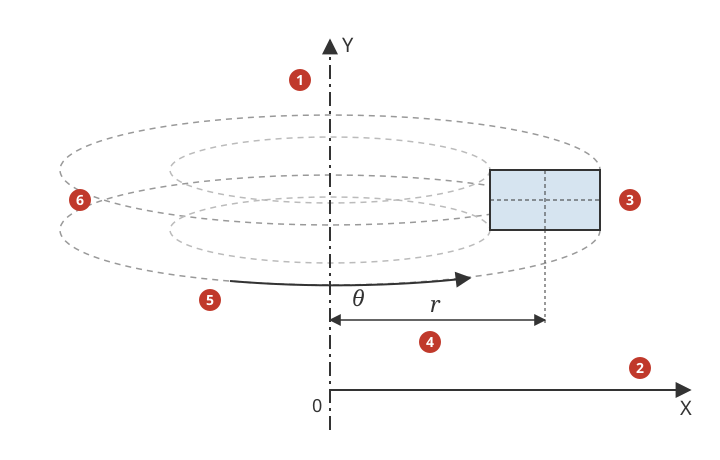
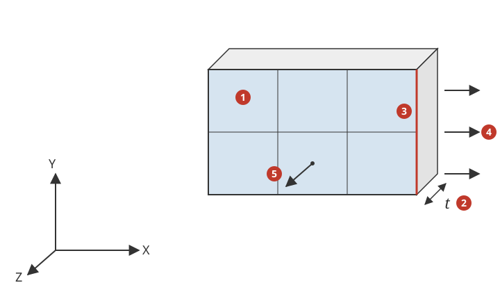
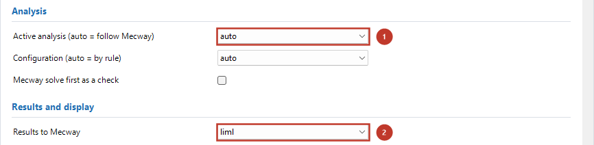

# 2D and axisymmetric analyses

*Nederlandse versie: [2D_en_axisymmetrisch.md](../2D_en_axisymmetrisch.md)*

The bridge translates Mecway's static and dynamic 2D analysis types to Code-Aster
`MECA_STATIQUE` or `DYNA_NON_LINE` with plane elements (U3.13.01 "Modélisations AXIS,
D_PLAN, C_PLAN"):

| Mecway analysis | Mecway material | Code-Aster | Result in Mecway |
|---|---|---|---|
| Static 2D (S20) | *Shell/membrane* with a thickness | `C_PLAN` (plane stress) | displacement X, Y; stress (σ_zz = 0); von Mises; reactions for the thickness t |
| Static 2D (S20) | *Shell/membrane* with a thickness and *plane strain* | `D_PLAN` (plane strain) | as above, σ_zz = ν(σ_xx + σ_yy) |
| Static Axisymmetric (SA0) | no geometry (isotropic material) | `AXIS` | displacement X (radial), Y (axial); stress with `stresszz` = hoop stress; reactions for 360 degrees |
| Dynamic Response 2D (D20), Dynamic Response Axisymmetric (DA0) | as S20 / SA0 | as S20 / SA0, in time (§2.4) | as S20 / SA0 per output time, plus velocity and acceleration |
| Acoustic Resonance 2D (A20) | *Speed of sound* (a thickness does not count) | `PHENOMENE='ACOUSTIQUE'`, `PLAN` (§4) | per mode the frequency and the pressure field `pressure`, as A30 |

The bridge analysis is `lin_static_3d` ("Static") for S20 and SA0 and `dyna_impl_3d`
("Dynamic (implicit)") for D20 and DA0: with "Active analysis (auto = follow Mecway)" =
`auto` the bridge chooses it. General operation of the bridge:
[`UserGuide.md`](UserGuide.md). Acoustic Resonance 2D (A20) goes to the acoustic cavity modes `acoustic_modes_3d` (§4). Mecway has no thermal 2D type: a thermal model in a plane is made of
shells ([`Thermal.md`](Thermal.md)).



1. Mecway's Y axis: the axis of symmetry (SA0, Code-Aster `AXIS`).
2. Mecway's X axis: the radius r; all nodes at X ≥ 0.
3. The plane elements in the XY plane: a cross-section of the body.
4. Radius r of a point: Code-Aster integrates per radian (r dθ), the bridge multiplies forces and reactions by 2π.
5. Hoop direction θ: `stresszz` is the hoop stress σ_θ.
6. The ring that the elements represent (360 degrees): Mecway's forces and reactions are for this whole ring.



1. The plane elements in the XY plane (Z = 0).
2. Thickness t: the *Shell/membrane* thickness of the material (S20); Mecway's forces and reactions are for the whole t, Code-Aster computes per unit thickness.
3. An edge of the plane elements (faceid 1..4): pressure, traction and an edge force act on such an edge (edge cells `SEG2`/`SEG3`).
4. A load on the edge, in the XY plane.
5. σ_zz, normal to the plane: 0 in plane stress (`C_PLAN`), ν(σ_xx + σ_yy) in plane strain (`D_PLAN`).

## 1. Step-by-step workflow

**Two input routes.** Mecway's own 2D types (route B) are linear. For plasticity, large
deformations, load steps and contact the model is a 3D model of plane elements (*Nonlinear
Static*) plus one line that tells the bridge to compute it in 2D (route A). Pick the route
from what you want to compute:

| What you want | Route | Mecway analysis type | Material / elements | Extra line in the custom model definition | Section |
|---|---|---|---|---|---|
| Linear static, also with a temperature (thermal stress) | B | *Static 2D* (S20) or *Static Axisymmetric* (SA0) | plane elements; S20: *Shell/membrane* with a thickness | none | §1.1 … §1.3, §2.5 |
| Linear dynamics in time | B | *Dynamic Response 2D* (D20) or *Axisymmetric* (DA0) | as S20 / SA0 | none | §1.1, §2.4 |
| Acoustic cavity modes in 2D | – | *Acoustic Resonance 2D* (A20) | plane elements | none | §4 |
| Plasticity, large deformations, time steps, load tables | A | *Nonlinear Static* (L30), solver CCX | plane shell elements with *Shell/membrane* thickness | `**ASTER-PLANE C_PLAN`, `D_PLAN` or `AXIS` | §1.4 |
| Contact (shrink fit, parts touching) | A | *Nonlinear Static* (L30), solver CCX | as above, *Contact* between edges | `**ASTER-PLANE ...` | §1.4 (item 6) |
| Linear static as a 3D model (e.g. to compare with shells) | A | *Static 3D* (S30) | as above | `**ASTER-PLANE C_PLAN` (verified; `D_PLAN`/`AXIS` follow the same route) | §1.4 |
| Heat transfer in 2D or axisymmetric, axisymmetric shells | – | – | – | not yet | §3 |
| Nonlinear dynamics, modes, buckling in 2D | – | – | – | not possible | §3 |

Route B needs no extra line and Mecway solves the same model itself; route A uses
Mecway's 3D analysis types, so Mecway keeps their time steps, plasticity and contact, and the
line `**ASTER-PLANE` switches the bridge from shells to `C_PLAN` (plane stress), `D_PLAN`
(plane strain) or `AXIS` (axisymmetric). Do not mix them: the line in an S20/SA0 model is an
ERROR (§1.6). Worked examples of both routes: §1.5.

### 1.1 In Mecway: the model

1. **Analysis type.** *Static 2D*, *Static Axisymmetric*, *Dynamic Response 2D* or
   *Dynamic Response Axisymmetric* in the analysis settings (dynamic: *Time period*,
   *Time step size* and *Generate solution every n time steps*; no *Mode
   superposition*).
2. **Mesh.** Plane elements tri3, tri6, quad4 or quad8 in the XY plane, all nodes with
   Z = 0 (Mecway ignores Z; the bridge stops if Z ≠ 0, §3). Axisymmetric: Y is the axis
   of symmetry, X the radius, all nodes with X ≥ 0 (Mecway Ltd., 2026, §6.1.3, §7.2).
   Quadratic elements may have curved edges (midside node off the chord).
3. **Material.**
   - S20: give the material a geometry *Shell/membrane* with a **thickness** t; for
     plane strain also tick *plane strain*. Without a thickness Mecway does not solve
     and the bridge stops (§3). The whole model has one thickness and one type (plane
     stress or plane strain), otherwise the bridge stops.
   - SA0: no geometry. A thickness does not count (the bridge ignores it with a
     WARNING; Mecway's own solve gives no solution then).
   - Density for gravity, centrifugal force and dynamics.
4. **Supports.** *Fixed support*, *Pinned support* and *Displacement* along X or Y on
   nodes or on edges (face selection of edges, faceid 1..4), *Symmetry* with normal X
   or Y on edges. Axisymmetric: Mecway asks for a support in X on nodes on the axis
   (X = 0) (Mecway Ltd., 2026, §7.2); do the same for the bridge (without it NOT
   verified). One support in Y is needed against rigid motion along the axis.
5. **Loads** (all values as in Mecway, see §2.2):
   - *Pressure* and *Traction* on edges;
   - *Force* on nodes (total, equally per node) or on edges (total, uniform over the
     edge area);
   - *Gravity* in the XY plane (SA0: only along Y);
   - *Centrifugal force* about Z (S20) or about Y (SA0);
   - S20 and SA0: *Thermal stress* with *Temperature* (on nodes, edges or elements) or
     *Node temperature*, and the thermal expansion coefficient in the material (§2.5).
   Values may be a time table (dynamics). Dynamics: *Rayleigh damping* on the whole
   model. Other items stop or are skipped with an ERROR (§3, §4).

### 1.2 In the main window of the bridge



1. *Active analysis (auto = follow Mecway)*: `auto` (or `lin_static_3d`; for D20/DA0
   `dyna_impl_3d`).
2. *Results to Mecway*: `liml`.

"Active analysis (auto = follow Mecway)" `auto` (or `lin_static_3d`) and "Results to Mecway" `liml` (General page;
the route `tabel` does not scale the reactions, the bridge stops). The settings of the
Static or Dynamic (implicit) page apply as in 3D; for D20/DA0 equal to Mecway: "Time
scheme (SCHEMA_TEMPS)" `NEWMARK`, `deformation` `PETIT` and "Solver steps per Mecway
time step" = 1 (default; §2.4). The result fields `strain` and `shell_*`
give nothing in 2D;
`principal_stresses` gives `principal1..3` and `tresca` as Mecway does (eigenvalues of
the 3D tensor with σ_zz, per element node, node = average). The error estimator is not
used in 2D (INFO).

### 1.3 Viewing the results in Mecway

The results have Mecway's own names and appear under the same items as Mecway's own
S20/SA0 solution (measured: Mecway adds *displacement*, *stress*, *von Mises stress*,
*reaction force*, *principal stress* and *Tresca stress* when it opens the result):

| Mecway variable | Code-Aster | Meaning |
|---|---|---|
| `displx`, `disply`, `displmag` | `DEPL` DX, DY | X, Y (SA0: radial, axial); no `displz` (as Mecway) |
| `stressxx`, `stressyy`, `stressxy` | `SIGM_NOEU`/`SIGM_ELNO` | in-plane stresses (SA0: σ_r, σ_z, τ_rz) |
| `stresszz` | `SIGM_*` SIZZ | 0 in plane stress, ν(σ_xx + σ_yy) in plane strain, **hoop stress** in SA0 |
| `stressyz`, `stresszx` | – | 0 (as Mecway) |
| `vonmises` | `SIEQ_*` | 3D von Mises with σ_zz |
| `reactionforcex/y/mag` | `REAC_NODA` × t or × 2π | for the whole thickness (S20) or 360 degrees (SA0), as Mecway |

### 1.4 Nonlinear in 2D: a 3D model with `**ASTER-PLANE` (route A)

Mecway has no nonlinear 2D type. For plasticity, large deformations, time steps and load
ramps in 2D, make the model as a 3D model and tell the bridge to compute it in 2D:

1. **Analysis type** *Nonlinear Static* (L30), with CCX as Mecway's solver (Mecway only
   solves L30 with CCX). *Static 3D* (S30) works too (linear, as S20).
2. **Mesh**: plane shell elements tri3, tri6, quad4 or quad8 in the XY plane (Z = 0),
   nothing else; axisymmetric: Y is the axis, X ≥ 0 (as §1.1).
3. **Material**: a *Shell/membrane* geometry with a thickness (Mecway needs it for shells;
   for `C_PLAN`/`D_PLAN` it is the thickness t of §2.2, for `AXIS` it does not count),
   plasticity (*Bilinear*, *Stress-strain curve*) as in 3D.
4. **The switch**: in CCX > *Custom model definition* one line

   ```
   **ASTER-PLANE C_PLAN
   ```

   with `C_PLAN` (plane stress), `D_PLAN` (plane strain) or `AXIS` (axisymmetric);
   `#ASTER-PLANE` in an OpenRadioss field and `$ASTER-PLANE` in a Mystran field work too,
   `-VLAK` is the Dutch spelling ([`ASTER_lines_examples.md`](ASTER_lines_examples.md) §2).
   Mecway's own solver ignores the line; the bridge then computes every elset with that
   modelisation instead of as shells (a *plane strain* tick on the material does not
   count then).
5. **Supports and loads** as in §1.1, on nodes and edges; a *Node rotation*, a zero
   *Displacement* along Z and a *Symmetry* with normal Z (for Mecway's own shell solve)
   are left out with an INFO. *Thermal
   stress* with *Temperature* and *Node temperature* as in §2.5, also as a time table.
6. **Contact** (L30 only): a *Contact* (unilateral) between two
   face selections of edges of the plane elements; the bridge writes them as edge cells
   (`SEG2`/`SEG3`) for `DEFI_CONTACT` with the settings of the Nonlinear static page, as in
   3D. Overlapping geometry (a shrink fit) is resolved in the first step. The result
   `contactpressure` is a pressure (no factor t or 2π). Verified frictionless in `AXIS` and
   `D_PLAN` (`C_PLAN` runs, checked only with ν = 0); friction NOT verified: with slave nodes
   held along the contact edge it stops with a singular matrix; leave those nodes out with a
   node selection and `**ASTER-ZONE SANS_GROUP_NO='<<selection>>'` (KNOWN_BUGS 141). *Bonded* contact in 2D: ERROR.
   Whether Mecway's window lets you pick shell edges for a contact is NOT verified.

The bridge analysis is `nonlin_static_3d` (L30) or `lin_static_3d` (S30); the settings of
the Nonlinear static page apply as in 3D. *deformation* `GROT_GDEP` (the default) becomes
`GDEF_LOG` for plastic material (`SIMO_MIEHE` if chosen, only in `D_PLAN`/`AXIS`) and
`GREEN_LAGRANGE` for elastic material; a pressure is then a follower load as in 3D. The
plasticity laws of the bridge support `C_PLAN` natively (Code-Aster 17.4 catalogue). Results
per step as in §1.3, plus `plasticstrainxx/yy/zz/xy` and `equivalentplasticstrain`; the
reaction forces with the factor t or 2π in every step (PL-30, PL-32). Verification PL-30 … PL-36: a thick
cylinder with perfect plasticity (Hill) in `D_PLAN` and `AXIS`, first yield at a hole in
`C_PLAN`, Code-Aster test case ssnp159b (`AXIS`, `GDEF_LOG`) through the bridge. NOT
included: the failure loop (`#ASTER-BEZWIJKEN`, WARNING), bonded contact, thermal analyses
(S44d). Contact: PL-40 and PL-41 (a shrink fit, contact pressure within 0.01% of
Lamé). Opening such a result in the Mecway window is NOT verified (a test in the Mecway
GUI still to do).

### 1.5 Worked examples

The three models are in the repository (`TestFiles/Verificatie/modellen/`, generated by
`tests_vlak_2d_thermisch.py`, `tests_vlak_2d_nonlin.py` and `tests_vlak_2d_contact.py`);
open one in Mecway to see every setting. Units SI, steel E = 210 GPa, ν = 0.3. For `AXIS`
the axes are those of the first figure: Y the axis of symmetry, X the radius. Route A was
checked with the bridge (results against closed forms), not yet in Mecway's window: whether
Mecway lets you pick shell edges for a *Contact* and how it shows a route-A result is NOT
verified; Mecway's own solve of examples 2 and 3 is not needed.

**Example 1 – route B: a thick tube with a radial temperature (`PL-24.liml`).**

1. Analysis type *Static Axisymmetric* (SA0).
2. Mesh: a rectangle X = 0.1 … 0.2 m (inner and outer radius), Y = 0 … 0.01 m (a slice
   of the tube), 8 × 1 quad8.
3. Material: isotropic, *Thermal expansion* 1.2e-5 1/K; no geometry (SA0).
4. Supports: *Displacement* along Y = 0 on the bottom edge and on the top edge (both
   ends held axially = a long tube in plane strain).
5. Loads: *Thermal stress* with reference temperature 293 K and a *Node temperature* per
   node (here a logarithmic profile from 393 K inside to 293 K outside; it can also come
   from a thermal solution of a 3D model, [`Thermal.md`](Thermal.md)).
6. Bridge: "Active analysis" `auto` (→ `lin_static_3d`), "Results to Mecway" `liml`. The
   log shows `INFO: Elset 'Buis' -> MODELISATION='AXIS' (Mecway SA0).` and the
   temperatures.
7. Results: `stresszz` = hoop stress σ_θ (−220 MPa at the inner wall, +140 MPa at the
   outer wall), `stressyy` = axial σ_z, `stressxx` = radial σ_r; `displx` = radial
   displacement. A tube with free ends: §2.5 (an `#ASTER` line `LIAISON_UNIF`,
   `PL-25.liml`).

**Example 2 – route A: an elastic-plastic cylinder under internal pressure (`PL-31.liml`).**

1. Analysis settings: *Nonlinear Static* (L30), solver CCX, *Time period* 1 s, *Time step
   size* 0.05 s.
2. Mesh: the same rectangle X = 0.1 … 0.2 m, Y = 0 … 0.01 m, 16 × 1 quad8, as
   **shell** elements (Mecway's quad8 in a 3D type).
3. Material: *Shell/membrane* with a thickness (any value; it does not count for `AXIS`),
   isotropic, plasticity *Bilinear isotropic* with yield strength 250 MPa and tangent
   modulus 0.
4. Supports: *Displacement* along Y = 0 on the bottom and top edges.
5. Load: *Pressure* on the inner edge (X = 0.1 m) as a time table: 0 at 0 s, 159.1 MPa at
   0.5 s, 187.6 MPa at 1 s.
6. The switch: with solver CCX the outline tree has a branch CCX; in CCX > *Custom model
   definition* one line (with another solver: the custom field of that solver, with its
   comment prefix, [`ASTER_lines_examples.md`](ASTER_lines_examples.md) §1):

   ```
   **ASTER-PLANE AXIS
   ```

7. Bridge: `auto` (→ `nonlin_static_3d`). The log shows `INFO: Elset '…' -> MODELISATION=
   'AXIS' (Mecway L30)` and that the shell thickness does not count.
8. Results per step: `equivalentplasticstrain` (plastic zone up to r ≈ 0.13 m at 0.5 s and
   0.16 m at 1 s), `displx` of the outer wall (0.163 mm at 1 s, 1.7% above Hill's 0.160 mm:
   the pressure follows the deformed wall), `stresszz` = hoop stress.

**Example 3 – route A: a shrink fit with contact (`PL-40.liml`).**

1. As example 2, but two parts: an inner ring X = 0.1 … 0.15005 m and an outer ring X =
   0.15 … 0.2 m (they overlap by 0.05 mm), elastic, *Time period* 1 s in one step.
2. Mesh 8 × 1 quad8 per ring. Face selections of edges: the outer edge of the inner ring
   (slave) and the inner edge of the outer ring (master); a *Contact* type unilateral
   elastic between them, friction 0, normal stiffness 1000 GPa/m (Mecway requires a
   value; with the default contact algorithm `STANDARD` the bridge does not use it).
3. *Displacement* along Y = 0 on the bottom and top edges of both rings; `**ASTER-PLANE AXIS`.
4. Result: the mean `contactpressure` on the slave edge 12.46 MPa (Lamé: 12.46 MPa); the
   overlap is resolved in the first step.

### 1.6 Common mistakes

| What went wrong | Message of the bridge | Solution |
|---|---|---|
| Mesh not in the XY plane | ERROR: A 2D analysis (…) needs all nodes in the XY plane (Z = 0) … | move or rotate the mesh to Z = 0 |
| Nodes at X < 0 in an axisymmetric model | ERROR: Axisymmetric (SA0): all nodes must have X >= 0 … (also in route A) | Y is the axis, X the radius (first figure) |
| The axis drawn along X (all X ≥ 0) | none: the bridge takes Y as the axis | draw the cross-section with Y as the axis |
| Beams, trusses or solids in the model | ERROR: Elset '…' contains line2 …; in a 2D analysis … | only plane elements; or compute in 3D |
| `**ASTER-PLANE` in an S20/SA0 model | ERROR: '#ASTER-PLANE …' only works in Mecway's Static 3D (S30) and Nonlinear Static (L30) … (already a 2D type: remove the line) | route B needs no line; remove it |
| `**ASTER-PLANE` in another 3D type (T30, V30, D30, …) | the same ERROR | S30 or L30; thermal 2D is not yet possible |
| `**ASTER-PLANE` with another value or none | ERROR: '#ASTER-PLANE …': expected C_PLAN, D_PLAN or AXIS. | write C_PLAN, D_PLAN or AXIS |
| Two `**ASTER-PLANE` lines with different values | WARNING: Several #ASTER-PLANE lines; the last one counts (…). | keep one line |
| *Plane strain* ticked on the material with `**ASTER-PLANE C_PLAN` | WARNING: Material '…' has plane strain, but #ASTER-PLANE says C_PLAN; the bridge follows the line. | the line decides; remove the tick or write D_PLAN |
| `#ASTER PLANE AXIS` (space instead of hyphen) | ERROR: '#ASTER PLANE AXIS' is Code-Aster code and is skipped; meant is '#ASTER-PLANE AXIS' | write `**ASTER-PLANE AXIS` |
| `#ASTER-PLANE` typed in the CCX field | none from the bridge (it accepts `#`, `**`, `$`); Mecway's own CCX solve may stumble over the `#` line | use `**` in the CCX field, `#` in the OpenRadioss field |
| Route A with `C_PLAN`/`D_PLAN` but no shell thickness | ERROR: Elset '…': #ASTER-PLANE C_PLAN needs a thickness … | give the material *Shell/membrane* with the thickness t |
| Plasticity in an S20/SA0 model | WARNING: Material '…' has plasticity, but S20 is linear … | route A (example 2) |
| Contact in S30 with `**ASTER-PLANE` | ERROR: Contact in a 2D analysis (S30) is not translated (yet) … | *Nonlinear Static* (L30) |
| A *Displacement* along Z or a *Node rotation* from the 3D shell model | INFO (route A, left out); ERROR in S20/SA0 | nothing to do in route A |

## 2. How the bridge translates

### 2.1 Elements and mesh

The bridge writes the plane elements as `TRIA3`/`TRIA6`/`QUAD4`/`QUAD8` cells with
`COOR_3D` and Z = 0; Code-Aster reads such a mesh as 2D (measured, no alarm). Each
component gets `MODELISATION='C_PLAN'`, `'D_PLAN'` or `'AXIS'`; edges with a pressure
or an edge load become `SEG2`/`SEG3` cells with the same modelisation (pressure edges
oriented outwards with `MODI_MAILLAGE ORIE_PEAU`). Measured against Mecway's own
solution (headless): tri3, tri6, quad4 and quad8 give the same displacements (≤ 1e-11
relative); Mecway's quad4 in 2D has no incompatible modes (unlike hex8, KB1).

### 2.2 Thickness and 360 degrees

Code-Aster computes `C_PLAN`/`D_PLAN` per unit thickness (there is no thickness in
`AFFE_CARA_ELEM`; measured: the reaction of a pressure on an edge of 20 mm is p × 0.02 m
× 1 m) and `AXIS` per radian (U4.44.01 §3.5: forces "brought back to a sector of 1
radian"). Mecway gives forces and reactions for the whole thickness t (also in plane
strain) and for 360 degrees (measured). The bridge therefore:

| Mecway | Code-Aster | Factor |
|---|---|---|
| force on nodes (N, total) | `FORCE_NODALE` | / t (S20) or / 2π (SA0) |
| force on edges (N, total) | `FORCE_CONTOUR` = F / A | A = L·t (S20) or 2π∫r dl (SA0) |
| pressure, traction (Pa) | `PRES_REP`, `FORCE_CONTOUR` | none |
| gravity, centrifugal force | `PESANTEUR`, `ROTATION` | none |
| reaction forces | `REAC_NODA` | × t or × 2π |

The mass in the log (`BRIDGE_STATCHECK`) is that of the whole thickness or of 360
degrees (Code-Aster's `MASS_INER` of `AXIS` is already for 360 degrees, measured).

### 2.3 Constraints

`fixed`, `pinnedsupport`: `DDL_IMPO` DX = DY = 0; `displacement` along X or Y:
`DDL_IMPO`; `symmetry` with normal X or Y: `DDL_IMPO` DX = 0 or DY = 0. Components the
2D model does not have (DZ, rotations, FZ) are left out. A pinned support on more than
one node holds every node (WARNING); Mecway's pinned support holds the mean
displacement (in 3D, KNOWN_BUGS 134).

### 2.4 Dynamics (D20, DA0)

D20 and DA0 go through `dyna_impl_3d` (`DYNA_NON_LINE`) exactly as Mecway's 3D Dynamic
Response (D30) without *Mode superposition*: output times every n-th Mecway step, loads
as a time table, Rayleigh damping (`AMOR_RAYL`). The mass per unit thickness or per
radian matches the forces of §2.2, so no extra factor. Mecway computes linearly with
Newmark (average acceleration): with "Time scheme (SCHEMA_TEMPS)" `NEWMARK`,
`deformation` `PETIT` and one solver step per Mecway step ("Solver steps per Mecway
time step" = 1, the default) the bridge is equal to Mecway's own D20/DA0
solution (≤ 4e-8, PL-10 … PL-12). The solver step is Mecway's *Time step size*, also
with *Generate solution every n time steps* > 1: the bridge then computes n steps per
output interval and writes only the output times. With the default HHT the bridge gives
a WARNING (numerical damping).

### 2.5 Thermal stress (S20, SA0)

A *Thermal stress* with *Temperature* or *Node temperature* goes as in 3D: a nodal
temperature field (`CREA_CHAMP` `NOEU_TEMP_R`, nodes without a temperature at the
reference temperature) as command variable `AFFE_VARC` `NOM_VARC='TEMP'` with
`VALE_REF` = the reference temperature, and `ALPHA` in `ELAS` (U4.43.03). A temperature
is a strain load: no factor t or 2π (§2.2). Code-Aster interpolates the nodal
temperatures within the element.

| Model | Thermal strain | `stresszz` |
|---|---|---|
| plane stress (`C_PLAN`) | α ΔT in X, Y and through the thickness (free) | 0 |
| plane strain (`D_PLAN`) | α ΔT in all three directions, total ε_zz = 0 | ν(σ_xx + σ_yy) − E α ΔT |
| axisymmetric (`AXIS`) | α ΔT radial, axial and hoop | hoop stress σ_θ |

End condition of a tube in `AXIS`: an end edge that is held axially (*Displacement* in Y)
is plane and fixed; an end edge without a support is free but does not stay plane. A long
tube with free ends (generalised plane strain: plane ends that may move axially, axial
resultant zero) needs an end edge that stays plane: put on that edge (here the face
selection `Top`) in the custom model definition

```
#ASTER plane = AFFE_CHAR_MECA(MODELE=model, LIAISON_UNIF=_F(GROUP_MA='<<Top>>', DDL='DY'))
#ASTER-EXCIT plane
```

(`LIAISON_UNIF`: all nodes of the edge get the same DY; [`ASTER_lines_examples.md`](ASTER_lines_examples.md)).
Verification PL-20 … PL-28 ([`Verification.md`](Verification.md)): free expansion (also a
solid disc with nodes on the axis and a temperature on edges) and fully held plates
exact, a thick tube with a logarithmic temperature within 1% of Timoshenko & Goodier
(|σ_r| 1.04% too large, see there). Displacements and reactions are equal to Mecway's own
S20/SA0 solution (≤ 1e-13, Mecway 35 headless; Mecway also interpolates the node temperatures
within the element); nodal stresses differ by the extrapolation (§5).

## 3. Not possible

KNOWN_BUGS 126; planned steps in `STAPPENPLAN.md`: S16e (loads and elements in the linear
types), S44 (nonlinear, contact, thermal, axisymmetric shells). A20 (acoustics): §4.

- Beams, trusses, springs or solids in a 2D analysis (Mecway's S20 allows beams and
  trusses): ERROR, the bridge stops.
- Several thicknesses, or plane stress and plane strain in one model: ERROR.
- Moment, line pressure, hydrostatic pressure, frictionless and elastic support,
  compression only, node rotation, constraint equations, couplings, contact, point
  masses: ERROR (stop or skipped).
- Temperatures (thermal stress) in D20/DA0: ERROR (in S20/SA0 translated, §2.5). A
  *Temperature* with a time table in S20/SA0 is left out (WARNING), as in 3D Static;
  Mecway's own S20 and SA0 give no expansion with it either (measured headless).
- Displacement along an oblique direction, symmetry with an oblique normal: skipped
  (ERROR).
- S20/SA0 with another analysis than `lin_static_3d`, D20/DA0 with another than
  `dyna_impl_3d`, explicit schemes, *Mode superposition* and an initial velocity in 2D:
  ERROR. Mecway itself has no nonlinear, frequency or buckling 2D type (Mecway 34
  converts V20 to V30 and B20 to S30); nonlinear in 2D: §1.4. S20/SA0 with a plastic
  material compute elastically (WARNING).
- `**ASTER-PLANE` in another type than S30/L30, with another value than `C_PLAN`,
  `D_PLAN`, `AXIS`, or without the hyphen: ERROR. An element offset in a 2D analysis (S20,
  SA0, D20, DA0 or `**ASTER-PLANE`): ERROR.
- The error estimator (INFO) and the result route `tabel` (ERROR).

## 4. Acoustics in 2D

| Mecway | Status | Explanation |
|---|---|---|
| Acoustic Resonance 2D (A20) | Yes: cavity modes (`acoustic_modes_3d`, `MODELISATION='PLAN'`), also with impedance | [`Acoustics.md`](Acoustics.md) §3.5; equal to Mecway's own A20 solution (quads ≤ 1e-6, triangles slightly higher, KNOWN_BUGS 130); no harmonic pressure field in 2D (Mecway has no 2D input for it) |
| acoustics axisymmetric | Mecway has no such type (the analysis codes in Mecway 34: S20, SA0, D20, DA0, A20 and the 3D types) | 3D (A30) or a cross-section in 2D (A20) |

## 5. Interpretation

- Displacements and reaction forces are equal to Mecway's own S20/SA0 solution
  (≤ 1e-11 relative, verification PL-01, PL-02, PL-04 … PL-06), the histories of
  D20/DA0 within 4e-8 (PL-10 … PL-12, with the settings of §2.4).
- Nodal stresses differ from Mecway where the stress varies strongly over an element
  (e.g. 1 to 3% at the hole of PL-01 with n = 16, 2% at the inner wall of a coarse
  ring): another extrapolation from the integration points, as for solids (KB3). Where
  the stress is uniform or linear in the element they are equal.
- Pressure on curved quadratic edges: Mecway's resultant is slightly too large (quarter
  ring a = 0.1 m, t = 10 mm, 100 MPa: Mecway 100161 N instead of p·a·t = 100000 N, u_r at
  the inner wall 0.17% smaller than the bridge); the bridge is exact (KB125).

## 6. Messages and solutions

| Message | Cause | Solution |
|---|---|---|
| ERROR: Elset '…': Static 2D (S20) needs a thickness | material without *Shell/membrane* geometry | give the material a thickness (also for plane strain) |
| ERROR: The 2D analysis has elsets with different modelisation or thickness | two materials with a different thickness or type | one thickness and one type per model; or compute in 3D |
| ERROR: A 2D analysis (…) needs all nodes in the XY plane (Z = 0) | mesh not in the XY plane | move or rotate the mesh into the XY plane |
| ERROR: Axisymmetric (SA0): all nodes must have X >= 0 | part of the mesh at X < 0 | mirror the mesh to X ≥ 0 (Y = axis) |
| ERROR: Elset '…' contains line2 …; in a 2D analysis … | beams, trusses, springs or solids in the model | remove them or compute in 3D |
| ERROR: … in a 2D analysis (…) is not translated (yet) | contact, coupling, constraint equation, point mass, or a temperature in D20/DA0 | remove it or compute in 3D |
| ERROR: … on '…' in a 2D analysis: … NOT included. | load or constraint without a 2D route (§3) | replace it by a supported load (§1.1) |
| ERROR: Mecway analysis type A20 (Acoustic Resonance 2D) is only translated to the cavity modes … | another analysis chosen | choose `auto` or `acoustic_modes_3d` ([`Acoustics.md`](Acoustics.md) §3.5) |
| ERROR: Mecway analysis type D20 (2D) is only translated to dyna_impl_3d, not to … | another analysis chosen on the start screen | choose `auto` or the analysis named |
| ERROR: D20 (2D) is translated with the implicit scheme … | explicit scheme or *Mode superposition* | choose `NEWMARK` or `HHT`; switch off *Mode superposition* in Mecway |
| ERROR: A 2D analysis (…) only works with the result route 'liml' | route `tabel` chosen | choose `liml` on the General page |
| ERROR: '#ASTER-PLANE …' only works in Mecway's Static 3D (S30) and Nonlinear Static (L30) … | the switch in another analysis type | use S30 or L30 (§1.4), or remove the line |
| ERROR: '#ASTER PLANE …' is Code-Aster code and is skipped; meant is '#ASTER-PLANE …' | the switch without the hyphen | write `**ASTER-PLANE` (§1.4) |
| WARNING: Material '…' has plasticity, but S20 is linear … | plasticity in S20/SA0 | Nonlinear Static (L30) with `**ASTER-PLANE` (§1.4) |
