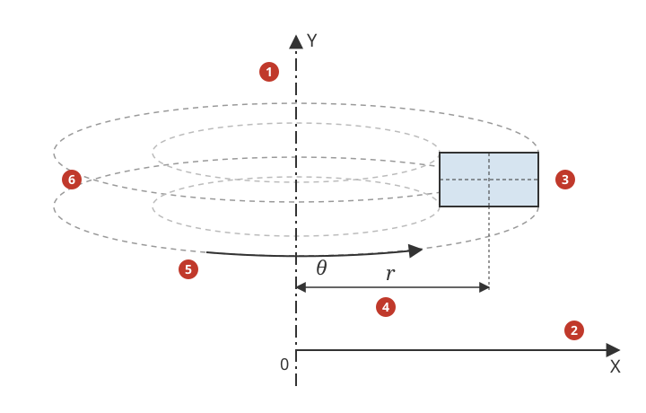
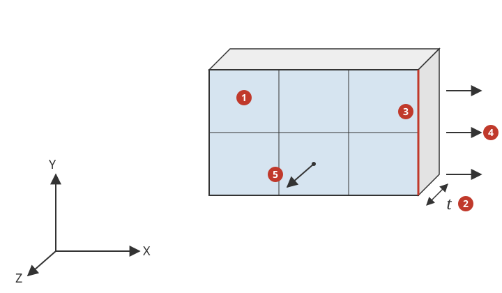
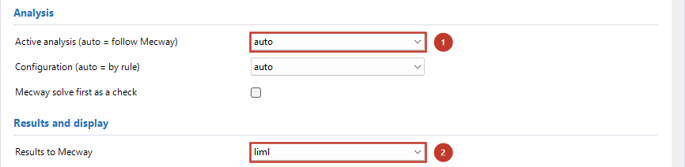

# 2D and axisymmetric analyses

*Nederlandse versie: [2D_en_axisymmetrisch.md](../2D_en_axisymmetrisch.md)*

The bridge translates Mecway's static and dynamic 2D analysis types to Code-Aster
`MECA_STATIQUE` or `DYNA_NON_LINE` with plane elements (U3.13.01 "Modélisations AXIS,
D_PLAN, C_PLAN"):

| Mecway analysis | Mecway material | Code-Aster | Result in Mecway |
|---|---|---|---|
| Static 2D (S20) | *Shell/membrane* with a thickness | `C_PLAN` (plane stress) | displacement X, Y; stress (σ_zz = 0); von Mises; reactions for the thickness t |
| Static 2D (S20) | *Shell/membrane* with a thickness and *plane strain* | `D_PLAN` (plane strain) | as above, σ_zz = ν(σ_xx + σ_yy) |
| Static Axisymmetric (SA0) | no geometry (isotropic material) | `AXIS` | displacement X (radial), Y (axial); stress with `stresszz` = hoop stress; reactions for 360 degrees |
| Dynamic Response 2D (D20), Dynamic Response Axisymmetric (DA0) | as S20 / SA0 | as S20 / SA0, in time (§2.4) | as S20 / SA0 per output time, plus velocity and acceleration |
| Acoustic Resonance 2D (A20) | *Speed of sound* (a thickness does not count) | `PHENOMENE='ACOUSTIQUE'`, `PLAN` (§4) | per mode the frequency and the pressure field `pressure`, as A30 |

The bridge analysis is `lin_static_3d` ("Static") for S20 and SA0 and `dyna_impl_3d`
("Dynamic (implicit)") for D20 and DA0: with "Active analysis (auto = follow Mecway)" =
`auto` the bridge chooses it. General operation of the bridge:
[`UserGuide.md`](UserGuide.md). Acoustic Resonance 2D (A20) goes to the acoustic cavity modes `acoustic_modes_3d` (§4). Mecway has no thermal 2D type: a thermal model in a plane is made of
shells ([`Thermal.md`](Thermal.md)).

1. Mecway's Y axis: the axis of symmetry (SA0, Code-Aster `AXIS`).
2. Mecway's X axis: the radius r; all nodes at X ≥ 0.
3. The plane elements in the XY plane: a cross-section of the body.
4. Radius r of a point: Code-Aster integrates per radian (r dθ), the bridge multiplies forces and reactions by 2π.
5. Hoop direction θ: `stresszz` is the hoop stress σ_θ.
6. The ring that the elements represent (360 degrees): Mecway's forces and reactions are for this whole ring.

1. The plane elements in the XY plane (Z = 0).
2. Thickness t: the *Shell/membrane* thickness of the material (S20); Mecway's forces and reactions are for the whole t, Code-Aster computes per unit thickness.
3. An edge of the plane elements (faceid 1..4): pressure, traction and an edge force act on such an edge (edge cells `SEG2`/`SEG3`).
4. A load on the edge, in the XY plane.
5. σ_zz, normal to the plane: 0 in plane stress (`C_PLAN`), ν(σ_xx + σ_yy) in plane strain (`D_PLAN`).

## 1. Step-by-step workflow

### 1.1 In Mecway: the model

1. **Analysis type.** *Static 2D*, *Static Axisymmetric*, *Dynamic Response 2D* or
   *Dynamic Response Axisymmetric* in the analysis settings (dynamic: *Time period*,
   *Time step size* and *Generate solution every n time steps*; no *Mode
   superposition*).
2. **Mesh.** Plane elements tri3, tri6, quad4 or quad8 in the XY plane, all nodes with
   Z = 0 (Mecway ignores Z; the bridge stops if Z ≠ 0, §3). Axisymmetric: Y is the axis
   of symmetry, X the radius, all nodes with X ≥ 0 (Mecway Ltd., 2026, §6.1.3, §7.2).
   Quadratic elements may have curved edges (midside node off the chord).
3. **Material.**
   - S20: give the material a geometry *Shell/membrane* with a **thickness** t; for
     plane strain also tick *plane strain*. Without a thickness Mecway does not solve
     and the bridge stops (§3). The whole model has one thickness and one type (plane
     stress or plane strain), otherwise the bridge stops.
   - SA0: no geometry. A thickness does not count (the bridge ignores it with a
     WARNING; Mecway's own solve gives no solution then).
   - Density for gravity, centrifugal force and dynamics.
4. **Supports.** *Fixed support*, *Pinned support* and *Displacement* along X or Y on
   nodes or on edges (face selection of edges, faceid 1..4), *Symmetry* with normal X
   or Y on edges. Axisymmetric: Mecway asks for a support in X on nodes on the axis
   (X = 0) (Mecway Ltd., 2026, §7.2); do the same for the bridge (without it NOT
   verified). One support in Y is needed against rigid motion along the axis.
5. **Loads** (all values as in Mecway, see §2.2):
   - *Pressure* and *Traction* on edges;
   - *Force* on nodes (total, equally per node) or on edges (total, uniform over the
     edge area);
   - *Gravity* in the XY plane (SA0: only along Y);
   - *Centrifugal force* about Z (S20) or about Y (SA0).
   Values may be a time table (dynamics). Dynamics: *Rayleigh damping* on the whole
   model. Other items stop or are skipped with an ERROR (§3, §4).

### 1.2 In the main window of the bridge

1. *Active analysis (auto = follow Mecway)*: `auto` (or `lin_static_3d`; for D20/DA0
   `dyna_impl_3d`).
2. *Results to Mecway*: `liml`.

"Active analysis (auto = follow Mecway)" `auto` (or `lin_static_3d`) and "Results to Mecway" `liml` (General page;
the route `tabel` does not scale the reactions, the bridge stops). The settings of the
Static or Dynamic (implicit) page apply as in 3D; for D20/DA0 equal to Mecway: "Time
scheme (SCHEMA_TEMPS)" `NEWMARK`, `deformation` `PETIT` and "Solver steps per output
interval" = Mecway's *every n time steps* (§2.4). The result fields `strain` and `shell_*`
give nothing in 2D;
`principal_stresses` gives `principal1..3` and `tresca` as Mecway does (eigenvalues of
the 3D tensor with σ_zz, per element node, node = average). The error estimator is not
used in 2D (INFO).

### 1.3 Viewing the results in Mecway

The results have Mecway's own names and appear under the same items as Mecway's own
S20/SA0 solution (measured: Mecway adds *displacement*, *stress*, *von Mises stress*,
*reaction force*, *principal stress* and *Tresca stress* when it opens the result):

| Mecway variable | Code-Aster | Meaning |
|---|---|---|
| `displx`, `disply`, `displmag` | `DEPL` DX, DY | X, Y (SA0: radial, axial); no `displz` (as Mecway) |
| `stressxx`, `stressyy`, `stressxy` | `SIGM_NOEU`/`SIGM_ELNO` | in-plane stresses (SA0: σ_r, σ_z, τ_rz) |
| `stresszz` | `SIGM_*` SIZZ | 0 in plane stress, ν(σ_xx + σ_yy) in plane strain, **hoop stress** in SA0 |
| `stressyz`, `stresszx` | – | 0 (as Mecway) |
| `vonmises` | `SIEQ_*` | 3D von Mises with σ_zz |
| `reactionforcex/y/mag` | `REAC_NODA` × t or × 2π | for the whole thickness (S20) or 360 degrees (SA0), as Mecway |

## 2. How the bridge translates

### 2.1 Elements and mesh

The bridge writes the plane elements as `TRIA3`/`TRIA6`/`QUAD4`/`QUAD8` cells with
`COOR_3D` and Z = 0; Code-Aster reads such a mesh as 2D (measured, no alarm). Each
component gets `MODELISATION='C_PLAN'`, `'D_PLAN'` or `'AXIS'`; edges with a pressure
or an edge load become `SEG2`/`SEG3` cells with the same modelisation (pressure edges
oriented outwards with `MODI_MAILLAGE ORIE_PEAU`). Measured against Mecway's own
solution (headless): tri3, tri6, quad4 and quad8 give the same displacements (≤ 1e-11
relative); Mecway's quad4 in 2D has no incompatible modes (unlike hex8, KB1).

### 2.2 Thickness and 360 degrees

Code-Aster computes `C_PLAN`/`D_PLAN` per unit thickness (there is no thickness in
`AFFE_CARA_ELEM`; measured: the reaction of a pressure on an edge of 20 mm is p × 0.02 m
× 1 m) and `AXIS` per radian (U4.44.01 §3.5: forces "brought back to a sector of 1
radian"). Mecway gives forces and reactions for the whole thickness t (also in plane
strain) and for 360 degrees (measured). The bridge therefore:

| Mecway | Code-Aster | Factor |
|---|---|---|
| force on nodes (N, total) | `FORCE_NODALE` | / t (S20) or / 2π (SA0) |
| force on edges (N, total) | `FORCE_CONTOUR` = F / A | A = L·t (S20) or 2π∫r dl (SA0) |
| pressure, traction (Pa) | `PRES_REP`, `FORCE_CONTOUR` | none |
| gravity, centrifugal force | `PESANTEUR`, `ROTATION` | none |
| reaction forces | `REAC_NODA` | × t or × 2π |

The mass in the log (`BRIDGE_STATCHECK`) is that of the whole thickness or of 360
degrees (Code-Aster's `MASS_INER` of `AXIS` is already for 360 degrees, measured).

### 2.3 Constraints

`fixed`, `pinnedsupport`: `DDL_IMPO` DX = DY = 0; `displacement` along X or Y:
`DDL_IMPO`; `symmetry` with normal X or Y: `DDL_IMPO` DX = 0 or DY = 0. Components the
2D model does not have (DZ, rotations, FZ) are left out.

### 2.4 Dynamics (D20, DA0)

D20 and DA0 go through `dyna_impl_3d` (`DYNA_NON_LINE`) exactly as Mecway's 3D Dynamic
Response (D30) without *Mode superposition*: output times every n-th Mecway step, loads
as a time table, Rayleigh damping (`AMOR_RAYL`). The mass per unit thickness or per
radian matches the forces of §2.2, so no extra factor. Mecway computes linearly with
Newmark (average acceleration): with "Time scheme (SCHEMA_TEMPS)" `NEWMARK`,
`deformation` `PETIT` and one solver step per Mecway step ("Solver steps per output
interval" = n of *every n time steps*) the bridge is equal to Mecway's own D20/DA0
solution (≤ 4e-8, PL-10 … PL-12). With the default (HHT, one step per output interval)
the bridge gives a WARNING and computes with larger steps (KB127).

## 3. Not possible

KNOWN_BUGS 126; planned step in `STAPPENPLAN.md`: S16e. A20 (acoustics): §4.

- Beams, trusses, springs or solids in a 2D analysis (Mecway's S20 allows beams and
  trusses): ERROR, the bridge stops.
- Several thicknesses, or plane stress and plane strain in one model: ERROR.
- Moment, line pressure, hydrostatic pressure, frictionless and elastic support,
  compression only, node rotation, constraint equations, couplings, contact, point
  masses, temperatures (thermal stress): ERROR (stop or skipped).
- Displacement along an oblique direction, symmetry with an oblique normal: skipped
  (ERROR).
- S20/SA0 with another analysis than `lin_static_3d`, D20/DA0 with another than
  `dyna_impl_3d`, explicit schemes, *Mode superposition* and an initial velocity in 2D:
  ERROR. Mecway itself has no nonlinear, frequency or buckling 2D type (Mecway 34
  converts V20 to V30 and B20 to S30).
- The error estimator (INFO) and the result route `tabel` (ERROR).

## 4. Acoustics in 2D

| Mecway | Status | Explanation |
|---|---|---|
| Acoustic Resonance 2D (A20) | Yes: cavity modes (`acoustic_modes_3d`, `MODELISATION='PLAN'`), also with impedance | [`Acoustics.md`](Acoustics.md) §3.5; equal to Mecway's own A20 solution (quads ≤ 1e-6, triangles slightly higher, KNOWN_BUGS 130); no harmonic pressure field in 2D |
| acoustics axisymmetric | Mecway has no such type (the analysis codes in Mecway 34: S20, SA0, D20, DA0, A20 and the 3D types) | 3D (A30) or a cross-section in 2D (A20) |

## 5. Interpretation

- Displacements and reaction forces are equal to Mecway's own S20/SA0 solution
  (≤ 1e-11 relative, verification PL-01, PL-02, PL-04 … PL-06), the histories of
  D20/DA0 within 4e-8 (PL-10 … PL-12, with the settings of §2.4).
- Nodal stresses differ from Mecway where the stress varies strongly over an element
  (e.g. 1 to 3% at the hole of PL-01 with n = 16, 2% at the inner wall of a coarse
  ring): another extrapolation from the integration points, as for solids (KB3). Where
  the stress is uniform or linear in the element they are equal.
- Pressure on curved quadratic edges: Mecway's resultant is slightly too large (quarter
  ring a = 0.1 m, t = 10 mm, 100 MPa: Mecway 100161 N instead of p·a·t = 100000 N, u_r at
  the inner wall 0.17% smaller than the bridge); the bridge is exact (KB125).

## 6. Messages and solutions

| Message | Cause | Solution |
|---|---|---|
| ERROR: Elset '…': Static 2D (S20) needs a thickness | material without *Shell/membrane* geometry | give the material a thickness (also for plane strain) |
| ERROR: The 2D analysis has elsets with different modelisation or thickness | two materials with a different thickness or type | one thickness and one type per model; or compute in 3D |
| ERROR: A 2D analysis (…) needs all nodes in the XY plane (Z = 0) | mesh not in the XY plane | move or rotate the mesh into the XY plane |
| ERROR: Axisymmetric (SA0): all nodes must have X >= 0 | part of the mesh at X < 0 | mirror the mesh to X ≥ 0 (Y = axis) |
| ERROR: Elset '…' contains line2 …; in a 2D analysis … | beams, trusses, springs or solids in the model | remove them or compute in 3D |
| ERROR: … in a 2D analysis (…) is not translated (yet) | contact, coupling, constraint equation, point mass or temperature | remove it or compute in 3D |
| ERROR: … on '…' in a 2D analysis: … NOT included. | load or constraint without a 2D route (§3) | replace it by a supported load (§1.1) |
| ERROR: Mecway analysis type A20 (Acoustic Resonance 2D) is only translated to the cavity modes … | another analysis chosen | choose `auto` or `acoustic_modes_3d` ([`Acoustics.md`](Acoustics.md) §3.5) |
| ERROR: Mecway analysis type D20 (2D) is only translated to dyna_impl_3d, not to … | another analysis chosen on the start screen | choose `auto` or the analysis named |
| ERROR: D20 (2D) is translated with the implicit scheme … | explicit scheme or *Mode superposition* | choose `NEWMARK` or `HHT`; switch off *Mode superposition* in Mecway |
| ERROR: A 2D analysis (…) only works with the result route 'liml' | route `tabel` chosen | choose `liml` on the General page |
