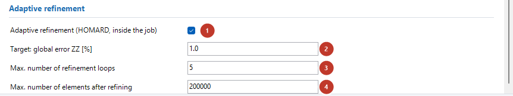
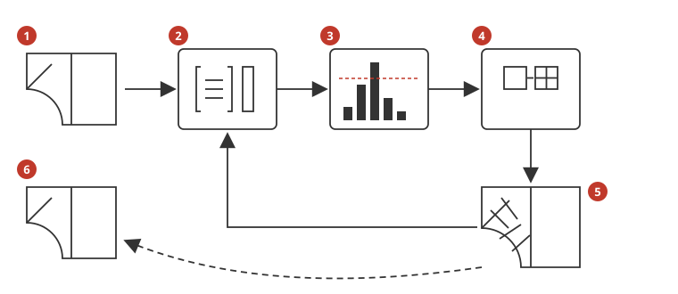
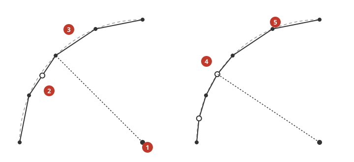

# Error estimator (discretisation error per element)

*Nederlandse versie: [Foutschatter.md](../Foutschatter.md)*

For a linear static analysis (Mecway *Static*, S30; bridge analysis
`lin_static_3d`) the bridge uses Code-Aster `CALC_ERREUR` to estimate the
discretisation error of the mesh: per element, per node and for the whole model. This
shows where the mesh is too coarse and where refining pays off most.

| What | Where you see it |
|---|---|
| estimated error per element (absolute) | field `errorestimate` in Mecway, per element (contour *per element*) and per node (averaged) |
| estimated error per element, relative (%) | field `errorestimaterel` |
| global relative error (%) of the whole model | log and status box after the run |

The estimator is Code-Aster's **residual estimator** (`ERME`): per element it measures
how badly the computed stresses satisfy equilibrium (inside the element, as a jump
between neighbouring elements and against the load on the boundary). Only **solid
elements** get an estimate. General working of the bridge:
[`UserGuide.md`](UserGuide.md).

## 1. Step-by-step workflow

### 1.1 In Mecway: the model

1. **Analysis type** *Static* (S30). For other analyses the bridge does no error
   estimation (§3.3).
2. **Solid elements** (hex8, hex20, tet4, tet10, wedge, pyramid). Shells, beams and
   springs in the same model are computed as usual but get no estimate.
3. **Constraints and loads** as always. Faces without a constraint or load are free
   (traction-free) boundaries for the estimator; the bridge finds them itself (§2.2).
   No extra selections are needed.

### 1.2 In the bridge main window

1. **Results to Mecway** = `liml` (General tab, default). With `tabel` only the
   global error is in the log, not the field.
2. Page (tab) **Static**, heading *Checks*:

| Setting (label) | Key | Default | When to change |
|---|---|---|---|
| Error estimator (CALC_ERREUR, solids only) | `error_estimator` | on | off when every second counts or the extra fields in the `.liml` (four variables) get too large; the estimate costs only element computations, no extra solution of the system |

For a single model you can also use an `#ASTER-OPTIE` line in Mecway's custom input
(`#ASTER-OPTIE error_estimator = no`, see
[`ASTER_lines_examples.md`](ASTER_lines_examples.md)).

**Why on by default:** the estimate uses the displacements already computed (only
element computations, no second solution of Ku = F) and always gives an impression
of the mesh quality. Measured (timing table in the `.mess`): the cantilever of FS-01
with 41,000 hex8 (46,500 nodes) spent 1.8 s of the 17.6 s of the whole job on the
estimator (`CALC_ERREUR` 0.9 s, `SIGM_ELNO` 0.4 s, model and load 0.4 s; the solution
`MECA_STATIQUE` itself 9.2 s). The estimator grows linearly with the number of
elements, the solution faster.

### 1.3 Starting and following

Click *Start*. Afterwards the log and the status box show for example:

```
Error estimator: global relative error 20.6% (residual estimator ERME; volume
part 10.7%, jumps 8.85%, boundary 2.86%). Field in Mecway: errorestimate (absolute)
and errorestimaterel (%). Above 20%: the mesh is coarse; refine where errorestimate is large.
```

(FS-01 with n = 8.) The bridge adds the last sentence only above 20%. The log also lists which loads the
estimator does not include (§2.3) and how many free faces it found.

### 1.4 Viewing the results in Mecway

- Under *Solution* choose the field `errorestimate`. With the contour display *per
  element* you see the true element value (constant per element); the nodal value is
  the average of the connected elements (`ERME_NOEU`).
- `errorestimate` is absolute (unit: stress x length^1.5, the norm over the element).
  Compare the values with each other: where they are largest, the mesh is coarsest
  relative to the stress gradient.
- `errorestimaterel` is the error of the element relative to its own stress level
  (%). It is large where the stress is small (near a neutral axis, a free end); use
  mainly `errorestimate` to decide where to refine.
- Mecway itself has no error field; the names are the bridge's own, in the same format
  as the stresses (`<nodevariable>` and `<elementnodevariable>`). Mecway shows them
  under *Solution* as `errorestimate` and `errorestimaterel`; the element value gives a
  contour that is constant per element (checked in Mecway 33, 6 Oct 2026).

### 1.5 Interpretation: what is large, what to do about it

The global relative error is 100 · η / sqrt(η² + ‖σ‖²), with η the estimated error
and ‖σ‖ the norm of the stresses over the whole model (§2.4). It is an error in the
**energy norm**, not an error in a displacement or a peak stress:

- The estimate is about **2x the true energy error** (verification FS-01: effectivity
  index 1.3 on the coarsest and 2.0 to 2.2 on the finer meshes).
- A displacement is much more accurate than the energy error (roughly its square).
  FS-01, cantilever with hex8: estimate 37.9% / 20.6% / 10.7% for a deflection that is
  3.6% / 1.0% / 0.23% smaller than the 3D limit.
- Stresses (especially peak stresses) converge more slowly than displacements.

Rule of thumb (from the verification, not a standard):

| Global relative error | Meaning |
|---|---|
| < 5% | fine mesh; displacements and smooth stresses reliable |
| 5 to 20% | usable for displacements; check the stresses that matter with a finer mesh |
| > 20% | coarse mesh (message in the status box); refine where `errorestimate` is large |

**What to do:** refine the mesh locally where `errorestimate` is largest and run
again. With linear elements the error roughly halves when the elements become half as
large (order 1); with quadratic elements (hex20, tet10, or `LINE_QUAD`) it becomes
about four times smaller (order 2). If the error stays large at one spot with every
refinement, there is a **singularity** there: a sharp re-entrant corner, a point load,
the edge of a clamped face. The stress does not converge there; judge the stress at
some distance (Saint-Venant) or round off the corner in the model.

## 2. How the bridge translates

### 2.1 Code-Aster commands

After `MECA_STATIQUE` and the usual `CALC_CHAMP` (in the `.comm` under *Foutschatter*):

```
model_err   = AFFE_MODELE(...)        # only the solid elements and their faces
fieldmat_err = AFFE_MATERIAU(...)     # same materials (and temperature field)
load_err    = AFFE_CHAR_MECA(...)     # all face and body loads in one load,
                                      # plus PRES_REP 1e-14 on the free faces
u_err   = CREA_CHAMP(... DEPL of res, only DX, DY, DZ)
res_err = CREA_RESU(... DEPL, MODELE=model_err, CHAM_MATER=fieldmat_err)
res_err = CALC_CHAMP(reuse=res_err, CONTRAINTE=('SIGM_ELNO',))
res_err = CALC_ERREUR(reuse=res_err, OPTION=('ERME_ELEM', 'ERME_ELNO', 'ERME_NOEU'),
                      EXCIT=_F(CHARGE=load_err))
```

`aster_results_export.py` writes `ERME_NOEU` (node) and `ERME_ELNO` (per element,
solid elements only) as `errorestimate` (component `ERREST`) and `errorestimaterel`
(component `NUEST`) into the `.liml`. Code-Aster prints the global error itself in the
`.mess` (block *ESTIMATEUR D'ERREUR EN RESIDU EXPLICITE*); the bridge reads that
block.

Why a separate model, load and result (all checked with Code-Aster 17.4 while
building):

- **Own model:** with beams in the model `CALC_ERREUR` stops with `<EXCEPTION>
  CALCUL_37` (*MECA_POU_D_E ne sait pas calculer l'option INIT_MAIL_VOIS*), and
  `CALC_ERREUR` has no `GROUP_MA`. The estimator's model has only the solid elements;
  the stresses must be computed on **all** of it (`SIGM_ELNO` on part of it gave alarm
  `INDICATEUR_2` and `<EXCEPTION> CALCUL_29`).
- **Own load:** the estimator accepts only one load per load type (two loads with
  `PRES_REP` gave alarm `INDICATEUR_7` "Le choix PRESS apparaît au moins dans 2
  charges" and `<EXCEPTION> INDICATEUR_8`) and does not know point loads
  (`FORCE_NODALE`: alarm `INDICATEUR_6` and `INDICATEUR_8`). The bridge therefore
  puts all loads the estimator knows into one `AFFE_CHAR_MECA` (§2.3). The solution
  itself does not use that load.
- **Own result:** with `reuse` on `res` and a different `EXCIT` Code-Aster refuses
  (`<EXCEPTION> CALCULEL_39`); without `reuse` `ERME_ELNO`/`ERME_NOEU` look for their
  source field in the old result (`UTILITAI8_13`, `CALCUL_29`/`CALCUL_17`).
  `CREA_RESU` with the displacements of `res` works without alarms.

### 2.2 Free boundaries

Code-Aster computes the boundary term of the estimator (σ·n − g, with g the load)
only on faces that carry a load. A face without a load counts as a **prescribed
displacement**: no boundary term. Source: Code-Aster test case sslv153a ("ces bords
sont consideres comme a deplacement impose par le calcul des indicateurs d'erreur")
and sslv07a ("le calcul de ERME_ELEM est faux car des bords a contrainte nulle n'ont
pas ete definis"). The bridge therefore finds all **free faces** of the solid elements
and gives them a pressure of 1e-14 Pa (group `BRERRVRIJ`, also in the model and in
`ORIE_PEAU`). A pressure of exactly 0 does not work: the boundary term then stayed the
same as without those faces (measured); sslv153a also uses 1e-14.

A free face is a face of exactly one solid element that:

- is not in a face selection used by a constraint, load, contact or coupling (those
  faces have their own load, or are constrained);
- does not have all its corner nodes in a node selection of a prescribed displacement
  (fixed, pinned, displacement, node rotation, frictionless, symmetry, compression
  only, elastic support);
- does not coincide with a shell element.

In the log: `INFO: Error estimator: n free faces of volume elements as group 'BRERRVRIJ'`.

### 2.3 Loads in the estimator

| Load in Mecway | In the estimator |
|---|---|
| surface pressure, traction, force on faces of solid elements (`PRES_REP`, `FORCE_FACE`) | yes (constant value); `FORCE_FACE` with reversed sign in the load of the estimator (see below) |
| gravity (`PESANTEUR`), centrifugal (`ROTATION`) | yes |
| force/moment on nodes (`FORCE_NODALE`), loads on shells and beams, line pressure on shell edges (`FORCE_ARETE`), hydrostatic pressure (formula) | no: a traction-free boundary for the estimator (INFO in the log). Around a point load the estimated error is then large; that is right: the stress is singular there |
| fixed, displacement, symmetry, frictionless, ... on faces | no boundary term (as Code-Aster treats a constrained boundary) |

**Sign of `FORCE_FACE`** (measured, Code-Aster 17.4): the boundary term of `ERME`
computes a `FORCE_FACE` as σ·n + g instead of σ·n − g. A block under uniform tension of
100 MPa (exact solution, hex20) gave with the traction as in the solution an estimated
error of 15% (boundary term only), with the reversed sign 0.000%; a pressure
(`PRES_REP`) gave 0.000%. The bridge therefore puts `FORCE_FACE` with the reversed sign
in the load of the estimator (`bridge_to_aster._erme_force_face`; the solution itself
does not use that load). Only the normal component counts in the boundary term ("TERME
NORMAL"): a tangential traction as in FS-01 does not change the estimate (boundary term
6.65 / 6.66 / 6.66% with FZ = +1e6 / −1e6 / 0). A U document or the source on this was
NOT consulted.

If two loads of the same type overlap on a face (e.g. two pressures on the same
face), the estimator takes only one of them (in one `AFFE_CHAR_MECA` the last
overwrites the first; WARNING in the log). The solution does add them.

### 2.4 What the numbers are

Per element (components of `ERME_ELEM`, recomputed from a run):

- `ERREST` = η_e, the estimated error of the element (→ `errorestimate`);
- `SIGCAL` = the norm of the stress over the element;
- `NUEST` = 100 · η_e / sqrt(η_e² + SIGCAL²) in % (→ `errorestimaterel`).

Global: η = sqrt(Σ η_e²), ‖σ‖ = sqrt(Σ SIGCAL²), relative error = 100 · η /
sqrt(η² + ‖σ‖²). The `.mess` splits the error into the volume part (equilibrium in the
element), the jumps between elements and the boundary term.

## 3. Particulars

### 3.1 Element types

Tested with hex8 (`3D`), hex8 with `LINE_QUAD`, hex20, and a mixed block of
hexa/penta/pyram/tetra (sslv153a, `LINE_QUAD`). A model with shells and beams next to
solids (a mixed test model, with `lin_solver_resi` 0.01: that model
also stops with `FACTOR_57` without the estimator) runs: only the solids get an
estimate. A
transition solid → shell or beam is a free boundary for the estimator (the force of
the shell or beam does not count as a load); there the estimated error is larger than
the true one. Tet4/tet10 and wedge are covered by the Code-Aster test cases (sslv153a,
sslv111f), not separately in the bridge verification.

### 3.2 Thermal stress

With a temperature load (`thermalstress`) the estimator uses the same temperature
(the material field with `AFFE_VARC`). Checked with TH-03b (bar clamped, uniformly
heated, constant stress): global error 0.000%. For an (almost) stress-free model, such
as free expansion (TH-03a), the relative error is meaningless (noise divided by
noise: 64% there with an absolute error of 7e-8). Other thermal stress cases: NOT
verified.

### 3.3 What is not possible

- **Nonlinear static, dynamics, modal, buckling:** no error estimate. Code-Aster's
  residual estimator is meant for linear elasticity (sslv07a calls it "stricto sensu
  faux" with `STAT_NON_LINE` when the boundaries are missing); with large deformations
  (`GROT_GDEP`, the default) and loads in time the estimate would need its own load
  per step. The setting does not exist there; an `#ASTER-OPTIE error_estimator` gives
  an ERROR there (unknown option).
- **Thermal** (`ERTH_ELEM`): not built.
- **Shells and beams:** no estimate (the bridge uses `ERME` on solids only).
- **Zienkiewicz-Zhu** (`ERZ1_ELEM`/`ERZ2_ELEM`) and the goal-oriented estimator
  (`QIRE_ELEM`, needs a second, dual problem) are not offered (the Code-Aster test
  cases with ZZ are mostly 2D; sslv111f uses `ERZ1_ELEM` in 3D).
- **Adaptive refinement**: with Mecway's own refinement, see §6; thermal and nonlinear with HOMARD, see §7.

## 4. Messages and solutions

The log lines are in the language of the bridge (`tr()`); the English text is shown.

| Message | Cause | Solution |
|---|---|---|
| INFO: Error estimator: loads not included (FORCE_NODALE, ...) | point loads or loads on shells/beams | normal; around those loads the estimated error is larger |
| WARNING: Error estimator: the model has no solid elements | only shells/beams | no estimate possible; switch the setting off to avoid the message |
| WARNING: Error estimator: ... on overlapping faces | two pressures/tractions on the same face | the estimator takes one; for a reliable estimate merge the loads in Mecway |
| WARNING: Error estimator: no load or free face for CALC_ERREUR | all boundaries constrained and no face load | no estimate |
| WARNING: Error estimator (error_estimator) only works for linear static | setting with another analysis | normal; no estimate |
| INFO: Error estimator: the field only goes to Mecway with result_route 'liml' | route `tabel` | set *Results to Mecway* to `liml` |
| status box: "Above 20%: the mesh is coarse" | coarse mesh | refine where `errorestimate` is large (§1.5) |

The Code-Aster messages for a `CALC_ERREUR` of your own (e.g. in `#ASTER-POST` code)
are in [`CodeAster_error_messages.md`](CodeAster_error_messages.md)
(`INDICATEUR_2/6/7/8`, `CALCULEL_39`, `RESULT1_40/65`, `CALCUL_37`).

## 5. Verification

[`Verification.md`](Verification.md) chapter Error estimator (FS):

- **FS-01** cantilever, hex8 n = 1 … 16: the global error decreases monotonically
  (79.5 / 61.1 / 37.9 / 20.6 / 10.7%); the absolute estimate η with order 0.88 / 0.96 /
  0.96 (expected 1); effectivity index 1.3 … 2.2; largest error at the clamped end.
- **FS-02** thick-walled cylinder (Lamé), hex20 n = 1 … 8: order 1.87 / 1.95 / 1.91
  (expected 2); largest error at the inner wall.
- **FS-03** Code-Aster test case sslv153a through the bridge: `ERREST` at node MESURE
  9339.36 (TEST_RESU 9339.361119), global error 51.518%, equal to the test case.

## 6. Adaptive refinement

With the setting **Adaptive refinement** the bridge runs, refines the model in Mecway
where the estimated error is largest (Mecway's own *Refine x2*, `mw.refine_x2`), and
runs again, until the global relative error is below the target or a limit is
reached. Everything happens in the open Mecway model: Mecway refines selections, loads
and constraints on faces, materials and components along. Code:
`Scripts/bridge_adapt.py`, the loop in `MecwayAsterBridgeMain.main()` (`_adapt_step`).

### 6.1 Step-by-step workflow in Mecway

1. Build the model as in §1.1: *Static* (S30), solid elements, preferably **hex20**
   (§6.5). A coarse mesh is fine: the loop refines by itself.
2. Apply **constraints and loads to faces** (face selections), not to a node selection
   with several nodes: Mecway does not add new nodes to a node selection (§6.4). A
   point load or a support on a single node is fine.
3. Main window, page **Static**, heading *Adaptive refinement*: switch on *Adaptive
   refinement (Mecway refine_x2)* and choose the target (§6.2). The error estimator
   must be on (default), *Results to Mecway* = `liml` (default).
4. Click *Start*. In each loop Code-Aster starts and the bridge waits until the
   calculation has finished, as always (status window, or OK with "Waiting for
   Code-Aster" = `confirm`; [User guide §2](UserGuide.md#2-workflow) step 5). "Stop..."
   also ends the loop. Then the bridge loads the results, chooses the
   elements, refines, saves the model and starts the next loop.
5. After the last loop the results of the finest mesh are in Mecway. The status box
   shows per loop the number of elements, the global error and the number of refined
   elements, and why the loop stopped.
6. The **original model** (with its results) is kept as
   `<model>_<run_id>_voor_verfijning.liml` in the work folder; Mecway's refinement
   cannot be undone through the API. The model itself is refined and saved after the
   loop.

For a single model it also works with `#ASTER-OPTIE` lines, e.g.
`#ASTER-OPTIE adapt_refine = yes` and `#ASTER-OPTIE adapt_target_error = 1.5`.

### 6.2 Settings

| Setting (label) | Key | Default | When to change |
|---|---|---|---|
| Adaptive refinement (Mecway refine_x2) | `adapt_refine` | off | on for the loop; each loop is an extra run |
| Target: global relative error [%] | `adapt_target_error` | 2 | 2 to 5 for displacements and smooth stresses; 1 to 1.5 for a peak stress (AD-02: Kt within 2% at 1.1%, still −5.9% at 1.8%) |
| Max. number of refinement loops | `adapt_max_loops` | 5 | higher if the target is not reached yet and the model stays small |
| Element selection | `adapt_select` | `dorfler` | `fraction` or `factor` if you want a fixed amount per loop |
| Selection value | `adapt_fraction` | 0.5 | dorfler: smaller (0.3) = fewer elements per loop and more loops; fraction: e.g. 0.1 (10% of the elements); factor: e.g. 2 (error > 2 x the mean) |
| Also refine the neighbours (thin elements) | `adapt_neighbours` | off | on for thin elements (thickness much smaller than the width), see §6.5 |
| Max. number of elements after refining | `adapt_max_elements` | 200000 | according to the memory of the computer; also set the memory limit of the run (`memory_limit`) high enough |

**Selection `dorfler`** (Dörfler 1996, *bulk criterion*): the elements with the largest
error η_e, as many as needed until together they carry the fraction 0.5 of Σ η_e². So
each loop refines where the error really is, however many elements that are.

**Why these defaults:** the target 2% is an energy norm that is ample for
displacements and average stresses (§1.5); 5 loops make a coarse mesh ~1000x finer at
the critical spot (2⁵ per direction); Code-Aster solves 200 000 elements on an
ordinary PC (loop 6 of the plate with a hole: 48 776 hex20 with the default memory
limit of 2048 MB; 156 019 hex20 gave no result any more).

### 6.3 Interpretation

- The loop is driven by the **global relative error in the energy norm** (§1.5). A
  displacement is already accurate at a few percent; a **peak stress** needs a smaller
  global error. Plate with a hole (AD-02): global error 2.4 / 1.8 / 1.1% at Kt −5.3 /
  −5.9 / +0.8%.
- The refinement concentrates where the stress changes quickly: in AD-02 98% of all
  refined elements lay within 3r of the hole.
- **Fewer elements than uniform**: AD-02 gets Kt within 2% with 15 810 elements; a
  global Refine x2 (refining everything) needs 49 152.
- A peak stress does not have to improve in every loop (AD-02 loop 3 → 4: −5.3 →
  −5.9%) as long as the elements at the peak itself are not refined yet; the global
  error does decrease in every loop.
- At a **singularity** (sharp re-entrant corner, point load, edge of a clamp) the loop
  keeps refining there without the stress converging (§1.5); do not judge the stress
  there, or round the corner.

### 6.4 What Mecway's refinement does (measured)

Checked headless with `mecway.exe <model> script <script.py>` (Mecway 33):

- A chosen element becomes 2 x 2 x 2 elements of the same shape; the neighbours get
  **transition elements** (hex8 → hex8 + pyr5 + tet4; hex20 → hex20 + pyr13 + tet10;
  tet10 → tet10 + pyr13 + wedge15). The mesh stays conforming: no hanging nodes (every
  interior face belongs to two elements, checked on all loops of AD-02).
- **Face selections** (and so face loads and constraints), **element selections** and
  **components** (elset and material) are carried over to the new elements.
- **Node selections are not**: after refining, a new node on an edge or face of a node
  selection does not belong to it (8 → 8 nodes after a global refinement of a hex20
  face). Therefore the loop stops with an ERROR if a node selection with a load or
  constraint lies on an edge that would be refined (AD-03).
- New nodes lie on the element geometry: with **hex20/tet10** a curved edge follows the
  quadratic shape (a hole edge stayed within 5e-4 r of the circle); with **hex8/tet4**
  they lie on the straight edge, so a curved edge keeps the polygon of the coarse mesh
  (the stress at such an edge then does not converge to that of the real shape).
- Elements and nodes are renumbered; the old solution stays in the `.liml` until the
  next run replaces it.
- Mid-side nodes of pyr13, tet10 and wedge15 from the refinement are in the node order
  that `bridge_mesh` assumes (checked on the AD-02 loops: a wrong order would shift all
  mid-side nodes of an element; in loop 5, in 90 of the 15 810 elements 1 or 2 mid-side
  nodes deviate more than 1/4 of the edge length from the edge midpoint: strongly
  curved transition edges, not an ordering error).

### 6.5 Element shape and poor transitions

After a few loops Mecway's transitions can produce poor elements. Measured on the plate
with a hole (`tests_adaptief.py`, outside the regression):

| Mesh | Result |
|---|---|
| hex20, elements about as long as wide (AD-02, slab in plane strain) | 5 loops, the global error decreases in every loop, Kt +0.8%; the mesh becomes mostly transition elements (loop 5: 1452 hex20, 6831 tet10, 3799 pyr13, 3728 wedge15) and the worst hex drops to 0.04 (WARNING from loop 4), without the error rising |
| hex20, thin plate (thickness 1/40 of the element width) | loop 2: nearly flat hex20 (scaled Jacobian 0.015), the global error rises from 3.7 to 19.6%: the loop stops (WARNING); with *Also refine the neighbours* only in loop 4 (Kt −2.6% at 8415 elements) |
| tet10 (Kuhn split of the same mesh, thick and thin) | after the first loop the global error rises (5.8 → 6.7%): the loop stops; continuing gave Kt −5.4% at 16 307 elements after 5 loops |

So: use **hex20** with elements that are not much thinner than wide; for a thin-walled
model switch on *Also refine the neighbours*. The bridge reports hex elements with a
scaled Jacobian < 0.1 (WARNING) and stops the loop when the global error no longer
decreases. With a tet mesh: rather refine with Mecway's automesh (*Point/Surface
refinement*) where `errorestimate` is large.

### 6.6 What is not possible

- Only **linear static** (the error estimator only exists there, §3.3).
- Only **solid elements** are chosen; the loop does not refine shells and beams.
- **Node selections** with a load or constraint on an edge to be refined: ERROR (apply
  the constraint to faces).
- **Thermal and nonlinear static**: for those there is the refinement with HOMARD
  inside the Code-Aster job, see §7 (the Mecway model stays unchanged there).
- The loop does not coarsen (*unrefine*).

These limits are also in `KNOWN_BUGS.md` (item 65).

### 6.7 Messages and solutions

| Message | Cause | Solution |
|---|---|---|
| Adaptive refinement: target reached | global error <= target | done |
| Adaptive refinement: maximum number of loops reached | target not reached yet | more loops (`adapt_max_loops`) or accept a higher target |
| WARNING: Adaptive refinement stopped: the global error no longer decreases | singularity, a load the estimator does not know (§2.3), or poor transition elements (§6.5) | look at `errorestimate` in Mecway; round the corner, use hex20, or switch on *Also refine the neighbours* |
| WARNING: ... element(s) with a poor shape | flat hex elements after refining | see §6.5; start again from the original model (`_voor_verfijning.liml`) |
| ERROR: ... the node selection(s) ... lie on edges that would be refined | constraint/load on a node selection | apply it to a face selection |
| Adaptive refinement stopped: ... the model would have about ... elements | limit `adapt_max_elements` | a higher limit (and `memory_limit`), or a looser target |
| WARNING: Adaptive refinement (adapt_refine) needs a linear static analysis with the error estimator | other analysis or estimator off | `error_estimator` on, analysis `lin_static_3d` |
| Adaptive refinement: only with result route 'liml' | route `tabel` | *Results to Mecway* = `liml` |
| Adaptive refinement stopped: no global error estimate in the .mess | the estimator did not run (no solids, no load) | see §4 |
| ERROR: Mecway refinement (refine_x2) failed | Mecway refused | see the log; refine by hand in Mecway |

### 6.8 Verification

[`Verification.md`](Verification.md) chapter Adaptive refinement (AD): plate with a hole
(d/W = 0.2) in tension, Kt against Peterson (2.519). Uniform (AD-01) −27.2 / −14.3 /
−6.3 / −2.5 / −0.75 / −0.14% for 12·4^k elements in the plane; the loop (AD-02, headless
Mecway) Kt +0.82% with 15 810 elements, uniform Refine x2 to 2% 49 152; AD-03: the loop
stops at a node-selection constraint.

## 7. Adaptive refinement with HOMARD (thermal, nonlinear static)

With the setting **Adaptive refinement (HOMARD, inside the job)** Code-Aster refines the
mesh itself, in one run: solve, error indicator, refine the elements with the largest
error with HOMARD (`MACR_ADAP_MAIL`), solve again, until the target or a limit. The result
then comes back onto the **original Mecway mesh**; the Mecway model itself does not
change. This works for **thermal** (Mecway T30/T31, `ther_3d`) and **nonlinear static**
(L30, `nonlin_static_3d`), where the error estimator of §1 does not exist. Linear static
keeps the Mecway route of §6. Code: `Scripts/bridge_homard.py` (bridge) and
`Scripts/aster_adapt.py` (in the job); research: step S35a in `STAPPENPLAN.md`.

### 7.1 Step-by-step workflow in Mecway

1. Build the model with **solid elements** (preferably hex20; tet10, wedge and pyramid
   also work). A coarse mesh is fine: the loop refines by itself.
2. Put **loads and constraints on face selections** (temperature, heat flux, convection,
   symmetry, frictionless, fixed, pressure, traction). A node selection with one node is
   allowed; a node selection with more nodes is not (§7.7).
3. Main window, page **Thermal** or **Nonlinear**, heading *Adaptive refinement*: switch
   on *Adaptive refinement (HOMARD, inside the job)* and choose the target (§7.2).
4. Click *Start*. The bridge recognises the curved boundaries (§7.4) and writes the loop
   into `study.comm`; Code-Aster computes all loops in one run (no OK per loop).
5. After the run the results are on the Mecway mesh. The status box shows per loop the
   number of elements and the global error, and why the loop stopped. With `med_export` or
   `vtu_export` the refined result itself is in `<model>_<run_id>_verfijnd.rmed`
   (ParaView, MWHub Post).



1. *Adaptive refinement (HOMARD, inside the job)* (`adapt_homard`): the loop on.
2. *Target: global error ZZ [%]* (`adapt_homard_target`).
3. *Max. number of refinement loops* (`adapt_homard_max_loops`).
4. *Max. number of elements after refining* (`adapt_homard_max_elements`).

The page *Nonlinear static* has the same four settings.

For a single model it also works with `#ASTER-OPTIE`, e.g. `#ASTER-OPTIE adapt_homard = yes`
and `#ASTER-OPTIE adapt_homard_target = 0.3`.

### 7.2 Settings

| Setting (label) | Key | Default | When to change |
|---|---|---|---|
| Adaptive refinement (HOMARD, inside the job) | `adapt_homard` | off | on for the loop; each loop is a full solve |
| Target: global error ZZ [%] | `adapt_homard_target` | 1 | 1 for the global field; much lower for a peak value: plate with a hole within 1% at 0.15% (thermal, AD-10) and 0.4% (plasticity, AD-11) |
| Max. number of refinement loops | `adapt_homard_max_loops` | 5 | higher if the target is not reached yet (AD-10/11: 8 to 9 loops from 12 elements) |
| Max. number of elements after refining | `adapt_homard_max_elements` | 200000 | according to the memory; also `memory_limit` |

**Fixed** (no setting): Dörfler selection 0.5 per loop (the elements with the largest
error that together carry half of Σ η², as §6.2); the loop stops at the target, the
maximum number of loops or elements, or when the error lies above the best value **two
loops in a row**. One rising loop does not stop the loop: HOMARD's transition elements
make the global error rise now and then (AD-10: 1.92 → 1.71 → 0.83 → 1.24 → 0.62 %).

**Why this default:** 1% is an ample target for the global field; a lower target quickly
costs many elements. See §7.6 for a peak value.

### 7.3 How the bridge translates it



1. Coarse Mecway mesh, as the bridge writes it.
2. Solve in Code-Aster (`THER_LINEAIRE`/`THER_NON_LINE`, or `STAT_NON_LINE` with the whole
   load history) on the current mesh.
3. Error indicator per element (ZZ: the difference between the stress or heat flux per
   element and the mean at the nodes); the elements above the red line (Dörfler 0.5) are
   chosen.
4. HOMARD refines the chosen elements (`MACR_ADAP_MAIL`), with transition elements
   (pyramids, tetrahedra) so that the mesh stays conforming, and puts new nodes on the
   curved boundaries (§7.4).
5. The refined mesh; back to 2 until the target or a limit is reached.
6. After the last loop: the result onto the original Mecway mesh with `PROJ_CHAMP`, so that
   it can go to Mecway (§7.5).

Details:
- **Indicator:** the bridge computes its own ZZ indicator (Zienkiewicz-Zhu): per element
  η² = V · mean over the nodes of |σ_element − σ_node|², globally
  100 √(Σ η² / (Σ η² + Σ ‖σ‖²)) %, an L2 norm of the stress (thermal: the heat flux),
  not the energy norm of §1.5. Code-Aster's own indicators stop on HOMARD's transition
  elements (S35a, measured: `ERTH_ELEM` cannot on `PYRAM13` and not after a stationary
  `THER_NON_LINE`; `ERZ1_ELEM` fails on a HOMARD `TETRA10`, `ERZ2_ELEM` with boundary
  elements).
- **Nonlinear:** each loop computes the **whole load history** again on the new mesh.
  Carrying fields over between steps (`MAJ_CHAM`) failed for the plastic state on HOMARD's
  meshes (S35a); computing again is reliable, but costs a full analysis per loop. The
  indicator uses the last time step.
- **Groups:** HOMARD refines element groups (components, face selections) along, but node
  groups keep only their old nodes and the nodes are renumbered. Therefore in this mode
  the bridge turns **symmetry on solid faces** into `FACE_IMPO DNOR = 0` on the face (like
  frictionless) instead of `LIAISON_OBLIQUE` per node group.
- **Pyramids in the Mecway mesh:** HOMARD refuses them without `ELEMENTS_ACCEPTES=
  'IGNORE_PYRA'`; the bridge sets that itself, the pyramids then stay unrefined.

### 7.4 Curved boundaries



1. Axis (centre) of the cylinder.
2. Without boundary following: the new node lies on the straight edge of the coarse
   element.
3. The boundary faces of the coarse mesh (a polygon on the cylinder).
4. With boundary following: the new nodes lie on the cylinder.
5. The real curved surface.

Without boundary following a hole keeps the polygon of the coarse mesh and the kinks act
as re-entrant corners: the heat flux at the hole rose to +21% in S35a and kept rising. The
bridge therefore looks for the curved boundaries itself:
- all **free faces** of the solid elements are divided into pieces (neighbouring faces with
  less than 50° between the normals belong together);
- each piece is fitted as a **cylinder** or **sphere**: all nodes must lie within 0.001 x
  the radius of the surface (nodes of a Mecway mesh lie on the CAD surface);
- a recognised surface becomes a group of boundary elements `BRRAND<n>` with
  `FRONTIERE_ANALYTIQUE` (cylinder: centre, axis, radius; sphere: centre, radius). The log
  reports each recognised surface (INFO) and each curved piece that is not recognised
  (WARNING; there new nodes lie on the straight element edges).

Cones and free-form surfaces are not recognised. Give a cylinder or sphere yourself, or
switch the boundary following off, with **`#ASTER-RAND`** per face selection (English
`#ASTER-BOUNDARY`):

```
#ASTER-BOUNDARY Hole = CYLINDER 0, 0, 0, 0, 0, 1, 10 mm
#ASTER-BOUNDARY Head = SPHERE 0, 0, 0.2, 25 mm
#ASTER-BOUNDARY Edge = NONE
```

CYLINDER: a point on the axis (x, y, z), the axis direction (ax, ay, az, without unit) and
the radius; SPHERE: centre and radius; lengths in m or with a unit; NONE: do not follow
this surface. The faces of that selection then do not take part in the automatic
recognition. Example and explanation also in
[ASTER_lines_examples.md](ASTER_lines_examples.md).

### 7.5 Results in Mecway

- **Node values** (temperature, displacement, stress, plastic strain, heat flux at the
  nodes) at the original nodes are equal to the refined result (the nodes of the coarse
  mesh remain; S35a: difference < 1e-16 relative).
- **Element-node values** (per element at a node): at a node that belongs to two coarse
  elements, both get the value of one refined neighbouring element; the jump between the
  coarse elements is lost (S35a: both 214.27 MPa, refined 214.27 and 236.12). For a peak
  look at the node value or at the refined result in ParaView.
- **Reaction forces** do not go to Mecway (WARNING): nodal forces of the refined mesh
  cannot be interpolated to the coarse nodes.
- All time steps of a nonlinear or transient analysis are carried over.
- The refined result itself: `<model>_<run_id>_verfijnd.rmed` with `med_export` or
  `vtu_export`.

### 7.6 Interpretation

- The target applies to the **global** ZZ error. A peak value at a hole needs a much
  smaller target: plate with a hole (AD-10) heat flux within 1% at 0.15%; with plasticity
  (AD-11) stress within 1% at 0.4%.
- **Fewer elements than uniform:** AD-10 −0.87% with 2621 elements, uniformly refined the
  same accuracy with 6144 (factor 2.3); AD-11 +0.9% with 4364, uniform +2.4% with 6144
  (at 1932 elements already equal to uniform: factor 3.2).
- The peak sometimes improves only late: with plasticity the stress at the hole stayed the
  same for three loops until the elements at the hole itself were refined.
- At a **singularity** (sharp re-entrant corner, point load) the loop keeps refining there
  without the value converging (as §1.5).

### 7.7 What is not possible

This first version gives an ERROR (and does not compute) for:
- **shells, beams, springs, point masses** (solid elements only);
- **node selections with more than one node** in a load or constraint (HOMARD does not
  extend them; put the load on a face selection);
- **contact**, bonded contact, couplings, constraint equations, **Compression only**,
  pre-tension sections, flexible joints;
- **element failure**, `LINE_QUAD` (`elem_hex8`), result route `tabel`, 2D.

Further: the loop does not coarsen, and for the element-node values and reactions see
§7.5. These limits are also in `KNOWN_BUGS.md` (item 65).

### 7.8 Messages and solutions

| Message | Cause | Solution |
|---|---|---|
| Adaptive refinement stopped: target reached | global ZZ error <= target | done |
| Adaptive refinement stopped: maximum number of loops reached | target not reached yet | more loops or a higher target |
| Adaptive refinement stopped: the maximum number of elements would be exceeded | limit `adapt_homard_max_elements` | higher limit (and `memory_limit`) or higher target |
| Adaptive refinement stopped: the error rose in two loops in a row | singularity or poor transitions | look at the refined result; round the corner |
| Adaptive refinement stopped: HOMARD made no new mesh | HOMARD failed (see the .mess) | the result of the last loop is in Mecway; report the case |
| ERROR: Adaptive refinement (adapt_homard): ... | something from §7.7 in the model | change the model or switch `adapt_homard` off |
| WARNING: ... curved boundary ... not recognised | not a cylinder or sphere (cone, free form, or a rounded piece attached to a flat face) | `#ASTER-RAND` if it is a cylinder or sphere after all; otherwise accept |
| WARNING: ... the reaction forces do not go to Mecway | nodal forces cannot be projected | reactions from a run without refinement |
| ERROR: '#ASTER-RAND ...': expected ... | wrong line | see §7.4 |

### 7.9 Verification

[`Verification.md`](Verification.md) chapter Adaptive refinement (AD): AD-10 thermal (heat
flux at the hole −0.87% against uniform n32, 2621 elements, factor 2.3 fewer than
uniform), AD-10b the same boundary with `#ASTER-RAND`, AD-11 plasticity (stress +0.9%,
strain +1.5%, 4364 elements), AD-12 a temperature on a node selection gives an ERROR.

## 8. Sources

- EDF R&D. *code_aster 17.4*: catalogue `Cata/Commands/macr_adap_mail.py` (`ELEMENTS_ACCEPTES`, `FRONTIERE_ANALYTIQUE`, `MAJ_CHAM`), `proj_champ.py`, test cases forma07b (indicator field + `CRIT_RAFF_ABS`), forma20c, forma21a, ssnp158a. The U documents U7.03.01 and U4.72.05 were not consulted locally.
- Zienkiewicz, O.C. & Zhu, J.Z. (1987). A simple error estimator and adaptive procedure for practical engineering analysis. *International Journal for Numerical Methods in Engineering*, 24(2), 337–357. Not consulted locally.
- EDF R&D. *code_aster 17.4*: catalogue `lib/aster/code_aster/Cata/Commands/calc_erreur.py`
  (options, `EXCIT`, no `GROUP_MA`), `Cata/Commons/c_nom_cham_into.py` (fields
  `ERME_ELEM`/`ELNO`/`NOEU`), `Messages/indicateur.py` (messages). The U and R documents
  of `CALC_ERREUR` and the residual estimator are not available locally: NOT
  consulted.
- EDF R&D. Validation test cases `sslv153a`, `sslv07a`, `sslv111f`, and for HOMARD
  `sslv110f` (run, §6.6) and `sslv319a` (`share/aster/tests`, code_aster 17.4).
- Mecway Ltd. *Mecway manual* (version 33), §4.4 Refinement Tools, §16.1 Command Line
  Parameters (`script`); the API `mw.refine_x2` from Mecway's scripting documentation.
- Dörfler, W. (1996). A convergent adaptive algorithm for Poisson's equation. *SIAM
  Journal on Numerical Analysis*, 33(3), 1106–1124 (selection `dorfler`). Not
  consulted locally.
- Pilkey, W.D. & Pilkey, D.F. (2008). *Peterson's Stress Concentration Factors* (3rd
  ed.). Hoboken: Wiley, chart 4.1 (verification AD). Not consulted locally.
- Ainsworth, M. & Oden, J.T. (2000). *A Posteriori Error Estimation in Finite Element
  Analysis*. New York: Wiley (effectivity index, residual estimators). Not consulted
  locally; general background.
- Verfürth, R. (1996). *A Review of A Posteriori Error Estimation and Adaptive
  Mesh-Refinement Techniques*. Stuttgart: Wiley-Teubner. Not consulted locally;
  general background.
