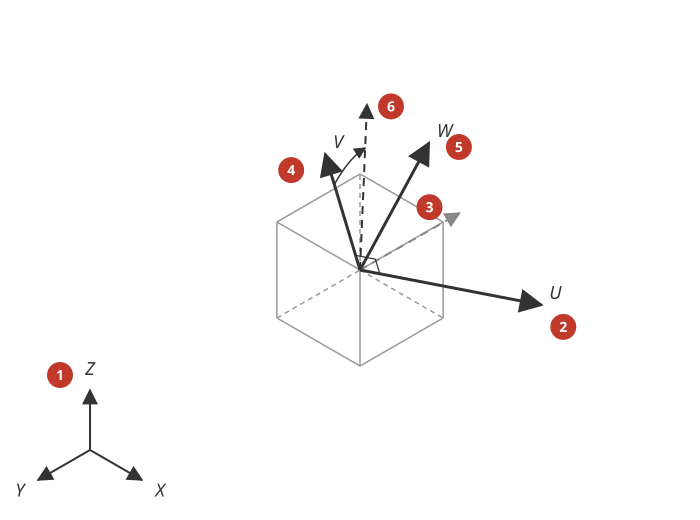

# Orthotropic and anisotropic material

*Nederlandse versie: [Orthotroop_materiaal.md](../Orthotroop_materiaal.md)*

Mecway's materials *Orthotropic*, *Stiffness matrix* and *Compliance matrix* (manual v34
§8.5) have different properties in the directions U, V and W of the element axes. The
bridge translates them on **solid elements** (hex, wedge, tet, pyramid, linear or
quadratic) in **Linear static** (S30, `lin_static_3d`), **Modal** (V30, `modal_3d`),
**Buckling** (B30, `buckling_3d`), **Nonlinear static** (L30, `nonlin_static_3d`) and implicit
**Dynamics** (D31, `dyna_impl_3d`) to Code-Aster's orthotropic
elasticity `ELAS_ORTH`, with Mecway's *Element orientation* as the direction of the
material axes. *Orthotropic* on **linear shells** (tri3, quad4: DKT/DST) is translated in
Linear static as a one-layer `DEFI_COMPOSITE` (§1.1). Quadratic shells, *Composite*
laminates, other analyses and a fully anisotropic matrix are not possible yet (§6).

## 1. Usage

1. Material > *Mechanical* > *Orthotropic*: Young's moduli in 1 (U), 2 (V) and 3 (W),
   Poisson's ratios 12, 23, 31, shear moduli 12 (UV), 23 (VW), 31 (WU) and, for thermal
   stress, three expansion coefficients. Or *Stiffness matrix* / *Compliance matrix*
   (6 × 6, the order 1..6 = UU, VV, WW, VW, WU, UV, measured; note that the *Orthotropic*
   tab lists the shear moduli as 12 (UV), 23 (VW), 31 (WU)).
2. The material axes are the element axes U, V, W. For solids they are the global X, Y,
   Z by default. To turn them: *Element properties* (per element) or *Loads and
   constraints* > *Element orientation* on an element selection: the direction of
   **U** and a vector for **V**, optionally an extra rotation about U (*angle*). Give
   **both** U and V: with only one of them, or with V parallel to U, Mecway does not solve
   the model and the bridge gives an ERROR; an angle without vectors has no effect. The
   orientation may be a formula of the element centre (x, y, z).
3. Choose *Static 3D*, *Frequency*, *Buckling*, *Nonlinear static 3D* or *Dynamic response 3D*
   (implicit) and start the bridge as usual. Mecway itself only allows the matrix types in
   Static 3D (manual §8.5), and solves the nonlinear and dynamic types with CCX. With large
   displacements the solids use `GREEN_LAGRANGE` (Saint Venant-Kirchhoff, orthotropic); Rayleigh
   damping goes into `ELAS_ORTH` as `AMOR_ALPHA`/`AMOR_BETA` (not verified separately).

1. Default (no orientation): U, V, W = global X, Y, Z.
2. U: the given vector (normalised).
3. The given V vector does not have to be perpendicular to U.
4. V: the projection of the given vector on the plane perpendicular to U.
5. W = U × V (right-handed).
6. *Angle*: V and W turn about U by this angle.

### 1.1 Shells

On a shell W is the normal and U lies in the element plane: by default along the edge from
node 1 to node 2 (measured with Mecway 34; the manual mentions node 3 for quadratic
elements), otherwise the projection of the U vector of *Element properties* or an *Element
orientation* card on the plane. The shell carries plane stress with E1, E2, ν12, G12. The
bridge writes one `DEFI_COMPOSITE` layer (thickness of the shell, the `ELAS_ORTH` material,
`ORIENTATION` = the angle from Code-Aster's local x axis to Mecway's U) per group `BRSHO<n>`
of elements with the same angle. A mesh with a varying edge direction (default U) therefore
gives several groups. Stresses come back in global axes on the top, middle and bottom
surface (field *shell_stresses*), as for isotropic shells. DKT has no transverse shear
flexibility (G23, G31 are not used), Mecway's shell has: in bending the difference is that of
isotropic shells (OR-22: 0.5%).

## 2. Poisson's ratios and matrices

Mecway uses the **major** Poisson's ratio: ν12 = −ε2/ε1 under a stress in direction 1,
ν23 = −ε3/ε2 under a stress in 2, and ν31 = −ε1/ε3 under a stress in 3 (manual §8.5).
Code-Aster's `NU_LT`, `NU_LN`, `NU_TN` are major ratios in the order L→T, L→N, T→N, so the
bridge writes `NU_LT` = ν12, `NU_TN` = ν23 and `NU_LN` = ν31 · E1 / E3 (the same compliance
term). With E1 = 100 GPa, E3 = 10 GPa and ν31 = 0.05: `NU_LN` = 0.5. That is not an error:
check with ν31/E3 = `NU_LN`/E1.

A *Stiffness matrix* or *Compliance matrix* is translated when it is **orthotropic in the
element axes**: all terms that couple a normal strain with a shear strain, or two shear
strains, are zero (c14 … c16, c24 … c26, c34 … c36, c45, c46, c56). The bridge then derives
the nine engineering constants from it. Code-Aster has no general anisotropic elasticity
for solid elements (`DEFI_MATERIAU` only has `ELAS_ORTH` and `ELAS_ISTR` there), so a
matrix with coupling terms gives an ERROR (§5). Shear terms are engineering shear strains
(γ = 2ε), as in Mecway. Compliance in m²/N (or mm²/N), stiffness in a pressure unit.

## 3. How the bridge translates

| Mecway | Code-Aster |
|---|---|
| *Orthotropic* E, ν, G, α in U, V, W | `DEFI_MATERIAU` `ELAS_ORTH` `E_L`, `E_T`, `E_N`, `NU_LT`, `NU_LN`, `NU_TN`, `G_LT`, `G_LN`, `G_TN`, `RHO`, with thermal stress `ALPHA_L/T/N` (L, T, N = U, V, W) |
| *Stiffness matrix* / *Compliance matrix* (orthotropic) | the same `ELAS_ORTH` (constants from the inverse of the normal block and the shear diagonal); no thermal expansion (Mecway has none for these types either) |
| element axes U, V, W (attributes, card, default) | `AFFE_CARA_ELEM` `MASSIF` `ANGL_REP` = (α, β, γ) nautical angles, per group `BRORI<n>` of elements with the same axes |
| *Orthotropic* on a linear shell | `DEFI_COMPOSITE` `COUCHE` (`EPAIS`, `MATER`, `ORIENTATION`) per group `BRSHO<n>`, assigned in `AFFE_MATERIAU` after the elset |

Elements with the same axes share one group: an orientation that is the same for a whole
component gives one `MASSIF` line, a formula per element gives as many groups as there
are different orientations (WARNING above 1000). An element with both a card and
attributes uses the card (Mecway does not solve such a model).

## 4. Results in Mecway

Stresses and strains come back in the **global** axes X, Y, Z (`stressxx` …), as Mecway
shows them. In Linear static the bridge also writes Mecway's field *stress in element
coordinates* (`lamuu`, `lamvv`, `lamww`, `lamuv`, `lamvw`, `lamwu`) for all solid elements
of a model with orthotropic material, with the field *stresses*: the stress tensor turned
to the element axes U, V, W (R σ Rᵀ per element node; at a node shared by elements with
different axes the mean of the element-node values, as Mecway). With it you see the stress
along the fibre (U) directly.

## 5. Messages and solutions

| Message | Cause | Solution |
|---|---|---|
| ERROR: Material '...' (StiffnessMatrix): the matrix couples normal and shear strains ... (terms c14 ... not zero) | a fully anisotropic matrix | Code-Aster cannot do this for solids; if the material is orthotropic in other axes, enter it in those axes and turn the element orientation |
| ERROR: Material '...' (Orthotropic): the constants do not give a positive definite stiffness | a modulus ≤ 0, or Poisson's ratios too large (e.g. the minor ratio entered as major) | check ν12² < E1/E2 etc.; Mecway does not solve this either |
| ERROR: Orthotropic/anisotropic material on quadratic shells (COQUE_3D), membranes, 2D or beams | the material on these elements | use an isotropic material there, or linear shells (STAPPENPLAN S13e) |
| ERROR: Orthotropic shells (elset ...) are currently translated in Linear static only | a shell with orthotropic material in another analysis | Static 3D (others: STAPPENPLAN S13e) |
| ERROR: Orthotropic shells with an element offset | an *Element offset* on such a shell | no offset (STAPPENPLAN S13e) |
| ERROR: Orthotropic shell elements ...: no U axis in the element plane | the U vector is normal to the shell | give a U axis that lies in the plane |
| ERROR: Orthotropic/anisotropic material (elset ...) is currently translated in Linear and Nonlinear static, Modal, Buckling and implicit Dynamics only | another analysis (explicit dynamics, mode superposition, harmonic, spectrum, thermal → mechanical, acoustics) | use one of the supported analyses (others: STAPPENPLAN S13c) |
| ERROR: Element orientation of ... solid element(s) with orthotropic material: only a U or only a V vector, or U parallel to V | the orientation of a solid gives only one of the two vectors, or V along U (Mecway does not solve this either) | give U and a V vector that is not parallel to U |

## 6. What is not possible

See also KNOWN_BUGS 131.

- A matrix with coupling terms (truly anisotropic, 21 constants): not in Code-Aster for
  solids.
- Orthotropic material on quadratic shells (COQUE_3D), membranes and with an element offset,
  shells in other analyses than Linear static, and *Composite* laminates (STAPPENPLAN S13e).
- Explicit dynamics, mode superposition, harmonic, response spectrum, the thermal →
  mechanical chain and acoustics (STAPPENPLAN S13c), and orthotropic thermal conductivity in
  thermal analyses. Modal with prestress, complex modes and cyclic
  symmetry use the same material but are not verified separately.
- *Stress in element coordinates* in Modal and Buckling (per mode).

## 7. Test models

OR-01 .. OR-06 and OR-09 in [`Verification.md`](Verification.md): a cube in uniaxial tension with
turned material axes (element attributes, a card with an angle, the stiffness and the
compliance matrix): all six global strains equal to Hooke's law in U, V, W turned to X, Y, Z
and to Mecway 34's own solve; the same cube heated freely (thermal strain α1, α2, α3 in U, V, W
turned to X, Y, Z, no stress); a cantilever with E1 and with E2 along the beam (Timoshenko).
OR-07, OR-08, OR-10: the cantilever in Frequency (first bending frequencies) and as a column
in Buckling, equal to Euler-Bernoulli within the shear effect and to Mecway's own solve.
OR-11: *stress in element coordinates* on a bar with two different element axes (R σ Rᵀ,
and the mean of the element-node values at the interface, as Mecway). OR-12 .. OR-14:
Nonlinear static (cube, large-deflection cantilever) and implicit dynamics (step load, period),
equal to Mecway's own CCX solve. OR-15: hex8 with `LINE_QUAD`; OR-17: an orientation card
with a formula of x (one `MASSIF` group per element column), equal to Mecway. OR-20 .. OR-22:
shells (membrane tension with U at 30° and with the default U along the edge 1–2, exact and
equal to Mecway; a strip in bending, 0.5% from Mecway's MITC4).

## 8. Sources

- Mecway manual v34 §7.4.2 (element axes, projection of the vector), §8.5 (orthotropic and
  anisotropic materials, major Poisson's ratio, material axes = element axes, for solids
  global by default); attribute names from `mecway.exe` (`youngsmodulusu` … `shearmoduluswu`,
  `thermalexpansionu/v/w`, `c11` … `c66`, `s11` … `s66`); semantics measured with headless
  Mecway 34 solves (cubes under an imposed homogeneous strain, 28 Oct 2026).
- Code-Aster 17.4: catalogue `defi_materiau.py` (`ELAS_ORTH`, `ELAS_ISTR`; no general 3D
  anisotropy), U4.43.01 (`ELAS_ORTH`; shells via `DEFI_COMPOSITE`, §3.5.2), `defi_composite.py`
  (U4.42.03); `affe_cara_elem.py` (`MASSIF` `ANGL_REP`), U4.42.01;
  nautical angles as in `code_aster/MacroCommands/observation_ops.py` (`anglnaut`).
