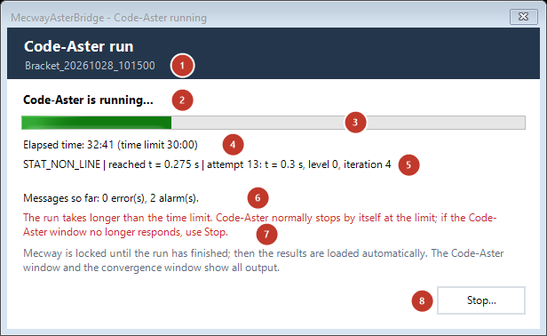
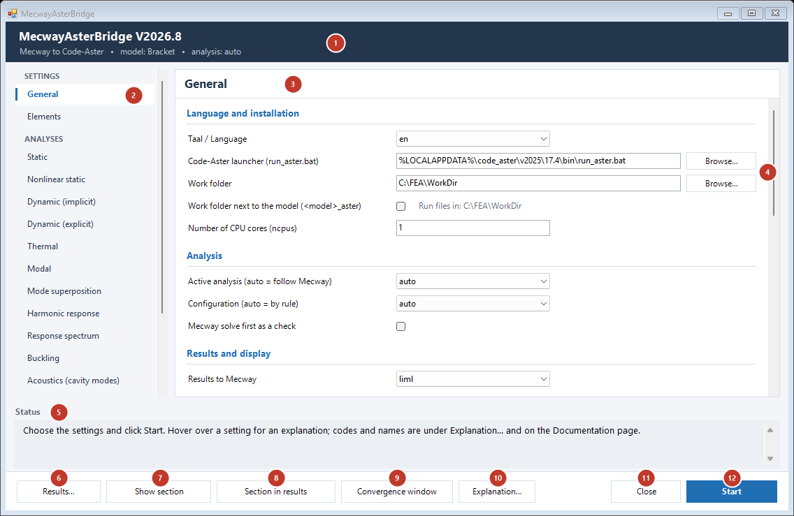
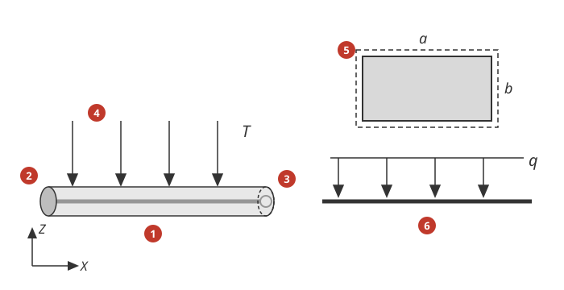
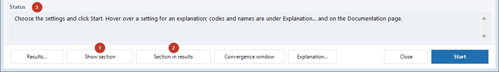
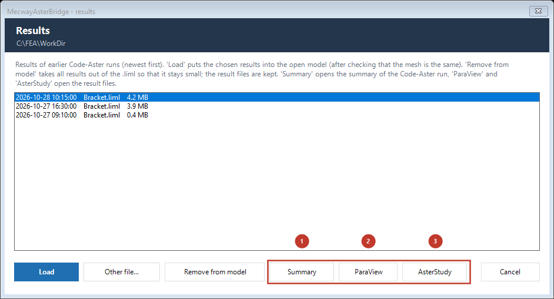

# MecwayAsterBridge user guide

*Nederlandse versie: [Handleiding.md](../Handleiding.md)*

The bridge solves a Mecway model with Code-Aster 17.4 and puts the results back into
Mecway. You build the model in Mecway (mesh, materials, loads, selections) and run
the bridge as a script; the bridge translates the `.liml` into a Code-Aster mesh
and a `.comm`, starts Code-Aster and loads the results.

**About the language of the software.** The main window, the messages, the
WARNING/ERROR lines in the log and the `.mess` and the convergence window are available in Dutch and
English: setting "Taal / Language" on the General page (`en` = English, the default;
`nl` = Dutch). This guide quotes the English text, e.g. "Work folder"; with `nl`
the window shows the Dutch text ("Werkmap"). Some things are in English only: INFO/SUCCESS lines in the log, the comments in the
generated `.comm`, and the developer file `KNOWN_BUGS.md`.

Related documents:

| Topic | Document |
|---|---|
| Installation (Code-Aster, scripts, menu item) | [`README.md`](../../README.md) |
| Which Mecway features are and are not translated (Yes/Partly/No per item) | [`Mecway_features.md`](Mecway_features.md) |
| Default settings and assumptions (why each default) | [`Default_settings_and_assumptions.md`](Default_settings_and_assumptions.md) |
| Settings for contact and nonlinear analyses, convergence window | [`Settings_contact_and_nonlinear.md`](Settings_contact_and_nonlinear.md) |
| Thermal analyses | [`Thermal.md`](Thermal.md) |
| 2D analyses: plane stress, plane strain (Static 2D) and axisymmetric (Static Axisymmetric), also dynamic (D20, DA0) | [`2D_and_axisymmetric.md`](2D_and_axisymmetric.md) |
| Welding: moving heat source (weld bead, transient thermal), residual stress, distortion and metallurgy (phases, hardness) | [`Welding.md`](Welding.md) |
| Modal analysis (also cyclic symmetry), linear and nonlinear buckling (CRIT_STAB, imperfection) | [`Modal_and_buckling.md`](Modal_and_buckling.md) |
| Mode superposition (Dynamic Response with Mode superposition) and harmonic response per frequency (`harmonic_3d`) | [`Mode_superposition.md`](Mode_superposition.md) |
| Acoustics: cavity modes and harmonic pressure field with source, absorbing boundaries and microphones (Acoustic Resonance 3D); vibroacoustics: coupled modes of structure + air/liquid (Frequency with a fluid part) and their response per frequency (source, absorbing boundaries, microphones) | [`Acoustics.md`](Acoustics.md) |
| Response spectrum (earthquake, shock) | [`Response_spectrum.md`](Response_spectrum.md) |
| Error estimator: discretisation error per element (linear static) | [`Error_estimator.md`](Error_estimator.md) |
| Fracture mechanics: K and G along a meshed crack (linear static, `CRACK_` selections) or an XFEM crack without a mesh (`#ASTER-XFEM`, §7) | [`Fracture_mechanics.md`](Fracture_mechanics.md) |
| Adaptive refinement: refine the mesh in Mecway where the error is large (linear static) | [`Error_estimator.md`](Error_estimator.md) §6 |
| Element failure | [`Failure.md`](Failure.md) |
| Bolt pretension (*Pre-tension section*) | [`Bolt_pretension.md`](Bolt_pretension.md) |
| Orthotropic and anisotropic material | [`Orthotropic_material.md`](Orthotropic_material.md) |
| Fatigue: damage and life per node (Wöhler curve, rainflow, Miner, critical-plane criteria, Manson-Coffin; `#ASTER-WOHLER`) | [`Fatigue.md`](Fatigue.md) |
| Your own Code-Aster input (`#ASTER` lines) | [`ASTER_lines_examples.md`](ASTER_lines_examples.md) |
| Code-Aster messages, cause and solution | [`CodeAster_error_messages.md`](CodeAster_error_messages.md) |
| Verification against analytical solutions | [`Verification.md`](Verification.md) |
| After an update of Mecway or Code-Aster: version warning, checking a new version | [`After_an_update.md`](After_an_update.md) |
| Known deviations and limitations (developer file, English) | [`KNOWN_BUGS.md`](../../KNOWN_BUGS.md) |

## 1. Requirements

- **Mecway 33 or 34.** The bridge runs in Mecway's IronPython 2.7 scripting environment
  (Mecway Ltd., 2026, §16.2) and has been tested with `.liml` files of versions 33 and
  34: developed and verified with Mecway 34; Mecway 33 was last fully verified with
  V2026.2 (which features are verified per version:
  [`After_an_update.md`](After_an_update.md) §6). Other versions have not been tested
  (assumption: the `.liml` format is the same); the bridge then warns.
- **Code-Aster 17.4 for Windows**; the path to `run_aster.bat` is in
  `CONFIG_BRIDGE["exe_aster"]` (`Scripts/bridge_utils.py`; default
  `%LOCALAPPDATA%\code_aster\v2025\17.4\bin\run_aster.bat`, the location of the
  Windows package) and can be set in the main window. Installation: see [`README.md`](../../README.md).
- The `Scripts/` folder of this repository in a fixed location. Mecway runs
  `Scripts/MecwayAsterBridgeMain.py`; Code-Aster loads
  `Scripts/aster_results_export.py` from that location during the run. The `.comm`
  templates (`AsterTemplate_*.comm`) are also in `Scripts/`; they need no setting.
- **Optional: [MecwaySectionProps](https://github.com/trednuK/MecwaySectionProps)**, for
  beams with a General section (§4.3). A separate Mecway script with its own installation.
- A work folder with a short path: work folder plus file name together may not exceed
  259 characters (Windows). If the path is too long, the bridge shortens the model
  name in the file names (WARNING); if it still does not fit, Code-Aster is not
  started.

## 2. Workflow

1. Build the model in Mecway. Supported analysis types: static 3D, nonlinear static
   3D, dynamic 3D (linear, also with mode superposition, and nonlinear), thermal
   steady state and transient, frequency (modal), buckling and acoustic cavity modes (§4; modal and
   buckling: [`Modal_and_buckling.md`](Modal_and_buckling.md); mode superposition:
   [`Mode_superposition.md`](Mode_superposition.md); acoustics: [`Acoustics.md`](Acoustics.md)). The bridge computes a response
   spectrum (earthquake, shock) on a frequency model with a Gravity table as the
   spectrum ([`Response_spectrum.md`](Response_spectrum.md)). Give every element set (elset)
   a material: without materials the bridge stops.
2. Start the bridge: *Tools* > the menu item of `MecwayAsterBridgeMain.py` (see
   [`README.md`](../../README.md)).
3. The **main window** appears (§3). Check the settings and click "Start"
   ("Close" stops the bridge without a run).
4. The bridge saves the model (`mw.save()`), reads the `.liml`, writes the mesh,
   `<model>_<run-id>.comm` and `.export` to the work folder (§5) and starts Code-Aster
   in a **separate window**. With route `tabel` it first checks that the Mecway
   solution matches the mesh; if not, it stops with a message.
5. The **status window** "Code-Aster run" appears (setting "Waiting for Code-Aster" =
   `auto`, default). It shows the elapsed time (with the time limit of the `.export`), what
   Code-Aster is doing at that moment (nonlinear: time reached, attempt, level and Newton
   iteration; static: the phase of the linear solver; modal: the modes found; otherwise the
   last line of the output) and the number of errors and alarms so far. The window is
   modal: Mecway is locked until the run has finished, because the bridge then reopens the
   model with the results. For the first 10 seconds it stays on top, also above the
   Code-Aster window that opens then. After that it is a normal window: click another
   screen, such as the convergence information, and that comes to the front. Bring the
   status window back with its taskbar button. Until Code-Aster starts its first command it shows "Code-Aster is
   starting...". It closes by itself once Code-Aster has finished (`run_aster`
   has returned); the bridge recognises that from an end marker that the Code-Aster window
   writes (`<model>_<run-id>_done.txt`, with the exit code of `run_aster`; removed after the
   run), and otherwise from `DIAGNOSTIC JOB` at the end of the `.mess`.

   

     1. The name of the run, `<model>_<run-id>`, as the files in the work folder (§5).
     2. What is happening, for example "Code-Aster is starting..." or "Code-Aster is running...".
     3. The progress of the whole run in percent. As long as the output holds no percentage,
        the bar moves back and forth.
     4. The elapsed time, with the time limit of the `.export` in brackets.
     5. What Code-Aster is doing right now; here, for a nonlinear analysis, the command, the
        time reached, the attempt, the level and the Newton iteration.
     6. The number of errors and alarms so far. Without messages this line stays empty.
     7. The warning that the run takes longer than the time limit. Below the limit this line
        stays empty.
     8. "Stop...", see below.

   - "Stop..." (or the close button, Esc) asks for confirmation first and then ends only
     the processes of this run (the Code-Aster window and everything started from it). The
     output up to that moment goes into the `.mess` with the line `BRIDGE_GESTOPT`; the
     status box and the convergence window report "Run stopped by the user." Code-Aster
     writes the results only at the end of the run, so a stopped run usually has no
     results. An adaptive refinement (§4) stops as well.
   - If you close the Code-Aster window yourself during the run, the bridge reports "Run
     aborted: the Code-Aster window was closed." and continues as after Stop.
   - If `run_aster` ends with an exit code other than 0, the status box reports that code
     with the path of the `.mess`; the Code-Aster window then stays open (as with an error
     in the `.mess`).
   - If the run takes longer than the time limit (with a 2 minute margin), the window
     warns; Code-Aster normally stops by itself at the limit.

   With "Waiting for Code-Aster" = `confirm` (or if the status window cannot be shown) it
   works as before: Mecway shows "Code_Aster has been started in a separate window. Click
   OK once the calculation has finished." (with the convergence window on, "The
   convergence window shows the progress." in between; with language `nl` the Dutch text
   "Code_Aster is gestart in een apart venster. ..."). Wait until the Code-Aster window
   shows `DIAGNOSTIC JOB` and only then click OK. If you click too early, the bridge asks
   again.
6. The results arrive in Mecway:
   - route `liml` (default): the bridge writes the results into the `.liml` (the
     previous version is kept as `<model>.liml.bak`) and reopens the model; the
     results are also kept separately and can be loaded again later (§5.1);
   - route `tabel` (table): the bridge writes nodal values into the existing Mecway
     solution (static and nonlinear static only, §3).
7. Then the main window comes back. The status box reports the outcome, what was not
   translated ("Note: these loads/constraints were NOT translated to Code-Aster;
   the results were computed without them: ...") and which errors Code-Aster reported (§6). For modal and buckling it also
   shows the frequencies or buckling factors.

## 3. The main window

The window stays open until you click "Close". After a run it comes back,
with the outcome and any messages in the **status box** at the bottom; the box is made
higher for a message, and you can drag its upper edge to make it larger or smaller. The
window is non-modal: Mecway stays usable while it is open (NOT checked in Mecway for all
actions, KNOWN_BUGS 38). The bridge runs only once at a time per Mecway: if you start it
again (*Tools*) while the window is open or a run is going on, it reports that the window
is already open and does not open a second window. The header shows the model and the
active analysis.

On the left is a **navigation list** with the pages of the window, in groups:
"Settings" (General, Elements), "Analyses" (one page per analysis) and
"Help" (Documentation). The chosen page is highlighted (bold, with a blue bar);
on the right are its title and its settings, in groups. Click a page, or use the arrow
keys (and Home/End, PageUp/PageDown) in the list; Ctrl+Tab and Ctrl+PageDown go to the next page from
anywhere in the window, Ctrl+Shift+Tab and Ctrl+PageUp to the previous one. The
window can be dragged larger (path fields grow along); in a small window the list and
the page scroll (the list with the mouse wheel or the bar on its right). "Start" and "Close"
are at the bottom right, the other buttons on the left.



| No. | Part | What it does |
|---|---|---|
| 1 | Header | The version of the bridge, the open model and the active analysis |
| 2 | Navigation list | Chooses the page shown on the right |
| 3 | Page | The title and the settings of the chosen page; the tables below give each setting |
| 4 | "Browse..." | Chooses the file or folder of a path field in a Windows dialog |
| 5 | Status box | The outcome of the last action and the messages |
| 6 | "Results..." | Saves the settings; then load an earlier run, remove the results from the model (small `.liml`), or open the result files of a run in ParaView or AsterStudy (§5.1). Then the window comes back |
| 7 | "Section ▾" | A menu for the shape of General sections (§4.3). "Show section" saves the settings and the model and shows the shape on the beams as temporary elements, before a calculation; "Hide section" removes them again. "Section in results" saves the settings and the model, puts that shape with its values in the results in the `.liml` and reopens the model; after a Code-Aster run this happens automatically |
| 8 | "Convergence window" | Opens the convergence and messages window as a separate window (stays open next to Mecway) for the newest run of the open model in the work folder the window shows (the "Work folder" field, or with "Work folder next to the model" the folder next to the model); if there is no run of this model, the newest `.mess` in that folder. Without a run the status box says there is nothing to show |
| 9 | "Close" | Closes the bridge. Settings changed after the last Start, Results... or action in the Section menu are not saved |
| 10 | "Start" | Saves the settings, saves the model and starts Code-Aster (§2). Then the window comes back |

- **Tooltips:** hover over a setting for an explanation; for a choice list the
  meaning of each option is shown too.
- **Documentation page:** the glossary of codes and names (D31, `GDEF_LOG`, `MUMPS`, ...) and the documents from `docs/` (in the chosen
  language), with formatting; links to other documents and to headings work, web
  addresses open in the default browser.
- **Saving:** settings apply to the run and are saved on Start, Results... and the actions
  of the Section menu in `Scripts/bridge_utils.py` (previous version: `bridge_utils.py.bak`). If the window
  cannot be shown (Windows Forms not available), the bridge asks for the settings
  with text prompts (`mw.input`) and does a single run.

The *Default* column below gives the value as shipped in the repository. Why each
value was chosen: [`Default_settings_and_assumptions.md`](Default_settings_and_assumptions.md).

**Page "General"**

| Setting (label) | Default | Meaning |
|---|---|---|
| "Taal / Language" | `en` | `nl` (Dutch) or `en` (English): main window, messages, WARNING/ERROR lines in the log and the convergence window, and the WARNING/ERROR lines (nl: WAARSCHUWING/FOUT) that the bridge scripts in the Code-Aster job write to the `.mess`. Applies to the run straight away; the main window switches language when it comes back. INFO/SUCCESS lines and the comments in the `.comm` are always in English |
| "Code-Aster launcher (run_aster.bat)" | `%LOCALAPPDATA%\code_aster\v2025\17.4\bin\run_aster.bat` | path to `run_aster.bat`; environment variables such as `%LOCALAPPDATA%` are allowed. If the file does not exist, the status box says so at start; choose it with "Browse..." |
| "Work folder" | empty = `WorkDir` next to the `Scripts` folder (the window shows that path) | folder for the mesh, `<model>_<run-id>.*`, log and results (§5); created if it does not exist |
| "Work folder next to the model (<model>_aster)" | off | on: the files of a run go to the subfolder `<model>_aster` next to the open `.liml` file (e.g. `C:\Projects\Beam.liml` → `C:\Projects\Beam_aster`), also for "Results...", the convergence window and adaptive refinement; the folder in use is shown next to the checkbox. A model that has not been saved yet uses the "Work folder" |
| "Number of CPU cores (ncpus)" | 1 | `ncpus` (threads) in the `.export`; the bridge runs without MPI (`mpi_nbcpu 1`) |
| "Active analysis (auto = follow Mecway)" | `auto` | `auto` follows the Mecway analysis type: S30 → Static, S20 and SA0 (2D, axisymmetric) → Static, D20 and DA0 → Dynamic (implicit) ([`2D_and_axisymmetric.md`](2D_and_axisymmetric.md)), L30 → Nonlinear static, D30 with *Mode superposition* → Mode superposition, D30 without and D31 → Dynamic (implicit), T30/T31 → Thermal, V30 → Modal (with a fluid part: Vibroacoustics (modes)), B30 → Buckling, A30 → Acoustics (cavity modes; with a source, `SOURCE_` selection, Acoustics (harmonic)), A20 → Acoustics (cavity modes, 2D); applies only to that run. Or choose an analysis yourself (Dynamic (explicit) is always chosen by hand). Another Mecway type (E30, ...) with `auto`: the bridge stops with a message |
| "Configuration (auto = by rule)" | `auto` | which configuration the bridge solves and which solution receives the results; the list shows the configurations of the open model (last saved version). `auto`: the only configuration, else the only one without suppressed items, else the first (WARNING). A name that is not in the model: WARNING and `auto` (§4) |
| "Mecway solve first as a check" | off | solves in Mecway first and stops on an error. Writes `<model>_<run-id>_vergelijking.csv` (Mecway and Code-Aster value per node) and logs the largest difference per variable; for modal and buckling the log compares the frequency or factor per mode |
| "Results to Mecway" | `liml` | `liml`: all time steps or modes, element-node values too; the model is reopened. `tabel` (table): nodal values of the last time only, into the existing Mecway solution; requires a solution that matches the mesh; Static and Nonlinear static only (not dynamic, thermal, modal or buckling) |
| "Convergence and messages window" | on | opens a separate window on every run: for a nonlinear analysis the residuals, progress and contact; for the static analysis the linear solver (time per phase, error bound, condition number; with GCPC the residual per iteration); for modal and buckling the first modes; for every analysis the messages (errors and alarms with explanation) and the diagnosis. Afterwards: the "Convergence window" button. See [Settings §4.4](Settings_contact_and_nonlinear.md#44-convergence-screen) |
| "Waiting for Code-Aster" | `auto` | `auto`: a modal status window with the progress and "Stop..."; the bridge recognises the end of the run itself and then loads the results (§2 step 5). `confirm`: you click OK in Mecway when the Code-Aster window shows `DIAGNOSTIC JOB` (the earlier behaviour) |
| "MED file for ParaView" | off | also writes `<model>_<run-id>.rmed` (ParaView/Salome); Mecway does not use it and it can grow to hundreds of MB |
| "Summary of the Code-Aster run (_aster_summary.txt)" | `summary` | after every run (also a failed or stopped one) a summary of the Code-Aster output in `<model>_<run-id>_aster_summary.txt` in the work folder; button "Summary" in the Results window and the convergence window (§5.2). `summary`: errors and alarms, steps, timings and the path of the full `.mess`; `full`: a copy of the whole `.mess` (start and end above 4 million characters); `off`: no file |
| "Summary also as Saved monitor in the .liml" | off | on: the same text also in the `.liml` as Mecway's *Saved monitor* item under *Solution*; route `liml` only; a failed run only if the model has no results yet (§5.2) |
| "Hide failed elements" | off | on: after a run (route `liml`) and after "Results..." > "Load" failed elements disappear in Mecway's own result view, each from the step after its failure; for this the bridge rewrites the solution in the `.liml` (§5.1; [Failure §4](Failure.md#4-results-in-mecway)) |
| "VTU/PVD files for ParaView" | off | also writes `<model>_<run-id>.pvd` with one `.vtu` per time step (any ParaView reads it, also without a MED reader), with the same fields as Mecway gets |
| "ParaView (empty = search automatically)" | empty | `paraview.exe` for the "ParaView" buttons in the Results window (§5.1) and the convergence window; when filled in, this path is always used. Empty = automatic: for a `.pvd` first the official ParaView 6.x (`%ProgramFiles%\ParaView 6*\bin\paraview.exe`, newest first), then Salome-Meca's, then an older ParaView; for a `.rmed` only Salome-Meca's ParaView (it loads the MEDReader plugin itself; see "Salome-Meca folder"): the official ParaView 6.2.1 has MEDReader but does not load it, and opens a `.rmed` only after *Tools > Manage Plugins > MEDReader* (tick *Auto Load* when you set `paraview_exe` to the official ParaView). Salome-Meca's ParaView is started through the installation's `run_paraview.bat`. ParaView 5.10 from paraview.org **cannot** open a `.rmed`. Environment variables are allowed |
| "Salome-Meca folder (empty = search automatically)" | empty | Salome-Meca for the "AsterStudy" buttons (§5.1) and for Salome-Meca's ParaView: an installation folder (with `run_salome.bat`) or a folder that holds installations (the newest counts). Empty = search automatically in `C:\SALOME-MECA`, `C:\Salome_meca` and `%ProgramFiles%\SALOME*`. Environment variables are allowed |

Below the settings the page shows the mapping of `auto` to the Mecway analysis types, a
note on the language and the path of `bridge_utils.py`.

Mecway's linear *Dynamic Response* (D30): with the option *Mode superposition*,
`auto` picks "Mode superposition" (`dyna_modal_3d`,
[`Mode_superposition.md`](Mode_superposition.md)); without it, `auto` picks
"Dynamic (implicit)". Set its "Time scheme" to
`NEWMARK` and "COMPORTEMENT DEFORMATION" to `PETIT` for the same scheme as Mecway
(verification MD-07: equal to Mecway); with other values the bridge gives a
WARNING. The steady-state response to a sinusoidal load per frequency (amplitude,
phase) has no Mecway analysis type: choose "Harmonic response" (`harmonic_3d`) yourself for a *Frequency* or *Dynamic Response* model
([`Mode_superposition.md`](Mode_superposition.md) §7).

**Page "Elements"** (all mechanical analyses)

| Setting (label) | Default | Choices |
|---|---|---|
| "Hex8 solid elements" | `3D` | `3D`: fully integrated; stiffer than Mecway's hex8 with incompatible modes (KNOWN_BUGS 1; the bridge gives a WARNING); with hyperelastic material (rubber) ~3x too stiff through volumetric locking: then choose `LINE_QUAD`. `3D_SI`: reduced integration, only for elsets with hex8 elements only, not explicit and not hyperelastic; with one element through the thickness ~0 bending stress. `LINE_QUAD`: Code-Aster makes all linear solid elements quadratic (hex8 → hex20, tet4 → tet10, ~3x as many nodes); only if nothing else stays linear (no beams, springs, DKT shells), the model has no quadratic solid elements and the scheme is not explicit; otherwise it stays `3D` with a WARNING. Results at the corner nodes |
| "Linear shells (tri3/quad4)" | `DKT` | `DKT` (Kirchhoff, thin), `DST` (with transverse shear deformation; static analysis only, otherwise DKT with a WARNING) or `COQUE_3D`: the shells are first made quadratic (quad9/tria7, with rotation about the normal); if they share nodes with elements that stay linear, or are the master of bonded contact, DKT is used (KNOWN_BUGS 2). Quadratic shells (tri6/quad8) are always `COQUE_3D` |
| "Beams (line2/line3)" | `POU_D_E` | For an open section with its shear centre far from the centroid: `POU_D_TG`; with other beams the bridge then warns. `POU_D_E` (Euler-Bernoulli, as in Mecway), `POU_D_T` (Timoshenko, with shear deformation) or `POU_D_T_GD` (Timoshenko with large displacements and rotations; nonlinear static with large displacements only, elsewhere `POU_D_T`; no beam stresses, [Settings §2.9](Settings_contact_and_nonlinear.md#29-beams-with-large-rotations-elem_beam--pou_d_t_gd)) or `POU_D_TG` (Timoshenko with warping and shear centre: flexural-torsional and lateral-torsional buckling of open profiles, [Modal and buckling §3.5.1](Modal_and_buckling.md#351-beam-with-warping-elem_beam--pou_d_tg)). A line3 beam is split at its midside node into two SEG2 cells (Code-Aster has no quadratic beam); results come back on all three nodes |
| "Warping of POU_D_TG beams at supports" | `auto` | Only with `POU_D_TG`. `auto`: warping fixed where a bending rotation is fixed (*Fixed support*, clamp), free at a fork support (only translations and the rotation about the beam axis fixed) and elsewhere; `free`: free everywhere; `blocked`: fixed at every supported node ([Modal and buckling §3.5.1](Modal_and_buckling.md#351-beam-with-warping-elem_beam--pou_d_tg)) |

**One page per analysis**: "Static", "Nonlinear static", "Dynamic (implicit)", "Dynamic (explicit)", "Thermal", "Modal", "Mode superposition", "Harmonic response",
"Response spectrum", "Buckling", "Acoustics (cavity modes)", "Acoustics (harmonic)",
"Vibroacoustics (modes)" and "Vibroacoustics (harmonic)".
The page of the active analysis is called "... (active)". At the top of each
page are the Code-Aster command, the `.comm` template used and the Mecway types that
lead to this analysis with `auto`. A page shows only the settings that belong to that
analysis:

| Setting (label) | Analyses | Default |
|---|---|---|
| "Result fields to Mecway" | all | see §4.1 |
| "Time limit run_aster [s]" | all | 600 (static), 1800 (nonlinear static, thermal, mode superposition, harmonic response, response spectrum, vibroacoustics (harmonic)), 7200 (dynamic), 900 (modal, buckling, acoustics, vibroacoustics (modes)) |
| "Memory limit run_aster [MB]" | all | 4096 (nonlinear static, dynamic, thermal), 2048 (others) |
| "MUMPS NPREC (-1 = check off)" | all | 8 |
| "Linear solver (MUMPS / GCPC)" | static | `MUMPS` |
| "Solver accuracy (RESI_RELA)" | static | 1e-6 |
| "Error estimator (CALC_ERREUR, solids only)" | static | on ([`Error_estimator.md`](Error_estimator.md)) |
| "Crack: R_INF [m] (0 = automatic)" / "Crack: R_SUP [m] (0 = automatic)", "Crack: smoothing along the front", "Crack: Legendre degree (0 .. 7)" | static (only with `CRACK_` selections or `#ASTER-XFEM`; smoothing and degree not for XFEM) | 0 / 0, `LINEAIRE`, 5 ([`Fracture_mechanics.md`](Fracture_mechanics.md)) |
| "Adaptive refinement (Mecway refine_x2)" | static | off ([`Error_estimator.md`](Error_estimator.md) §6) |
| "Substeps per time interval" | nonlinear static | 10 |
| "Max. Newton iterations (ITER_GLOB_MAXI)" | nonlinear static, dynamic implicit, thermal (`THER_NON_LINE` only) | 20 |
| "NEWTON REAC_ITER" | nonlinear static, dynamic implicit, thermal (`THER_NON_LINE` only) | 1 (at least 1) |
| "End time without time load [s]" | nonlinear static, dynamic | 1.0 |
| "Convergence criterion (RELA / MAXI / RELA or MAXI)" | nonlinear static, dynamic implicit | `RELA` (choice `RELA`, `MAXI`, `RELA_OF_MAXI`) |
| "Convergence RESI_GLOB_RELA" | nonlinear static, dynamic implicit, thermal (`THER_NON_LINE` only) | 1e-5 (nonlinear static, dynamic implicit; Code-Aster default 1e-6), 1e-6 (thermal) |
| "Convergence RESI_GLOB_MAXI [N]" | nonlinear static, dynamic implicit (with `MAXI` and `RELA_OF_MAXI`) | 1e-3 |
| "Contact method (STANDARD / PENALISATION)" | nonlinear static, dynamic | `STANDARD` |
| "Strain definition hardening curve" | nonlinear static, dynamic | `auto` |
| "COMPORTEMENT DEFORMATION" | nonlinear static, dynamic | `GROT_GDEP` |
| "Time scheme (SCHEMA_TEMPS)" | dynamic | `HHT` (implicit; choice `HHT`/`NEWMARK`), `DIFF_CENT` (explicit; choice `DIFF_CENT`/`TCHAMWA`) |
| "HHT ALPHA (-0.3 .. 0)" | dynamic implicit | -0.1 |
| "Solver steps per Mecway time step" | dynamic implicit | 1 |
| "Energy balance (ENERGIE; not with contact)" | dynamic implicit | off |
| "Time step / critical time step" | dynamic explicit | 0.5 |
| "Time scheme THETA (0 .. 1)" | thermal | 0.57 |
| "Element failure (plastic strain)" | nonlinear static, dynamic | on |
| "Failure limit all plastic mat. (0 = off)" | nonlinear static, dynamic | 0 |
| "Stiffness of failed element (x E)" | nonlinear static, dynamic | 1e-6 |
| "Number of modes (without maxmode in Mecway)" | modal, buckling, mode superposition, harmonic response, response spectrum, acoustics (cavity modes), vibroacoustics (modes) | 10, except 4 (buckling) and 20 (response spectrum) |
| "Search frequency [Hz] (0 = lowest modes)" | modal, acoustics (cavity modes) | 0 |
| "Mode shape normalisation (NORM_MODE)" | modal, buckling | `MASS_GENE` (modal), `RIGI_GENE` (buckling) |
| "Mode check (VERI_MODE SEUIL)" | modal, buckling, mode superposition, harmonic response, response spectrum, acoustics (cavity modes), vibroacoustics (modes) | 1e-6 |
| "Solver steps per period of the highest mode" | mode superposition | 50 |
| "Extra modal damping (fraction of critical)" | mode superposition, harmonic response | 0 |
| "Static correction truncated modes (MACRO_ELAS_MULT)" | mode superposition, harmonic response | off (mode superposition), on (harmonic response) |
| "Spectrum table: column 'time' is" | response spectrum | `period` |
| "Modal damping (fraction of critical)" | response spectrum | 0.05 |
| "Combination of modes" / "Combination of directions" | response spectrum | `CQC` / `SRSS` |
| "Missing mass (pseudo-modes, MODE_CORR)" | response spectrum | on |

The frequencies, sources and other settings of the harmonic response, acoustics and
vibroacoustics are in [`Mode_superposition.md`](Mode_superposition.md) §7 and
[`Acoustics.md`](Acoustics.md).

Explanation per setting:
[`Settings_contact_and_nonlinear.md`](Settings_contact_and_nonlinear.md) §2
(mechanical), [`Thermal.md`](Thermal.md) §2,
[`Modal_and_buckling.md`](Modal_and_buckling.md) §1.2, [`Mode_superposition.md`](Mode_superposition.md) §1.2, [`Response_spectrum.md`](Response_spectrum.md) §1.2, [`Error_estimator.md`](Error_estimator.md) §1.2 and [`Failure.md`](Failure.md).
Buckling always looks for the smallest buckling factors, as Mecway does (no setting,
see [`Modal_and_buckling.md`](Modal_and_buckling.md) §1.2). For a single model you can also set a setting in the model with `#ASTER-OPTIE` (see
[`ASTER_lines_examples.md`](ASTER_lines_examples.md)); it applies to that run only and
is not saved.

### 3.1 Large displacements (DEFORMATION)

The bridge chooses `DEFORMATION` per element type
(`bridge_to_aster._deformation_for`): if you choose `GROT_GDEP`, `GREEN_LAGRANGE`,
`GDEF_LOG` or `SIMO_MIEHE`, solids get `GREEN_LAGRANGE` (elastic) or
`GDEF_LOG`/`SIMO_MIEHE` (plastic), DKT/DST `GREEN_LAGRANGE`, `COQUE_3D`
`GROT_GDEP`, cables always `GROT_GDEP` and beams `PETIT` (WARNING; KNOWN_BUGS 11),
except with `elem_beam` = `POU_D_T_GD` (`GROT_GDEP`, large rotations).
Details: [`Settings_contact_and_nonlinear.md`](Settings_contact_and_nonlinear.md) §2.3.

## 4. What is translated

For each part of Mecway (analysis types, loads, constraints, couplings and contact,
elements, materials and cross-sections, results, settings),
[`Mecway_features.md`](Mecway_features.md) states whether it is translated (Yes,
Partly or No), with the limitation and what you can do instead. In addition the bridge does:

| Item | Supported |
|---|---|
| Mecway input | [`Mecway_features.md`](Mecway_features.md) |
| Welding | moving heat source (Goldak double ellipsoid) in a transient thermal analysis via `#ASTER-LASBRON`, or as a Mecway formula in x, y, z, t (heat generation, heat flux); temperature-dependent conductivity and specific heat; with a Thermal stress then residual stress and distortion (`STAT_NON_LINE`, temperature-dependent E, yield strength and α via `#ASTER-MATERIAL`); phase transformations in steel and hardness (`CALC_META`, CCT diagram) via `#ASTER-METALLURGIE`, optionally with transformation strain in the residual stress: [`Welding.md`](Welding.md) |
| Failure | elements whose plastic strain exceeds a limit get a very low stiffness and zero stress (nonlinear static and dynamic, solid elements and shells, not beams; limit via `#ASTER-BEZWIJKEN`, `PLAS_TAB` Eps_p_max or a setting): [`Failure.md`](Failure.md) |
| Fatigue | damage D and life per node of solid elements and shells (top and bottom side) with a Wöhler or strain curve (Manson-Coffin) per material (`#ASTER-WOHLER`), rainflow and Miner, or a critical-plane criterion (Dang Van, Matake, Crossland; `#ASTER-FATIGUE criterion`); load history as blocks or a signal on a static run (`#ASTER-BLOCK`, `#ASTER-SIGNAL`) or the time steps of a nonlinear/dynamic run: [`Fatigue.md`](Fatigue.md) |
| Results | see §4.1 |

What is not translated is reported at the end of the run. Whatever Mecway cannot
enter but Code-Aster does know, you add with `#ASTER` lines.

**Units.** The bridge converts every Mecway value with a unit to SI. A unit it does
not know is used unchanged with a WARNING in the log; check the input in that case.

**Configurations.** The active configuration cannot be read through the Mecway API;
so choose on the start screen (General) under *Configuration* which one the bridge
solves. The list shows the configurations of the open model (the last saved version:
save a new configuration first). With `auto` the bridge solves the only
configuration, else the configuration in which nothing is suppressed; if there is
none or more than one, the first, with a WARNING. Items suppressed in the solved
configuration or through a suppressed group are left out. The results go into the
solution of that configuration; the solutions of the other configurations stay, and
the bridge makes the configuration active in Mecway (`mw.set_active_configuration`).
The setting also applies to *Results...*: set it to the configuration of the run
before loading those results.

**Load cases and combinations.** Mecway no longer has load cases (they are converted
to configurations when a file is opened) and a configuration has no factor: it only
switches load items on or off (manual §2.8; in the `.liml` a `<configuration
name=".."/>` and per item `<suppressed configuration=".."/>`). A combination such as
1.2 G + 1.5 Q with factors, and an envelope over load cases, therefore cannot be set
up in Mecway, and the bridge does not translate them (`MACRO_ELAS_MULT` is not built).
This is how you do it instead:
1. Make a configuration for each load case and each combination (Edit → New
   configuration). Give a combination its own load items with the factored value
   (e.g. a second gravity with 1.2 × 9.81 m/s² and a second pressure with 1.5 × q)
   and suppress in each configuration the items that do not belong to it. For linear
   statics this equals the superposition (Mecway headless: 1.2 G + 1.5 Q to 3e-15
   relative).
2. The bridge solves one configuration per run: choose it on the start screen
   (*Configuration*) and start; repeat this for each load case or combination. Each
   run puts its results into the solution of its configuration, so you can switch
   between the configurations in Mecway. Verification LS-20: G, Q and ULS chosen with
   the setting, ULS = 1.2 G + 1.5 Q to 5e-16 relative.
3. Mecway's own solver solves all configurations (Solve all configurations;
   headless `mecway <model> solve` does so too); use it to check a bridge run per
   configuration.

**Formulas.** A value entered as a formula (Mecway: Formula) that depends on time t
only is sampled the way Mecway does for CCX: 10001 times from 0 to the Time period,
keeping only the points needed to stay within 0.01% of the range; the result is a
`DEFI_FONCTION`. Mecway's units (value, time in s or min) are applied; a formula
without t is a plain value. Formulas the bridge cannot read are reported (ERROR) and
not included. Allowed: `+ - * / ^`, parentheses, `pi`, `e`, `sin`, `cos`, `tan`,
`asin`, `acos`, `atan`, `atan2`, `log` (natural), `abs`, `sqrt`, `heaviside`,
`unittriangle`, `max`, `min`. In a linear static, modal or buckling analysis the value
at the end time is used. A curved formula (e.g. a sine) gives many time points and
therefore many solver steps (KNOWN_BUGS 104).

*Formulas in x, y, z* (position-dependent, possibly also with t) become a `FORMULE` of
X, Y, Z (and `INST`) in `AFFE_CHAR_MECA_F`, with x, y, z in the formula's *Position
unit* (the initial position, also with large displacements). This works for:
- **Pressure** and **Traction** on faces of solids and on shell faces. Mecway computes
  these formulas too (1, 7 or 9 points per face); example: pressure `3*y^2` with
  position in m and pressure in kPa on a 1 × 2 m face gives 8 kN, in Mecway and in
  the bridge (verification LS-40, LS-41). On DKT/DST shells Code-Aster takes the
  formula at the nodes (small deviation on a coarse mesh, LS-44a); `COQUE_3D` is exact.
- **Force**: like a number, the formula is the total force: per area f/A on faces,
  per node f/n on nodes, evaluated at the location itself.
- **Line pressure** on beams (`FORCE_POUTRE`) and shell edges (`FORCE_ARETE`), e.g. a
  triangular load `-1000*x` N/m (LS-43).
- **Displacement** and **Node rotation**: the value as a formula (at each node), with
  a fixed direction (LS-42).

Mecway 34 itself does **not** apply force, line pressure or prescribed
displacement/rotation with x, y or z in the formula (measured: reactions 0); the
bridge does and reports it with a WARNING. Formulas in x, y, z work in static,
nonlinear static, implicit dynamics, modal and buckling; elsewhere, and for gravity,
moment, centrifugal force, velocity, frictionless, a direction as a formula or
pressure on shell edges and beam ends, the bridge reports them (ERROR) and leaves
them out (KNOWN_BUGS 104).

**Loads on the side face of a beam.** Mecway gives a beam (line2/line3) three faces: the
side face (faceid 1, the whole element) and the two ends (faceid 2 and 3). A *Traction* on
the side face acts in Mecway as a distributed load *traction × perimeter of the section*
per length, in the global direction you enter and whatever the beam orientation; the
bridge writes it as `FORCE_POUTRE` (also with a formula in x, y, z, which Mecway takes at
one point per element and Code-Aster at the integration points). The perimeter is the full
outline of the section: rectangle 2(a + b), circle π·d, tube and box section outer plus
inner wall, I/T/L/C profiles all edges, *UniformGeneralSection* its *perimeter* field
(measured in Mecway 34). A *Pressure* on the side face has zero resultant (the normal
turns all the way around the section): Mecway's own solver applies nothing, the bridge
neither (WARNING); for a transverse load use a traction or a line pressure. Verification
LS-92a .. LS-92h.



1. Side face of the beam element (faceid 1): the whole element.
2. End at the first node (faceid 2).
3. End at the second node (faceid 3).
4. Traction T in a global direction on the side face.
5. Perimeter of the section: all outer and inner edges (here a rectangle a × b: 2(a + b)).
6. The resulting line load q = T × perimeter on the beam axis (`FORCE_POUTRE`).

**Hydrostatic pressure on shell edges.** The bridge applies it like a pressure on a
shell edge: p(x) = ρ g · (x − x₀) on the edge face *edge length × thickness*, in the
shell plane, as consistent nodal forces (also when the free surface lies inside an
element). Mecway's own solver applies **nothing** here (manual §9.17: only faces that are
locally two-dimensional; measured with the internal solver and CCX); the bridge reports
that with a WARNING. To compare with Mecway, enter the same load in Mecway as a
*Pressure* with the formula ρ g (h − z) on that edge (Mecway applies a pressure formula
on shell edges); the bridge equals that within 0.01% (LS-93a .. LS-93c).

### 4.1 Result fields

With "Result fields to Mecway" you choose per analysis
which fields the bridge returns; fewer fields give a smaller `.liml`. Names in Mecway
are the same as those of Mecway's own solution where Mecway knows them.

| Field | Mecway variables | Code-Aster field | On by default for |
|---|---|---|---|
| `displacements` | `displx/y/z`, `displmag` (also per mode); `rotx/y/z` on nodes of beams and shells | `DEPL` | all mechanical analyses |
| `stresses` | `stressxx` .. `stresszx` (solid elements, nodal values and per element node); `beamsixxmin`/`beamsixxmax` (beams with a rectangular or circular section: smallest/largest axial stress from N and M, without shear and torsion) | `SIGM_NOEU`, `SIGM_ELNO`, `SIPM_ELNO` | static, nonlinear, dynamic, mode superposition, harmonic response, response spectrum, vibroacoustics (harmonic) |
| `vonmises` | `vonmises` (solid); `vonmisesu1`/`vonmisesm`/`vonmisesb` (shell top/middle/bottom) | `SIEQ_NOEU`, `SIEQ_ELNO` | as `stresses` |
| `reactions` | `reactionforcex/y/z/mag`, `reactionmomx/y/z/mag` | `REAC_NODA` | static, nonlinear, dynamic, response spectrum |
| `velocities` | `velx/y/z`, `velmag`; `angularvelx/y/z`, `angularvelmag` at nodes of beams and shells | `VITE` | dynamic, mode superposition |
| `accelerations` | `accx/y/z`, `accmag` (harmonic: `accampx/y/z`, ω²\|U\|) | `ACCE` (response spectrum: `ACCE_ABSOLU`) | harmonic response, response spectrum, vibroacoustics (harmonic) |
| `plastic_strain` | `plasticstrainxx` .. `plasticstrainzx` (bridge names) | `EPSP_NOEU` | nonlinear static |
| `plastic_strain_eq` | `equivalentplasticstrain` | `VARI_NOEU` V1 | nonlinear, dynamic |
| `temperature` | `temperature` (K) | `TEMP` | thermal |
| `heat_flux` | `heatfluxx/y/z/mag` (nodal values and per element node) | `FLUX_NOEU`, `FLUX_ELNO` | thermal |
| error estimator (setting *Error estimator*, not in this list) | `errorestimate`, `errorestimaterel` (solid elements, nodal values and per element; bridge names) | `ERME_NOEU`, `ERME_ELNO` | static ([`Error_estimator.md`](Error_estimator.md)) |
| fatigue (`#ASTER-WOHLER`, not in this list) | `damage` (damage D), `life` (repetitions until D = 1); shells also `damage_top`/`damage_bottom`, with a criterion `fatigue_eq`/`fatigue_ratio`; nodal values, bridge names | from `SIGM_NOEU`/`EPSI_NOEU`/`SIEQ_NOEU` (rainflow, Miner; `aster_fatigue.py`) or `CALC_FATIGUE FATIGUE_MULTI` | static, nonlinear, dynamic ([`Fatigue.md`](Fatigue.md)) |
| `strain` | solids: `lstrainxx` .. `lstrainzx` (linear), `greenlagrangestrainxx` .. (nonlinear with large displacements, like Mecway's L30/D31); shells: `lstrainxxu`/`m`/`b` .. (top/middle/bottom, global axes); node and element-node values; shear as engineering strain γ = 2ε (like Mecway) | `EPSI_NOEU`/`EPSI_ELNO` (`EPSG_*`), shells `EPSI_ELNO` + `EXTR_COQUE` | off (larger `.liml`) |
| `beam_forces` | `tensileforce` (N), `sheary`, `shearz` (V along Mecway's V and W), `torsion`, `bendingmomv`, `bendingmomw`; local axes and signs as in Mecway; node and element-node values; also the source of `beamvonmisesmax`, `beamsixxabsmax` and `beamtaumax` (§4.3) | `EFGE_NOEU`, `EFGE_ELNO` | static, nonlinear, dynamic |
| `shell_stresses` | `stressxxu1` .. `stresszxu1`, likewise `m1` (middle) and `b1` (bottom): shell stress tensor in global axes, as in Mecway | `SIGM_ELNO` after `EXTR_COQUE`, rotated in the job from the local shell axes to global | off (18 variables) |
| `shell_forces` | `forceperlengthu`/`v`/`uv` (N/m), `momentu`/`v`/`uv` (N·m/m; `momentu` > 0 gives tension on top), `shearuw`/`shearvw` (shear force per length) in Mecway's U,V axes (U = `orientationu*`, an *Element orientation* card or the edge node 1→2) | `EFGE_ELNO`, rotated in the job to Mecway's U,V | static, nonlinear |
| `safety_factor` | `factorofsafety` (Mecway shows the item *failure*): tensile strength / von Mises for materials with Mecway's von Mises failure criterion; shells the smallest of top and bottom; unloaded 1e6 | from `SIEQ_NOEU`/`SIEQ_ELNO` (in the job) | static, nonlinear, dynamic |
| `principal_stresses` | `principal1` >= `principal2` >= `principal3` and `tresca` (= principal1 − principal3), solids, per element node and as the node average, as Mecway computes them (Mecway's fields *principal stress* and *Tresca stress*); shells: `principal1u1` .. `principal3u1`, `trescau1`, likewise `m1` (middle) and `b1` (bottom), from the global stress tensor of that surface (the normal stress 0 counts, so one value is about 0) | from `SIGM_ELNO` (shells after `EXTR_COQUE`; in the job) | off |
| `principal_strains` | solids: `lprincipalstrain1..3`, with Green-Lagrange (nonlinear with large displacements) `greenlagrangeprincipalstrain1..3`, like Mecway; shells: `lprincipalstrain1u1` .. `lprincipalstrain3b1` (top/middle/bottom); per element node and node average | from `EPSI_ELNO`/`EPSG_ELNO`, shells `EPSI_ELNO` + `EXTR_COQUE` (also without `strain`; in the job) | off |
| `contact` | `contactpressure` (Pa, positive in compression; negative becomes 0), `contactstate` (0 open, 1 closed, 2 sliding) on the slave nodes | `-LAGS_C` (`DEPL`); state from `CONT_NOEU` (linear contact faces only) or from the pressure (> 1% of the largest) | nonlinear, dynamic |
| `metallurgy` | `ferrite`, `pearlite`, `bainite`, `martensite`, `austenite` (phase fractions), `hardness` (if the dataset has hardness); names of the bridge | `META_NOEU`, `DURT_NOEU` | thermal transient: always included with `#ASTER-METALLURGIE`, route `liml` only ([`Welding.md`](Welding.md) §10) |
| pressure (acoustics, not in this list) | `pressure` per mode (Mecway's name); harmonic per frequency also `pressurei`, `pressuremag`, `pressurephase`, `spl` | `PRES` (vibroacoustics: `DEPL` component `PRES`) | acoustics, always ([`Acoustics.md`](Acoustics.md)) |

**`shell_forces` is on by default** (static and nonlinear). If the model has
shells, the bridge reports this once per run with a WARNING. The field adds 8 variables
per node and per element node; the other results do not change. Measured on a flat
plate (linear static, the default fields with and without `shell_forces`):

| Model | Results | `.liml` total | Code-Aster job |
|---|---|---|---|
| 3500 quad4 (DKT) | 1.1 → 3.0 MB | 1.6 → 3.5 MB | 1.3 → 1.6 s |
| 2000 quad8 (`COQUE_3D`) | 1.8 → 4.2 MB | 2.4 → 4.7 MB | 3.2 → 3.6 s |
| 12000 quad4 (DKT) | 3.6 → 10.0 MB | 5.5 → 11.9 MB | 2.9 → 3.8 s |

The whole run (7 to 10 s, mostly starting Code-Aster) did not differ measurably;
opening a larger `.liml` in Mecway takes longer (not measured). Not needed? Untick
`shell_forces` on the page of the analysis, *Result fields to Mecway*.

For modal and buckling the bridge returns only the shapes (`displacements`), as
Mecway does; for modal, `stresses`, `vonmises`, `strain`, `beam_forces`,
`shell_stresses` and `shell_forces` can be included per mode; other selected fields
are ignored (INFO in the log). Nodal stresses follow the Code-Aster standard
(extrapolation and averaging per node) and therefore differ from Mecway (KNOWN_BUGS 3).

The extra fields (`strain` .. `contact`) are only included when selected and when the
model has something for them (otherwise an INFO). Via route `tabel` only `strain`
(solids) and `beam_forces` (nodal values); the rest via route `liml` only. Not in mode
superposition, harmonic, spectrum and the thermal → mechanical chain. Mecway's names,
axes and signs were checked headless in Mecway 34; compared with Mecway's own solution
in [`Verification.md`](Verification.md) (LS-30 .. LS-32, NL-30). Limits:

- shells: the axes of Code-Aster (projection of X or the group's `VECTEUR`) and of
  Mecway (edge 1→2, *Element properties* → `orientationu*` or an *Element
  orientation* card in Loads & Constraints, LS-31d) are determined per element from
  the corner nodes. Strongly curved quadratic shells: NOT verified;
- `contactstate` 2 (sliding) only comes from `CONT_NOEU` with friction: NOT verified;
  with hex20/tet10 contact faces (integration not at the nodes) there is no
  `CONT_NOEU` and the state follows from the pressure;
- `factorofsafety`: Mecway itself only computes it when displaying (not in a headless
  solution), so it was only checked against the definition (manual v34 sec. 8.7); only
  the von Mises criterion (Tsai-Wu etc.: WARNING).

**Check of mass and reactions** (linear and nonlinear static). After the run the log
(INFO) and the status box show a line such as

```
Check: mass 78.5 kg, centre of gravity (0.5, 0.05, 0.05) m; sum of reactions FX -770.085, FY 0, FZ 0 N (compare with the drawing and the loads yourself).
```

The mass and the centre of gravity come from `POST_ELEM MASS_INER` over the whole model
(with the cross-sections and shell thicknesses of `CARA_ELEM`); the reactions are the
sum of `REAC_NODA` over all nodes in the last stored step (nonlinear: the last
converged time). The sum of the reactions equals **minus** the resultant of the
applied loads (in the example self-weight +X, reaction −X). Aubry (2019, §4.13–4.14)
calls the mass check the first test of a model: an error in density, thickness or
units shows up here at once. The bridge does not compare with the loads itself
(pressures on curved faces and formulas make that unreliable); it is a number for your
own check. Forces between parts (contact, couplings) cancel in the sum; with an
elastic support the spring force counts as a reaction (sec. 4.1, `reactions`). Not
for dynamic, modal and thermal analyses. In the `.mess`: lines `BRIDGE_STATCHECK` and
`BRIDGE_STATREAC`.

### 4.2 Result formulas (Solution > Formula)

A formula that you add in Mecway under *Solution > Formula* (for example
`qf.z/3600/(12^2)` or `sqrt(u.x^2+u.y^2)`) is computed by the bridge from the
Code-Aster results and returned under the formula's own name, as Mecway does in its own
solve. After loading it is valid (not red) and shows a contour like any other field.
The formula must be in the model **before** the run; a formula you add afterwards is
computed by Mecway itself from the loaded results.

How the bridge computes it (as measured in Mecway 34):

- every symbol is first converted to the unit of the formula window (*Units*, the
  `<unit>` lines in the `.liml`), e.g. `x` in mm, `T` in °F (with offset), `qf.x` in
  Btu/h/ft²; then the formula is evaluated and the number stored as it is;
- per node, with the node values (the same values Mecway shows for the field), on the
  nodes where all symbols have a value (`FR.x`: the reaction nodes); a node where the
  result is not finite (e.g. `1/x` at x = 0) is left out, as in Mecway;
- in every time step (`t` is the time of the step); a formula with `t` is not computed
  in a static or steady solution and not for modes (Mecway does not either);
- the language is Mecway's: `+ - * / ^ ( )`, `pi`, `e`, `sin`, `cos`, `tan`, `asin`,
  `acos`, `atan`, `atan2(y,x)`, `log` (natural), `abs`, `sqrt`, `heaviside(x)`,
  `unittriangle(w,x)`, `max(x,y)`, `min(x,y)`; symbols are case sensitive (`T` =
  temperature, `t` = time).

| Symbols | Field (setting *Result fields to Mecway*) |
|---|---|
| `x`, `y`, `z`, `t` | node position (undeformed), time |
| `u.x`, `r.x`, `v.x`, `av.x`, `a.x` (and y, z) | `displacements`, `velocities`, `accelerations` |
| `FR.x`, `MR.x` | `reactions` |
| `s.xx` .. `s.zx`, `vm` | `stresses`, `vonmises` |
| `e.xx`, `g.xy` .. (linear), `GLe.xx`, `GLg.xy` .. (Green-Lagrange) | `strain` (off by default) |
| `peeq` | `plastic_strain_eq` |
| `T`, `qf.x`, `qf.y`, `qf.z` | `temperature`, `heat_flux` |
| `FI.u`, `FI.v`, `FI.w`, `MI.u`, `MI.v`, `MI.w` | `beam_forces` |
| `cstr.P`, `fos`, `P` | `contact`, `safety_factor`, acoustic pressure |
| `s1`, `s2`, `s3`, `tr`; `e1`, `e2`, `e3`; `GLe1`, `GLe2`, `GLe3` (Green-Lagrange) | `principal_stresses`; `principal_strains` (off by default) |

With Green-Lagrange strain in the solution (nonlinear with large displacements) Mecway
rewrites `e`, `g`, `e1`..`e3` in a formula to `GLe`, `GLg`, `GLe1`..`GLe3`; the bridge
then reads the Green-Lagrange values for them too. Shells: the stress and strain symbols
(`s.xx`, `s1`, `tr`, `e1`, ...) read solid fields; Mecway has no symbols for the shell
surfaces and does not compute such a formula on shells either.
Not possible: stresses in element coordinates (`s.uu`..), shell forces (`ML`, `FL`), Zienkiewicz-Zhu stresses,
external force `FE`, strain energy, electric fields and material properties (`youngsmodulus`
etc.). Such a formula stays invalid in Mecway; create it again after loading (Mecway then
computes it). Verification FX-01 .. FX-05 ([`Verification.md`](Verification.md)).

| Message | Cause | Solution |
|---|---|---|
| INFO: Formula 'F' (...) -> computed by the bridge as 'formula(2)' | normal | – |
| WARNING: Formula 'F' (...) cannot be computed by the bridge (symbol 's1' is not supported ...) | symbol of a field the bridge does not write, or a syntax error | after loading: delete the formula and create it again (*Solution > Formula*) |
| WARNING: Formula 'F' (...) needs the result field strain, which is not chosen | the field of a symbol is not in *Result fields to Mecway* | tick the field on the page of the analysis |
| WARNING: Formula 'F' (...): unit '...' of '...' not known: SI used | unit that the bridge does not know (Mecway then also computes in SI) | choose another unit in the formula window |
| `.mess`: aster_results_export: WARNING: formula ... skipped: ... not in the results | the field is missing in this analysis (e.g. stresses in modal without *stresses*) | as above |

### 4.3 The shape of a General section

Mecway has no shape for a *General section* and draws such a beam as a small rectangle. The
bridge shows the real section on those beams, before a calculation and in the results. The
calculation does not change.

**Making such a beam.** Use [MecwaySectionProps](https://github.com/trednuK/MecwaySectionProps),
a separate script for Mecway. It calculates the properties of a flat face you select and makes
the General section from them, so that the section need not be known beforehand:

1. Select the flat face of the section in Mecway and calculate it in MecwaySectionProps.
2. Choose the beam component under "Assign to", keep "Store extra Code-Aster properties and
   the shape" and "Set the V axis of the beam" ticked, and use "Create general section".
3. Check the beam line: it belongs on the centroid (the window gives its position). The tool
   does not move nodes.
4. For an open section, choose Beams = `POU_D_TG` on the Elements page: only that beam carries
   the warping and the shear centre together. On a beam with its shear centre far from the
   centroid, another choice gives a WARNING.
5. Run as usual. The bridge passes the extra properties (`EY`, `EZ`, `JG`, ...) to Code-Aster
   and warns when a beam no longer fits its section.

A General section made by hand also works, without these extra properties and without a shape.

The shape comes from "Store extra Code-Aster properties and the shape": the outline then goes
as comment lines `** SECTIE-VORM` into a custom model definition. A run does not use those
lines. The bridge compares the area in the lines with the General section of the material: if
they differ, the section was changed afterwards and the outline is not used.

The actions for the section are in the menu of the "Section ▾" button at the bottom of the main
window (§3):



1. "Section ▾": opens the menu (also with a right-click).
2. "Show section" and "Hide section": the shape on the beams before a calculation, and
   removing it again. Only the one that applies can be chosen. Saves the settings and the model.
3. "Section in results": the shape with its values in the results. First removes the
   temporary elements of "Show section" and saves the settings and the model.
4. Status box: the outcome of these actions and the messages, see the table at the end of this
   chapter.

**Before a calculation.** "Show section" in the Section menu saves the model and puts the shape on the
beams with a General section, as temporary elements in component `Doorsnede_tijdelijk`. The
menu then offers "Hide section". The temporary elements go:

- with "Hide section";
- when the bridge is closed;
- at the start of a run or of Results...;
- after a crash: at the next start of the bridge.

If you save in Mecway itself while the shape is shown, it is in the file as well until then.

**In the results.** "Section in results" in the Section menu puts the shape as shells in the
`<solution>` of the `.liml`, with their values, and reopens the model. The model part stays
unchanged; the previous version is kept as `.bak` (§5). At the end of a Code-Aster run this
happens automatically once when the model has an outline; the `.bak` then holds the results
without the shape. By hand it is needed after a solve
in Mecway itself and after loading results again. A new solve in Mecway replaces the solution:
the shells are then gone until you use the button again. With route `tabel` nothing happens
automatically; shells already in the solution are no problem there.

In the tree under *Solution* the shells have:

| Variable | Contents |
|---|---|
| `longitudinalstress` (`langsspanning` with language `nl`) | stress along the beam from normal force and bending, in Pa, plus = tension |
| `displx/y/z`, `displmag` | displacement of the point on the section: that of the beam plus the rotation times the arm |
| `rotx/y/z` | rotation of the beam |
| `sectionvonmises` (`doorsnedevonmises`) | von Mises at that point of the section, in Pa, after a Code-Aster run |
| `sectionshear` (`doorsnedeschuif`) | shear stress from shear force and torsion at that point, in Pa, after a Code-Aster run |
| `stressptu` | when that field is stored: the same stress on the shells |
| every other result | the value of the beam at that end of the shells; where the beam has none (a reaction force away from a support), the shells have none either |

`longitudinalstress` is σ = N/A + Mv·w/Iyy − Mw·v/Izz, with v and w the place on the section in
the principal axes. Shear stress from shear force or torsion and the warping bimoment are not
in it. The bridge uses the beam forces of Mecway or Code-Aster when they are stored, otherwise
the displacements and rotations of the element ends. The formula is linear elastic: with
plasticity it does not hold.

With a distributed load on a beam element, Mecway's own element stress has the same term
q h²/12 in the moment (h = element length), and so has `longitudinalstress`.
Measured on Mecway 35 at the clamp of a cantilever: 0.833 of theory with one element, 0.958
with two and 0.997 with eight. So refine the beam if this point matters. For beam forces from
Code-Aster see the next paragraph.

**Stress over the section.** In the Code-Aster job the bridge calculates the stress at every
point of the section from the section forces of `beam_forces` (result field, on by default).
Besides the shell variables above that gives, on the beams themselves, per element end:

| Variable | Contents |
|---|---|
| `beamvonmisesmax` | largest von Mises over the section, √(σ² + 3τ²), in Pa |
| `beamsixxabsmax` | largest absolute longitudinal stress over the section, in Pa |
| `beamtaumax` | largest shear stress over the section, from shear force and torsion, in Pa |

- For a General section with an outline, and for Mecway's I, T, L and C, also without
  "Section in results". On a rectangle, tube and circle `beamsixxmin/max` stay. Route `liml` only.
- Each maximum is its own: the three can lie at different points of the section.
- A sharp inner corner has no finite stress, so the three maxima leave out a zone of 1 × the
  local thickness around such a corner. On the shells a point inside a zone shows the larger of
  the two values where the outline leaves the zone; its σ stays that of the point.
- The shells show the points of the outline only. The largest shear stress often lies inside the
  section, in the middle of a web, or on a side without a point: `beamtaumax` is the number to use.
- The shear stress uses T_S = MT + EY·VZ − EZ·VY, the torque about the shear centre. EY and EZ
  come from `#ASTER-SECTIE`, otherwise from the shear centre of the section as the bridge
  calculates it.
- A load inside an element counts as Code-Aster reports it. With `FORCE_POUTRE` (line load) the
  end values are exact: LS-97g on `POU_D_E` ([Verification](Verification.md));
  MecwayAdvancedBeamAnalysis measured the same section forces on `POU_D_T`, `POU_D_TG` and line3,
  through this stress NOT verified. Own weight on `POU_D_TG` is not exact: V is the value at
  mid-element and M lies q h²/12 off at the ends (LS-97h), so refine the beam there.
- `POU_D_T_GD` has constant section forces per element: an end shows the value of mid-element
  (LS-97l), so at a clamp half an element too low.
- Not in it: the stress from restrained warping. Beam theory holds for an open section only a
  few decay lengths from a clamp or a load introduction (MecwayAdvancedBeamAnalysis measured 4/k
  on solid models). Linear elastic only: a material with plasticity is skipped.
- The table for the shells is in `<model>_<run_id>_section.json` in the work folder and is found
  again after loading results. Without it (a solve in Mecway itself, a run of an older version) the
  shells have `longitudinalstress` only.
- What cannot be calculated gives a WARNING in the log file, and the run goes on: see the table
  at the end of this chapter.

What you see in the view:

- In the results Mecway's rectangle becomes a thin bar, in the solution only; the model
  keeps its material. The side is the smallest of 2 mm, 3% of the largest size of the
  section and a quarter of the wall thickness (2 A / P). Before a calculation it stays as
  it is.
- At a kink the rings of two elements do not meet.
- Only free ends have a cap.
- A variable without a value on the shells shows them black. Also Mecway's rectangle can be
  black where the beam itself has no value, as with `longitudinalstress`.

**Direction of the section.** Next to the outline, MecwaySectionProps puts a line
`** SECTIE-RICHTING <material>: V=vx vy vz, U=ux uy uz` in the model: the global directions the
section was made for. V is the V axis a beam must have (principal axis 1), U the beam direction
the stored data are written for. The bridge compares every beam of that material with it
(`POU_*`, line2 and line3, a line3 along the straight line between its ends), using the V axis
that also goes into the calculation, so with *Element orientation* and the V vector. This
happens on a run for all beams, and with "Show section" and "Section in results" for the drawn
beams. The messages are in the log file and in the status box. It is only a check: mesh and
results do not change. A model without this line is not checked and gives no message. A
reversed beam with the default V also has its V reversed, so it gives two messages. If you
change the section by hand later, the line stays and the message can be wrong.

Limits:

- Beams without an outline are not drawn; the log file gives the number.
- Cyclic models are refused.
- Modal solutions: the shape moves along, there is no stress variable.
- A material with plasticity or hyperelasticity has no stress variable.
- The `.liml` grows: a model with only beams up to about 8 times. A file of 2.6 GB took 174 s
  in the rewrite.
- More than 200 000 side faces (one quad per outline segment per beam) are refused.

| Message | Cause | Solution |
|---|---|---|
| No beam to draw. | no beam with a usable outline | create the General section with MecwaySectionProps, with the shape ticked |
| There are no results yet: calculate the model first. | the `.liml` has no solution | calculate first |
| WARNING: SECTIE-VORM '...': A = ... in the line, but ... in the material | section changed after MecwaySectionProps | create the General section again |
| WARNING: SECTIE-VORM '...': no material with a general section of this name (renamed?) | material renamed or deleted | change the name in the lines, or create the General section again |
| WARNING: Material '...': on ... beam(s) the section is turned | the V axis of these beams is more than 1 degree from the V in `SECTIE-RICHTING`; **the results are wrong** | correct the V axis (*Element orientation* or V vector), or reassign the section with MecwaySectionProps |
| WARNING: Material '...': ... beam(s) run against the direction ... mirrored | the beam runs against the U in `SECTIE-RICHTING` | reverse these beams, or reassign the section with MecwaySectionProps |
| WARNING: Material '...': ... beam(s) are not parallel to the direction ... | the beam is more than 1 degree skew to the U in `SECTIE-RICHTING` | check these beams, or give them their own material and assign the section to it with MecwaySectionProps |
| WARNING: SECTIE-RICHTING '...' is skipped | the line does not have three valid numbers per vector | create the General section again; an earlier good line of that material stays valid |
| ERROR: Section view: ... quads over ... beams, the limit is ... | too many beam elements times outline points | fewer beam elements, or a simpler section |
| WARNING: Material '...': general section without a usable shape | no `SECTIE-VORM`, or one of another section: no stress over the section | create the General section with MecwaySectionProps, with the shape ticked |
| WARNING: No beam section forces in the result | result field `beam_forces` is off | switch it on |
| WARNING: Material '...': section of several parts | the section consists of separate pieces: only `beamsixxabsmax` | none; the shear fields need one piece |
| WARNING: numpy/scipy not available in Code-Aster | an incomplete Code-Aster installation | install Code-Aster again |
| No shear stress and von Mises on the shape: those need the table of a Code-Aster run | a solve in Mecway itself, or the `_section.json` is gone | calculate with Code-Aster |

## 5. Files in the working directory

All files of a run are called `<model>_<run-id>...`: `<model>` is the name of the
Mecway file (characters other than A-Z, a-z, 0-9, `-` and `_` become `_`, without double or
trailing `_`, e.g. `My Model (v2).liml` → `My_Model_v2`; shortened
if the path is too long, §1), `<run-id>` the date and time of the start, e.g.
`ProfielBuigen_20261006_101500.mess`. So they can be found together and a next run
overwrites nothing. Messages show the real name. The working directory is the folder from the "Work folder" field, or with "Work folder next to the model" the subfolder `<model>_aster` next to the open model (§3).

| File | Contents |
|---|---|
| `<model>_<run-id>_bridge_log.txt` | log of the bridge (INFO/WARNING/ERROR per step); `bridge_log.txt`: only messages outside a run (e.g. Results...) |
| `<model>_<run-id>.mail` | the mesh (ASTER format) |
| `<model>_<run-id>.comm`, `<model>_<run-id>.export` | Code-Aster input; can be rerun with `run_aster.bat <model>_<run-id>.export` |
| `<model>_<run-id>.mess` | Code-Aster messages (errors, alarms, tables with `UNITE=6`) |
| `<model>_<run-id>_console.txt` | full console output of Code-Aster (including Python errors) |
| `<model>_<run-id>_aster_summary.txt` | summary of the run: errors and alarms, steps, timings (§5.2) |
| `<model>_<run-id>_done.txt` | end marker with the exit code of `run_aster` (§2 step 5); exists only briefly, the bridge removes it after the run |
| `<model>_<run-id>_results.xml` | **the results** in Mecway's own format (route `liml`); the bridge puts them into the `.liml` and keeps the file, so you can load them again later (§5.1) |
| `<model>.liml.bak` | the `.liml` from before results were read in or removed, or from before the shape went into the results (by hand or at the end of a run) |
| `<model>_<run-id>.resu` | result tables, only with route `tabel` |
| `<model>_<run-id>.rmed` | results in MED (ParaView/Salome), only with "MED file for ParaView"; the "ParaView" (when there is no `.pvd`) and "AsterStudy" buttons in the Results window and the convergence window open it (§5.1) |
| `<model>_<run-id>.pvd`, `_<k>.vtu` | results in VTK (ParaView), only with "VTU/PVD files for ParaView"; the "ParaView" button opens the `.pvd` (§5.1); with failure also the cell fields `failed` (0 intact, 1 failed) and `T_BEZWIJK`; with beam forces also the section forces per element end as the cell fields `EFGE_<N/VY/VZ/MT/MFY/MFZ>_1/_2` |
| `<model>_<run-id>_paraview_launch.log` | output of the ParaView that the "ParaView" button started (§5.1) |
| `<model>_<run-id>_salome.py`, `_salome_session.log`, `_salome_launch.log` | from the "AsterStudy" button (§5.1): the session script that makes Salome-Meca open the `.rmed`, the log of that script and the output of Salome-Meca; also as `<model>_<run-id>_verfijnd_salome.py` or `<model>_<run-id>_xfem_salome.py` etc. when the button opened that MED file. Can be deleted |
| `<model>_<run-id>_vergelijking.csv` | comparison with the Mecway solve (only with "Mecway solve first as a check") |
| `<model>_<run-id>_monitor_log.txt` | log of the convergence and messages window |

Files without a timestamp from older bridge versions (`study.mess`,
`model_mesh.mail`, `study_results.xml`, ...) are removed by the bridge at the start of
a run. Files with a timestamp are kept; delete old runs yourself when you no longer
need them (`_results.xml` and `.rmed` can be large).

### 5.1 Loading results again later (small .liml)

Mecway only shows results that are in the `.liml`, which therefore becomes large
(about the size of `<model>_<run-id>_results.xml`). With the "Results..." button in the main window you choose:

- **"Remove from model"**: removes all results from the open
  `.liml` (previous version: `.bak`). The model itself stays the same and the `.liml`
  is small again; the result files in the work folder are kept.
- **"Load"**: pick a run from the list (newest first, with date, model and
  size), or a `_results.xml` elsewhere with "Other file...". The
  bridge first checks that the mesh is the same: node and element numbers, and the
  node coordinates via `<model>_<run-id>.mail` of the same run (so keep that file
  with the results). If the mesh has changed, the results are not loaded.

Both save the model first and then reopen it. The results are those of the run: if
you change loads or materials afterwards, they no longer belong to them (only the
mesh is checked). "Summary" opens the summary of the chosen Code-Aster run (§5.2); the
window stays open.

With "Hide failed elements" (§3) "Load" also hides the failed elements in the loaded results ([Failure §4](Failure.md#4-results-in-mecway)); "Load" with that option off gives back the results without hiding. "Section in results" does not work on results with hidden elements: load them again with the option off first.

**Opening in ParaView or AsterStudy.** The "ParaView" and "AsterStudy" buttons open the
result files of the run chosen in the list outside Mecway. The window stays open and is no
longer kept in front of the other windows after a successful start, so that the started program can come in
front of it. The same buttons are in the convergence window, for the run shown
([Settings §4.4](Settings_contact_and_nonlinear.md#44-convergence-screen)).

- "ParaView" opens `<model>_<run-id>_verfijnd.rmed` (adaptive refinement) or
  `<model>_<run-id>_xfem.rmed` (the mesh that follows an XFEM crack) when present, else the
  `.pvd` ("VTU/PVD files for ParaView"), else the `.rmed` ("MED file for ParaView"). If the run
  has other result files too, a message names them; open those with *File > Open* in
  ParaView. Which ParaView: setting "ParaView" (§3). What ParaView itself reports is in
  `<model>_<run-id>_paraview_launch.log`.
- "AsterStudy" opens the MED file (`_verfijnd.rmed`, `_xfem.rmed`, else the `.rmed`) in
  Salome-Meca, module AsterStudy, tab *Results*. A `.pvd` alone is not enough: turn on "MED
  file for ParaView" (a `_verfijnd.rmed` of adaptive refinement is written without it too). The bridge writes the session script `<file>_salome.py` next to the MED
  file and starts a new Salome-Meca session with it; that takes a while. A second click within
  60 s gives a message instead of a second Salome-Meca. Which Salome-Meca: setting
  "Salome-Meca folder" (§3). Verified with Salome-Meca 2025 from Code-Aster's Python (the one
  of the convergence window; 10 Nov 2026: `.rmed` and `_verfijnd.rmed` in the *Results* tab);
  and from a hidden Mecway 35; clicking the buttons in an open Mecway is NOT verified.

If there is no ParaView that opens a MED file (no Salome-Meca and no "ParaView" filled in),
"ParaView" opens the first file the ParaView found can open (the `.pvd`) and names the others.
If the file or the program is missing, a message says what you can do. If the bridge starts a
program through a `.bat` or `.cmd` (Salome-Meca's ParaView, or an own "ParaView" that ends
so), it does not start it when the path of the file or of the installation contains one of the
characters `% & ^ ! " < > |`; "AsterStudy" does not start when the path of the session script
contains a comma. The message says so.



1. "Summary": opens `<model>_<run-id>_aster_summary.txt` of the chosen run (§5.2).
2. "ParaView": opens the result of the chosen run in ParaView.
3. "AsterStudy": opens the MED file of the chosen run in Salome-Meca, AsterStudy, tab
   *Results*.

### 5.2 Summary of the Code-Aster run

After every run (route `liml` and `tabel`, also a run that failed or was stopped) the bridge
writes a readable summary of the Code-Aster output to `<model>_<run-id>_aster_summary.txt` in
the work folder of the run, so that you can read it after the Code-Aster windows have been
closed. Open it with the button "Summary" in the Results window (§5.1, number 1 in the image;
the run chosen in the list) or in the convergence window (the run shown); it opens in the
default text editor. If the file is missing (an older run, or the setting is `off`), the button
makes it from the `.mess`. After a run with errors the status box also gives the path.

Setting "Summary of the Code-Aster run (_aster_summary.txt)" (`aster_summary`, page General):

- `summary` (default): the model, the run, the path and size of the full
  `<model>_<run-id>.mess`, the Code-Aster version and the `DIAGNOSTIC JOB` line; every error
  and alarm message box (`<EXCEPTION>`, `<F>`, `<S>`, `<E>`, `<A>`) once, with the number of
  times it occurred; the list of alarms Code-Aster gives at the end; Python errors from
  `<model>_<run-id>_console.txt`; for a nonlinear analysis each time step with level, Newton
  iterations and converged/failed (the first and last 25, plus every failed one), otherwise the
  progress lines; the bridge's own lines (mass check, modes, result file); the time per
  command and the memory; the end of the `.mess`. At most 400 000 characters.
- `full`: a copy of the whole `.mess`; above 4 million characters the first million and the
  last three million, with a note in between.
- `off`: no file after the run (the buttons still make it on request).

The messages are Code-Aster's own (French).

**In the model as Saved monitor (optional).** With "Summary also as Saved monitor in the
.liml" (`save_monitor_liml`, off by default) and route `liml` the bridge also puts the same text
into the `.liml` as Mecway's own *Saved monitor* item (outline tree, under *Solution*; Mecway
manual §10.3), the item Mecway uses for the progress messages of its own solver. It then stays
in the model when you save it or send it to someone else; "Load" (§5.1) also adds the monitor
of that run if its `.mess` is still in the work folder. A run without results gets a solution
with only the monitor only if the model has no results yet; if the model already has results
(of an earlier run or of Mecway's own solve), the model is left untouched. A solution with only
the monitor of an earlier failed run does not count as results. With route `tabel` there is no
Saved monitor (that route fills Mecway's existing solution through the API, which cannot add
the item); the summary file is written as usual. If you solve the model with Mecway's own
solver afterwards, Mecway replaces the text with its own progress messages; "Remove from model"
(§5.1) removes it too. With the setting off (default) the bridge never writes a Saved monitor
and a failed run never changes the model.

## 6. Reading errors

- **Message before Code-Aster** ("Writing the mesh failed", "Generating the solver
  files failed", "No materials found in the model", "The work folder is too long",
  analysis type not supported):
  see the ERROR lines in `<model>_<run-id>_bridge_log.txt`.
- **Start seems to do nothing**: the start screen comes back with the reason in the
  status box at the bottom. "The folder of the open model no longer
  exists": the model was opened from a folder that has since been moved or deleted, so
  Mecway cannot save it; save it with *File > Save As...* in an existing folder and
  click Start again.
- **"Code-Aster reports errors in `<model>_<run-id>.mess`"**: the bridge searches the `.mess` for `<EXCEPTION>`,
  `<F>`, `<S>`, `<E>` and `<...Error>` and shows the first five messages. For a known
  code it gives an explanation:
  - `FACTOR_10/11/42/57` and `MECANONLINE9_4`: singular stiffness matrix; usually a
    part can move freely or there are duplicate supports;
  - `MECANONLINE9_7`: Newton does not converge; the results up to the last time
    reached have been loaded. See
    [`Settings_contact_and_nonlinear.md`](Settings_contact_and_nonlinear.md) §4;
  - `ALGELINE3_81` (modal): singular stiffness due to a mechanism;
    `ALGELINE5_49` / `ALGELINE3_78`: too few modes around the search frequency. See
    [`Modal_and_buckling.md`](Modal_and_buckling.md) §4;
  - `ALGORITH16_52`, `ALGORITH16_58`, `ALGORITH14_94` (cyclic symmetry): the cut
    faces do not repeat about the axis. See [`Modal_and_buckling.md`](Modal_and_buckling.md) §7.

  Alarms (`<A>`) appear as WARNINGs in the log, with an explanation for known codes:
  mode check `ALGELINE5_23`, `ALGELINE2_74`; `ALGELINE3_82` (lower bound of the Sturm
  band on a rigid mode, usually harmless); `MODELISA4_8`/`MODELISA8_13` (duplicate
  cells, normal in vibroacoustics); with complex modes `ALGELINE5_79` (fewer modes
  than requested) and `FACTOR_11` (free-free model). All codes seen so far, with cause and
  solutions: [`CodeAster_error_messages.md`](CodeAster_error_messages.md).
- **After closing the windows**: the messages of a run are summarised in
  `<model>_<run-id>_aster_summary.txt` (button "Summary" in the Results window and the
  convergence window, §5.2), with the path of the full `.mess`.
- **"Code-Aster wrote no `<model>_<run-id>.mess` for this run"** or **only "DIAGNOSTIC JOB : <F>_ABNORMAL_ABORT"** without a message: the
  cause is in the Code-Aster window (which then stays open).
- **"Python error in `<model>_<run-id>.comm`"**: the `.comm` was not (fully) executed, usually because of a
  typo in `#ASTER` lines. The message names the faulty line; the full output is in
  `<model>_<run-id>_console.txt`.
- **Results differ from Mecway**: see `KNOWN_BUGS.md` (among others hex8 stiffer,
  nodal stresses according to the Code-Aster standard).

## 7. Assumptions

The main assumptions for use; the full list, with the reasoning behind the defaults,
is in [`Default_settings_and_assumptions.md`](Default_settings_and_assumptions.md).

- **Assumption:** the `.liml` format of Mecway 33 and 34 (tested); other versions have
  not been tested (WARNING, [`After_an_update.md`](After_an_update.md)).
- **Assumption:** with *Configuration* = `auto`, the only configuration or the one
  without suppressed items is the intended one (§4); the API cannot read the active
  configuration.
- **Assumption:** the top of a shell in Code-Aster (`SUP`, side of the positive
  element normal) is Mecway's `vonmisesu1`; NOT verified.
- **Assumption:** a formula in t is sampled the way Mecway does for CCX (§4).
- The non-modal main window and its buttons have NOT been verified in Mecway for all
  actions (KNOWN_BUGS 38).
- The bridge does not imitate Mecway exactly where Code-Aster has its own standard
  (e.g. nodal stresses, hex8): the choice follows Code-Aster, with options where
  possible.

## 8. References

- Aubry, J.-P. (2019). *Beginning with code_aster*, version of 29 January 2019,
  sec. 4.13–4.14: the mass (`POST_ELEM MASS_INER`) and the sum of the reactions
  (`REAC_NODA`, `POST_RELEVE_T RESULTANTE`) as the first check of a model (sec. 4.1).
- EDF R&D (2019). *Code_Aster, documentation U4.51.01: Opérateur MECA_STATIQUE*.
  Version "default", 10-12-2019 (local copy; the bridge uses Code-Aster 17.4).
- EDF R&D (2020). *Code_Aster, documentation U4.51.03: Opérateur STAT_NON_LINE*.
  Version "default", 30-04-2020.
- EDF R&D (2021). *Code_Aster, documentation U4.50.01: Mot clé SOLVEUR*. Version
  "default", 04-11-2021.
- EDF R&D (2016). *Code_Aster, documentation U3.14.01: Modélisations 3D et 3D_SI
  mécaniques*. Version "default", 21-12-2016.
- EDF R&D (2018). *Code_Aster, documentation R3.07.03: Éléments de plaque :
  modélisations DKT, DST, DKTG et Q4G*. Version "default", 28-06-2018.
- EDF R&D (2025). *code_aster 17.4, command catalogue*
  (`lib/aster/code_aster/Cata/Commands/*.py` of the Windows installation): default
  values and allowed choices of the keywords.
- Mecway Ltd. (2026). *Mecway Finite Element Analysis, Manual, Version 33*
  (`C:\Program Files\Mecway\manual.pdf`): §2.8 Configurations, §6 Analysis types,
  §16.2 Scripts.

The Code-Aster documents above are the local (English, machine-translated) copies in
the Code-Aster documentation folder; their content may differ in details from version
17.4. Where the behaviour of 17.4 matters, it has been checked in the catalogue or
with a run (see [`Verification.md`](Verification.md)).

## Trademarks

Mecway is a product of Mecway Ltd. Code_Aster is a trademark of EDF. This project is not affiliated with or endorsed by Mecway Ltd or EDF.
